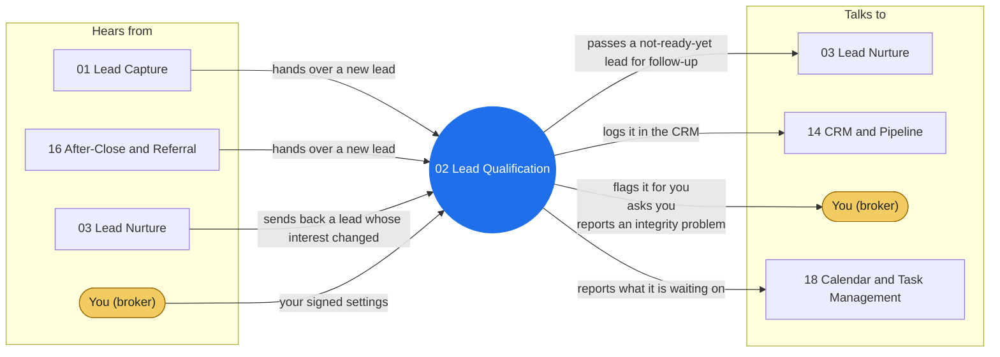

# Agent 02 - Lead Qualification

Lead scoring and triage. Use when a captured lead needs readiness scoring on timeline, financing, and motivation, a priority tier assignment, tire-kicker archiving, or hot-lead flagging for human handoff.

## Who it works with

Left: who sends this agent messages. Right: who it sends messages to. The blue circle is the agent; the yellow box is you. Every arrow is a lane on the closed track (`identity/routes.json`): the hub refuses any message that is not on one.

## Where it shows up

Playbooks whose test run includes this agent (pictures in [PLAY-BY-PLAY](../docs/PLAY-BY-PLAY.md)):

- [P04 — Open House Cycle](../docs/PLAY-BY-PLAY.md#p04--open-house-cycle)
- [P11 — Speed to Lead](../docs/PLAY-BY-PLAY.md#p11--speed-to-lead)
- [P21 — Lead Rescore Cycle](../docs/PLAY-BY-PLAY.md#p21--lead-rescore-cycle)

## The rules it follows

- [SKILL.md](SKILL.md) - its job, its limits, and when it stops and asks you
- [DECISIONS.md](DECISIONS.md) - the decisions made ahead of time for it

*Generated by `tools/gen_diagrams.py` from `identity/routes.json` and the playbook test runs; edit the generator, not this file.*
