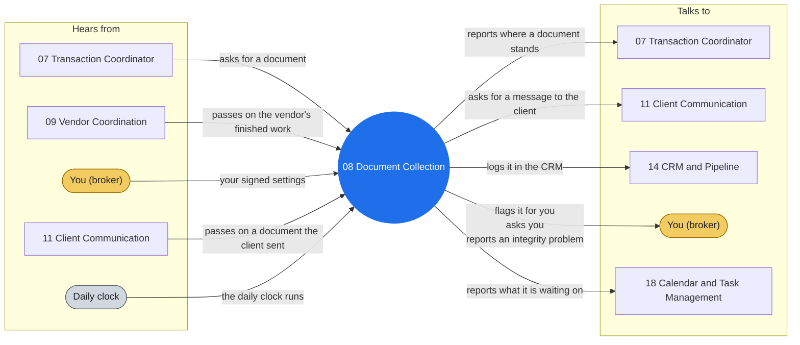

# Agent 08 - Document Collection

Transaction document management. Use for requesting, receiving, filing, and chasing pre-approvals, proof of funds, inspections, appraisals, title commitments, HOA docs, surveys, disclosures, and amendments.

## Who it works with

Left: who sends this agent messages. Right: who it sends messages to. The blue circle is the agent; the yellow box is you. Every arrow is a lane on the closed track (`identity/routes.json`): the hub refuses any message that is not on one.

## Where it shows up

Playbooks whose test run includes this agent (pictures in [PLAY-BY-PLAY](../docs/PLAY-BY-PLAY.md)):

- [P03 — Under-Contract Transition](../docs/PLAY-BY-PLAY.md#p03--under-contract-transition)
- [P09 — Contract to Close (the deadline engine)](../docs/PLAY-BY-PLAY.md#p09--contract-to-close-the-deadline-engine)
- [P10 — Close & Post-Close Handoff](../docs/PLAY-BY-PLAY.md#p10--close--post-close-handoff)

## The rules it follows

- [SKILL.md](SKILL.md) - its job, its limits, and when it stops and asks you
- [DECISIONS.md](DECISIONS.md) - the decisions made ahead of time for it

*Generated by `tools/gen_diagrams.py` from `identity/routes.json` and the playbook test runs; edit the generator, not this file.*
