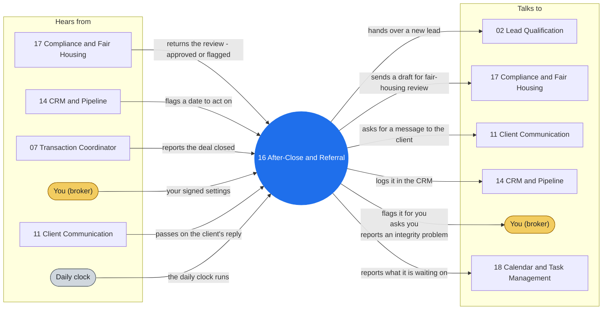

# Agent 16 - After-Close & Referral

Post-close relationship and referrals. Use for 30/90/365 check-ins, home anniversary and maintenance touches, refinance rate alerts, periodic referral solicitation, review requests, and birthday and holiday greetings per the supplied client list.

> **Words used here.** Lane, closed track, playbook, tuple and the other technical words are explained in plain language in [GLOSSARY.md](../docs/GLOSSARY.md).

## Who it works with

Left: who sends this agent messages. Right: who it sends messages to. The blue circle is the agent; the yellow box is you. Every arrow is a lane on the closed track (`identity/routes.json`): the hub refuses any message that is not on one.

## Where it shows up

Playbooks whose test run includes this agent (pictures in [PLAY-BY-PLAY](../docs/PLAY-BY-PLAY.md)):

- [P09 - Contract to Close (the deadline engine)](../docs/PLAY-BY-PLAY.md#p09---contract-to-close-the-deadline-engine)
- [P10 - Close & Post-Close Handoff](../docs/PLAY-BY-PLAY.md#p10---close--post-close-handoff)
- [P13 - Referral & Anniversary Cycle](../docs/PLAY-BY-PLAY.md#p13---referral--anniversary-cycle)
- [P18 - Seller Weekly Report](../docs/PLAY-BY-PLAY.md#p18---seller-weekly-report)

## The rules it follows

- [SKILL.md](SKILL.md) - its job, its limits, and when it stops and asks you
- [DECISIONS.md](DECISIONS.md) - the decisions made ahead of time for it

*Generated by `tools/gen_diagrams.py` from `identity/routes.json` and the playbook test runs; edit the generator, not this file.*
