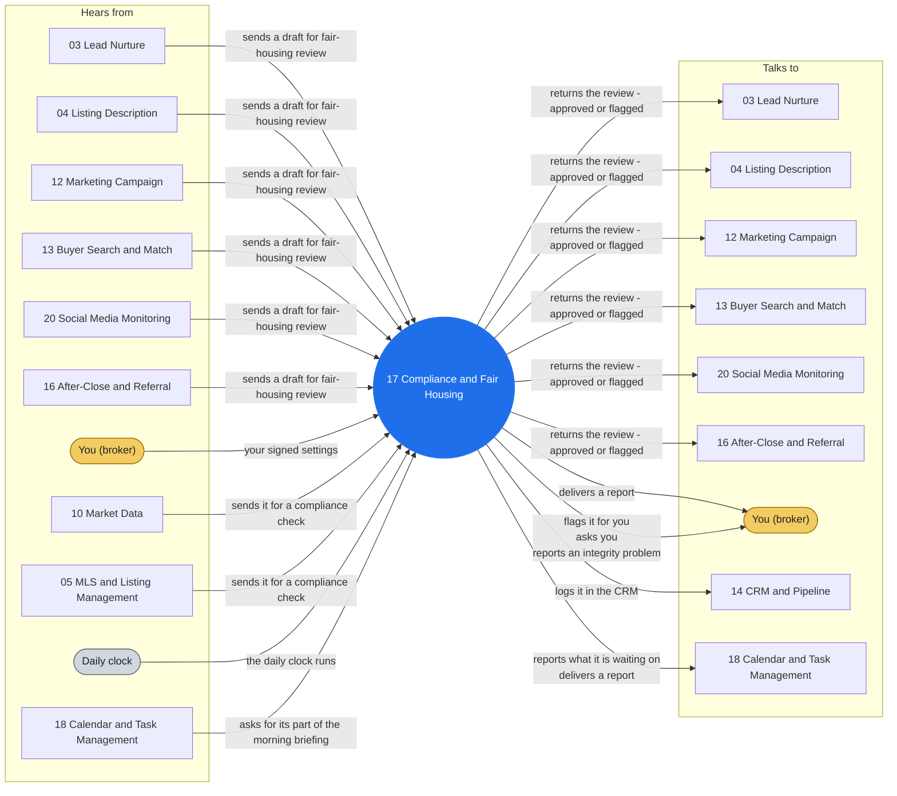

# Agent 17 - Compliance & Fair Housing

Compliance guardrail, validation only. Use for reviewing outbound listings, ads, emails, sequences, and criteria language for fair-housing compliance, prohibited language, steering, and required disclosures.

> **Words used here.** Lane, closed track, playbook, tuple and the other technical words are explained in plain language in [GLOSSARY.md](../docs/GLOSSARY.md).

## Who it works with

Left: who sends this agent messages. Right: who it sends messages to. The blue circle is the agent; the yellow box is you. Every arrow is a lane on the closed track (`identity/routes.json`): the hub refuses any message that is not on one.

## Where it shows up

Playbooks whose test run includes this agent (pictures in [PLAY-BY-PLAY](../docs/PLAY-BY-PLAY.md)):

- [P01 - New Listing Onboarding](../docs/PLAY-BY-PLAY.md#p01---new-listing-onboarding)
- [P02 - Price Adjustment](../docs/PLAY-BY-PLAY.md#p02---price-adjustment)
- [P03 - Under-Contract Transition](../docs/PLAY-BY-PLAY.md#p03---under-contract-transition)
- [P04 - Open House Cycle](../docs/PLAY-BY-PLAY.md#p04---open-house-cycle)
- [P05 - Expired/Withdrawn Wind-down](../docs/PLAY-BY-PLAY.md#p05---expiredwithdrawn-wind-down)
- [P08 - Offer to Acceptance](../docs/PLAY-BY-PLAY.md#p08---offer-to-acceptance)
- [P09 - Contract to Close (the deadline engine)](../docs/PLAY-BY-PLAY.md#p09---contract-to-close-the-deadline-engine)
- [P10 - Close & Post-Close Handoff](../docs/PLAY-BY-PLAY.md#p10---close--post-close-handoff)
- [P12 - Geographic Farm Campaign](../docs/PLAY-BY-PLAY.md#p12---geographic-farm-campaign)
- [P16 - Morning Operations](../docs/PLAY-BY-PLAY.md#p16---morning-operations)
- [P18 - Seller Weekly Report](../docs/PLAY-BY-PLAY.md#p18---seller-weekly-report)
- [P20 - Vacant Property Watch](../docs/PLAY-BY-PLAY.md#p20---vacant-property-watch)
- [P21 - Lead Rescore Cycle](../docs/PLAY-BY-PLAY.md#p21---lead-rescore-cycle)

## The rules it follows

- [SKILL.md](SKILL.md) - its job, its limits, and when it stops and asks you
- [DECISIONS.md](DECISIONS.md) - the decisions made ahead of time for it

*Generated by `tools/gen_diagrams.py` from `identity/routes.json` and the playbook test runs; edit the generator, not this file.*
