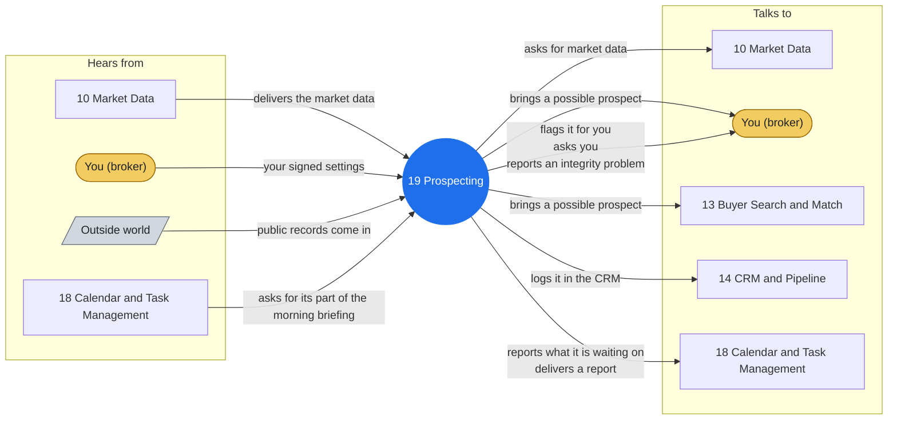

# Agent 19 - Prospecting

Prospecting discovery with zero outreach. Use for monitoring predefined zip codes for new listings and flagging expired and FSBO opportunities into the human review queue.

> **Words used here.** Lane, closed track, playbook, tuple and the other technical words are explained in plain language in [GLOSSARY.md](../docs/GLOSSARY.md).

## Who it works with

Left: who sends this agent messages. Right: who it sends messages to. The blue circle is the agent; the yellow box is you. Every arrow is a lane on the closed track (`identity/routes.json`): the hub refuses any message that is not on one.

## Where it shows up

Playbooks whose test run includes this agent (pictures in [PLAY-BY-PLAY](../docs/PLAY-BY-PLAY.md)):

- [P09 - Contract to Close (the deadline engine)](../docs/PLAY-BY-PLAY.md#p09---contract-to-close-the-deadline-engine)
- [P10 - Close & Post-Close Handoff](../docs/PLAY-BY-PLAY.md#p10---close--post-close-handoff)
- [P12 - Geographic Farm Campaign](../docs/PLAY-BY-PLAY.md#p12---geographic-farm-campaign)
- [P16 - Morning Operations](../docs/PLAY-BY-PLAY.md#p16---morning-operations)
- [P24 - Prospecting Outreach (probation mode)](../docs/PLAY-BY-PLAY.md#p24---prospecting-outreach-probation-mode)

## The rules it follows

- [SKILL.md](SKILL.md) - its job, its limits, and when it stops and asks you
- [DECISIONS.md](DECISIONS.md) - the decisions made ahead of time for it

*Generated by `tools/gen_diagrams.py` from `identity/routes.json` and the playbook test runs; edit the generator, not this file.*
