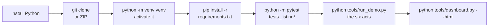

# ListingAssistants Windows Quickstart Guide
### Cold-Start Installation, Touchscreen Verification & Test Data Ingestion
**Platform:** Windows 10 / Windows 11 (Standard PC, All-in-One, or Laptop)  
**Target Environment:** Clean machine or fresh developer workstation  
**Official Repository:** `https://github.com/QuietFireAI/listing-assistants`  
**Official Production Domain:** [ListingAssistants.com](https://ListingAssistants.com)

---

## 1. Prerequisites (2 Minutes)

Before installing ListingAssistants, ensure the machine has Python installed:

### Step 1: Install Python (if not present)
1. Download **Python 3.12** (or 3.10+) from [python.org/downloads/windows](https://www.python.org/downloads/windows/).
2. Run the installer.
3. **CRITICAL:** Check the box at the bottom: **`[x] Add python.exe to PATH`** before clicking **Install Now**.
4. *(Optional)* Click "Disable path length limit" at the end of setup.

### Step 2: Open PowerShell
Press the `Windows Key`, type `powershell`, and launch **Windows PowerShell**.

Allow local virtual environments to run (one-time command):
```powershell
Set-ExecutionPolicy -ExecutionPolicy RemoteSigned -Scope CurrentUser
```
*(Press `Y` to confirm if prompted).*

---

## 2. Download & Install (3 Commands)

<!-- diagram:install-quick - drawn in tools/doc_diagrams.py; edit it there, not here -->

<!-- /diagram:install-quick -->

You can install either via `git` or by downloading the official release archive:

### Option A: Using Git (Recommended)
```powershell
git clone https://github.com/QuietFireAI/listing-assistants.git
cd listing-assistants
```

### Option B: Without Git (ZIP download)
1. Open `https://github.com/QuietFireAI/listing-assistants`, click **Code**, then **Download ZIP**
   (or download "Source code (zip)" from a release page).
2. Right-click the zip file, select **Extract All...**, and extract it (e.g. to `C:\ListingAssistants`).
3. In PowerShell, `cd` into the extracted folder.

### Step 3: Create Virtual Environment & Install Dependencies
```powershell
# 1. Create a dedicated isolated virtual environment
python -m venv venv

# 2. Activate the virtual environment
.\venv\Scripts\Activate.ps1

# 3. Upgrade pip and install dependencies
pip install --upgrade pip
pip install -r requirements.txt
```

---

## 3. Verify the install

### Step 1: Run the test suite
```powershell
python -m pytest tests_listing/
```
Expected: `1024 passed` (CI runs this on Windows on every push). It takes
several minutes on Windows - every audit-log write is flushed to disk - where
Linux takes under a minute. The suite runs every agent's rules and all 24
playbooks end to end against the real hub.

### Step 2: Run the six-act demo
```powershell
python tools/run_demo.py
```
One listing, on the real hub, with real signatures and the real audit log:
* Act 1: signed listing authorization; photography ordered from the vetted roster. The price is yours.
* Act 2: photos delivered; Agent 04 drafts from property facts and Agent 17 reviews every asset.
* Act 3: a steering phrase is flagged and never released; marketing stops on flagged copy.
* Act 4: clean assets approved; MLS active is live-verified, Clear Cooperation satisfied, campaign published.
* Act 5: a pricing question goes to the legal-line queue; no agent answers it.
* Act 6: the audit chain is verified.

### Step 3: Open the Broker Desk

```powershell
python tools\desk.py --showcase
```

Open http://127.0.0.1:8765 in your browser. Press **Next** to play the
operator scenes; when the bar turns red it is your move: press **Send**
(twice) or **Continue** / **Cancel** on the outlined card. A held message
also has **Don't send**: it signs a decline, with your reason, and that
message never goes out. Stop the desk with Ctrl+C (or Ctrl+Break). Your own
desk, on your own records, is `python tools\desk.py`. Every part of the page
is explained in `docs\BROKER_DESK_MANUAL.md`; twelve tests, with what you
should see, are in `docs\BROKER_DESK_TESTING_GUIDE.md`.

### Step 4: Open the client funnel page
```powershell
python tools/dashboard.py --html
Start-Process dashboard.html
```
The page lists each client drawer under `drawers\` with its stage in the funnel
(`INTAKE` -> `QUALIFICATION` -> `PRE-MARKET` -> `ACTIVE MLS` -> `IN ESCROW` ->
`CLOSED`) and any pending human decisions recorded in the drawer.

---

## 4. Add your own test listing

The agents file each client's records in a per-client drawer under
`console-state\drawers\<client_id>\` as they work (listing package, approved
description, timeline, documents, CRM entries, expenses, holds). You can also
create one by hand and file a document in it:

```powershell
python -c "from dispatcher.client_drawer import ClientDrawerManager; d = ClientDrawerManager('drawers').provision_drawer('listing_oak_terrace_101', 'Oak Terrace Seller', '101 Oak Terrace'); d.store_file('00', 'documents', 'property_disclosure.txt', open(r'C:\path\to\property_disclosure.txt','rb').read()); print(d.verify_hashes())"
```

The drawer gets these folders:
```text
drawers\listing_oak_terrace_101\
├── artifacts\      agent drafts
├── documents\      documents you or the agents file
├── interactions\
├── financials\
├── timeline\       pause and resolution records for human decisions
├── audit\
└── drawer_manifest.json   identity, file index, SHA-256 per file
```

Check a drawer's files against their recorded hashes:
```powershell
python tools/inspect_client_drawer.py --root drawers listing_oak_terrace_101
python tools/inspect_client_drawer.py --list      # the drawers the agents filed (console-state\drawers)
```

Files are stored unencrypted; use an encrypted volume (e.g. BitLocker) for the
drawers folder if you need encryption at rest.

---

## 5. A local model (optional)

ListingAssistants runs deterministically with no model: every agent is a rule
engine. Agent 04 can optionally have a model on this machine write the listing
remarks. With Ollama serving a model at `http://localhost:11434/v1` (no extra
Python package needed):

```powershell
python tools/restore_point.py --exam my-model-1 --model-url http://localhost:11434/v1 --model-name <model>
python tools/console.py session <your file> --model-url http://localhost:11434/v1 --model-name <model>
```

The first line asks the model the four broker exam questions and turns the
model on only if every answer passes. In the session, sign
`{"drafting": {"mode": "model"}}` to Agent 04. Details and what the checks
cover: docs/OPERATOR_TUNING_GUIDE.md, section 10.

---

## 6. Daily operator checklist

| When | Action | Command |
| :--- | :--- | :--- |
| Once | Your key, then who you are | `python tools/console.py init` then `python tools/console.py onboard` |
| Once (optional) | Text pages to your phone | `python tools/console.py pager` (asks for your Twilio details) |
| Morning | Run the daily clock (sweeps + morning briefing) on the console's log and saved state; Task Scheduler can run it | `python tools/run_sweeps.py` |
| Any time | Decisions waiting on you | a session line `{"do": "show", "what": "waits"}` |
| Any time | Client funnel page | `python tools/dashboard.py --html` |
| Any time | Recent plain-language events | `python tools/show_logs.py --tail 50` |
| End of day | End-of-day report, built from the audit chain | `python tools/show_logs.py --eod` |
| Any time | Verify the audit chain | `python tools/console.py verify` |
