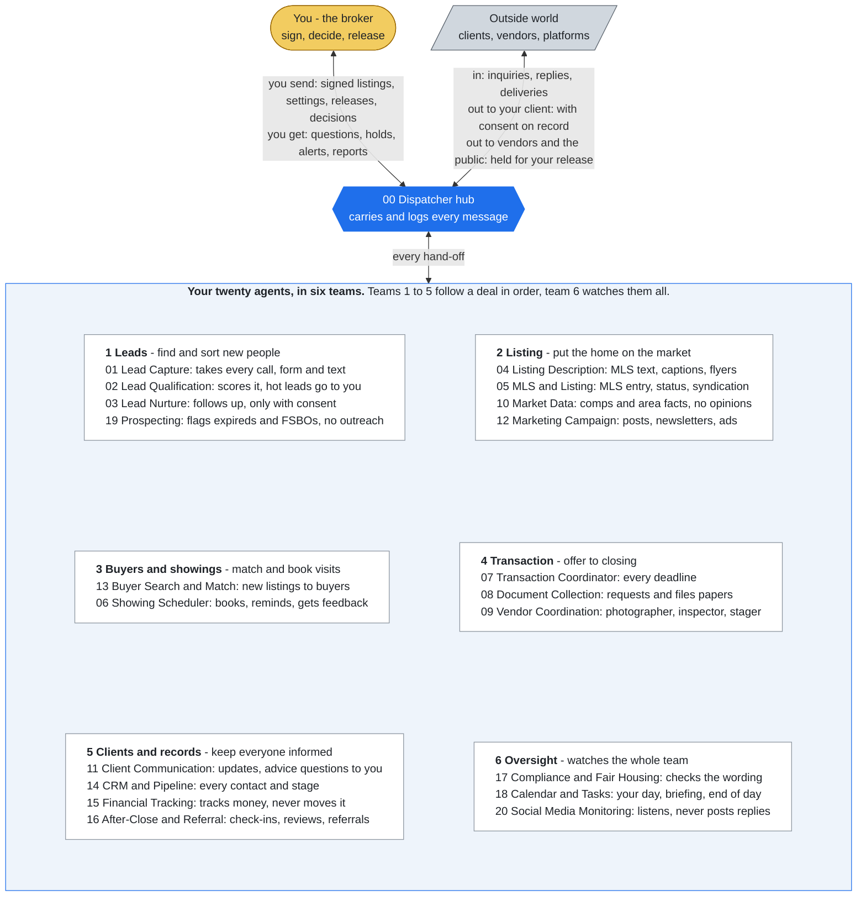
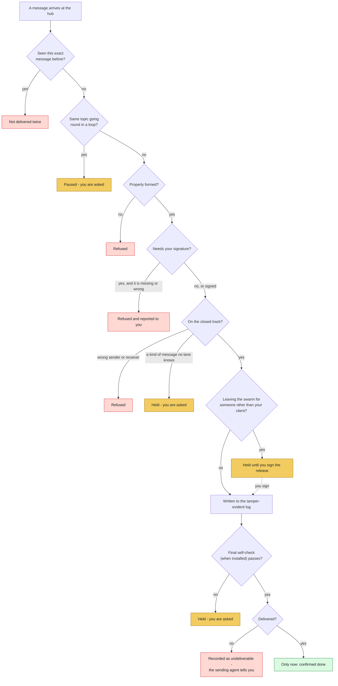
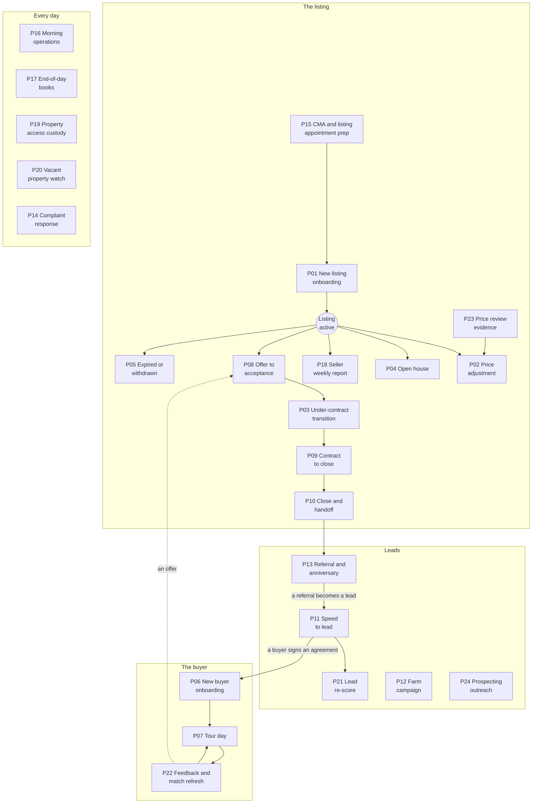
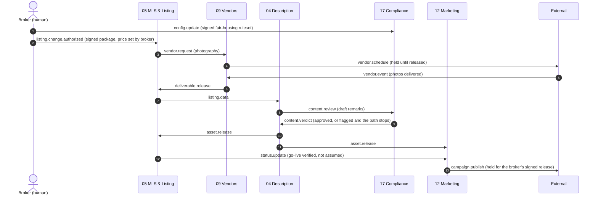
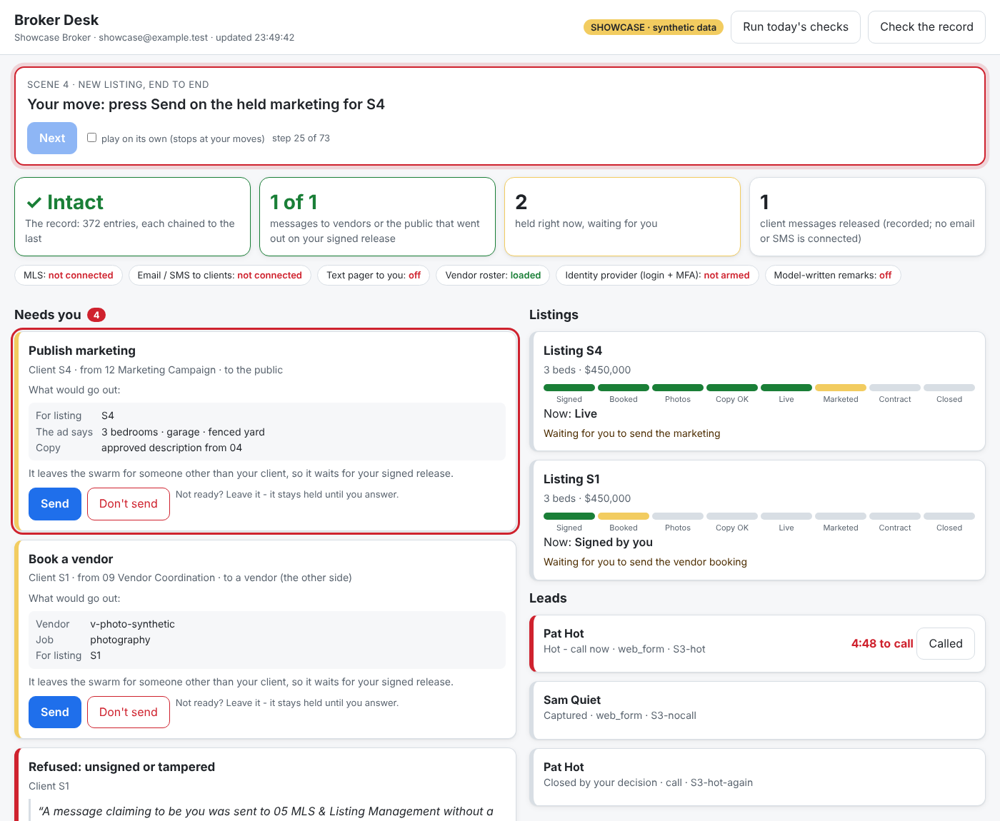
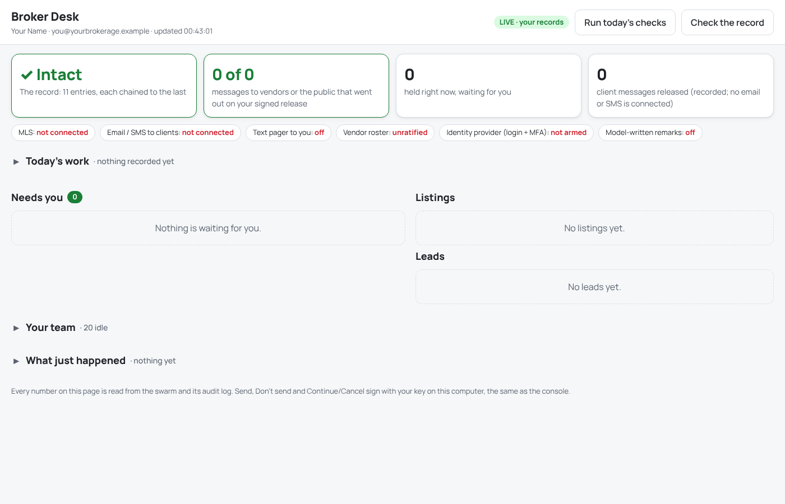

# ListingAssistants

**Twenty agents that run the coordination work of a residential listing
business, on a closed track: one dispatcher hub routes every message, every
route is pre-approved, and every action lands on a hash-chained audit log.**

ListingAssistants (formerly `listing-agents`,
[ListingAssistants.com](https://ListingAssistants.com)) is the residential
real estate identity for [dispatcher-agents](https://github.com/QuietFireAI/dispatcher-agents).
The dispatcher supplies the governance chassis; this repository supplies the
real estate domain: the agents, their routes, their decision tuples, and 24
playbooks.

> **Fiduciary notice.** Price, terms, and every movement of money stay with the
> licensed broker and the client. ListingAssistants coordinates the work around
> those decisions. Its default build contains no payment, transfer, or wire
> capability, and any disclosure of a client's position to the other side waits
> for the broker's signed release. Details: [docs/FINANCIAL_CAPABILITY.md](docs/FINANCIAL_CAPABILITY.md).

---

## Words used here

This page uses some words from the software side. The ones that matter most,
in plain language (every one, with more detail: [docs/GLOSSARY.md](docs/GLOSSARY.md)):

| Word | What it means here |
|---|---|
| [Agent](docs/GLOSSARY.md#agent) | One member of your digital operations team, with one job. There are twenty, numbered 01 to 20. |
| [Swarm](docs/GLOSSARY.md#swarm) | The whole team working together: the twenty agents plus the hub. |
| [Hub (dispatcher, Agent 00)](docs/GLOSSARY.md#dispatcher-and-hub) | The one piece every message passes through. It checks each message, delivers it, and writes it to the record. Agents talk only to the hub. |
| [Identity](docs/GLOSSARY.md#identity) | The real estate version of a general-purpose system: the hub and the record come from [dispatcher-agents](https://github.com/QuietFireAI/dispatcher-agents); this repository adds the agents, their routes, their decisions and the playbooks. |
| [Message and intent](docs/GLOSSARY.md#message) | One piece of work passed between agents through the hub. Its *intent* is the kind of message, written like `listing.data` or `vendor.request`. |
| [Route and lane](docs/GLOSSARY.md#route-and-lane) | Which kind of message may go from which agent to which. Each sender-kind-receiver combination is a lane. |
| [Closed track](docs/GLOSSARY.md#closed-track) | Messages travel only on the routes listed in `identity/routes.json`, like trains on rails. Anything else is refused or held for you. |
| [Playbook](docs/GLOSSARY.md#playbook) | A standard piece of real estate work from start to finish (P01 New Listing Onboarding through P24), with the agents involved and the points where it waits for you. |
| [Tuple](docs/GLOSSARY.md#tuple) | One decision made ahead of time, written as *(the situation, what to do)*. When no tuple fits, the agent stops and asks you. |
| [Signature and signing key](docs/GLOSSARY.md#signature) | Your digital signature, made with a private key file on your computer. It proves a message came from you and was not changed after. |
| [Hold and release](docs/GLOSSARY.md#hold) | A message leaving for anyone but your client waits at the hub (*held*) until you sign its *release* (**Send**) or sign **Don't send**. |
| [Paused thread](docs/GLOSSARY.md#paused-thread) | Work an agent cannot finish on its own waits for your signed **Continue** or **Cancel**. |
| [HITL](docs/GLOSSARY.md#hitl) | *Human in the loop*: the points where the system waits for you. |
| [Audit log (the record)](docs/GLOSSARY.md#audit-log) | The running record of everything the swarm does. It is [hash-chained](docs/GLOSSARY.md#hash-chained): each entry carries a fingerprint of the one before, so any edit shows. |
| [Client context](docs/GLOSSARY.md#client-context) | The short id of the client or file a message belongs to, such as `S4`. |
| [Daily clock](docs/GLOSSARY.md#daily-clock) | The once-a-day run that wakes every agent for its scheduled checks: deadlines, re-scores, weekly reports. |
| [Pillars](docs/GLOSSARY.md#pillars) | Five QuietFire self-checks built into the product. One needs a reviewer model; without one, it says *UNARMED* on the record. |
| [Test, suite and CI](docs/GLOSSARY.md#test-and-suite) | A test runs one part and checks the result; the suite is all of them; [CI](docs/GLOSSARY.md#ci) runs the suite on GitHub after every change. |

## What it does

Twenty spoke agents cover the listing lifecycle end to end:

| Area | Agents |
|---|---|
| Leads | 01 Lead Capture, 02 Lead Qualification, 03 Lead Nurture, 19 Prospecting |
| Listing | 04 Listing Description, 05 MLS & Listing Management, 10 Market Data, 12 Marketing Campaign |
| Buyers & showings | 06 Showing Scheduler, 13 Buyer Search & Match |
| Transaction | 07 Transaction Coordinator, 08 Document Collection, 09 Vendor Coordination |
| Clients & records | 11 Client Communication, 14 CRM & Pipeline, 15 Financial Tracking, 16 After-Close & Referral |
| Oversight | 17 Compliance & Fair Housing, 18 Calendar & Task Management, 20 Social Media Monitoring |

<!-- diagram:team-readme - drawn in tools/doc_diagrams.py; edit it there, not here -->


*No agent talks to another directly: every arrow goes through the hub, and only on lanes listed in `identity/routes.json`. Each agent's own picture is in its folder (for example [05-mls-listing-management](05-mls-listing-management/README.md)).*
<!-- /diagram:team-readme -->

Agent 00 is the dispatcher: the hub process that validates, routes and logs
every message. The broker is the principal the swarm serves and the only
holder of signing authority.

Every agent is a deterministic Python rule engine
(`dispatcher/listing_spokes*.py`). The same input produces the same result,
which is what lets every rule carry a test. The agents call no language
model.

## How it stays accountable

<!-- diagram:hub-readme - drawn in tools/doc_diagrams.py; edit it there, not here -->


*What the hub does with every message, in order (`dispatcher/hub.py`). The same picture, with each check explained: [00-dispatcher](00-dispatcher/README.md).*
<!-- /diagram:hub-readme -->

- **Closed track.** Only the 52 routes in `identity/routes.json` (146
  sender-intent-receiver lanes) are legal, and every message to or from an
  agent travels on one of them, including the daily clock (`clock.tick`). Anything else is rejected and logged;
  a well-formed message on an unknown route is held for a human.
- **Hash-chained audit log.** Every entry links to the previous one by
  SHA-256 from a genesis anchor. `verify_chain()` names the first line that
  was edited, deleted or reordered.
- **Signed authority.** Listing changes, configuration updates, disclosure
  releases and human decisions on paused work require a cryptographic
  Ed25519 signature, which also covers who the message says signed it. An
  unsigned or tampered authority message is rejected and flagged as an
  integrity violation. The signer
  registry (which human login signed) arms once you ratify
  `config/authority_signers.json`; until then the hub records on the audit
  log that it is checking signatures only.
- **Outbound holds.** A message leaving for a counterparty or the public
  (a vendor, a buyer's agent, an ad network) holds for the broker's signed
  release, whatever its wording. Messages to the client the identity serves
  pass.
- **Every handoff is checked.** When the hub rejects or dead-letters a
  message an agent sent, the agent records `handoff.failed` on the audit log
  and the message goes to the human clarification queue. A signed
  configuration an agent does not recognize is held for you too, never
  acknowledged in silence.
- **Held threads wait for you.** When an agent cannot finish on its own (the
  same person arriving under a new lead, a client reply that names no agent,
  a social reply draft), the whole thread holds through the HITL protocol
  until you sign continue or cancel.
- **State survives a restart.** The swarm's state is saved to a local SQLite
  file after each session or clock run and restored at start-up only when
  the hash-chained audit log vouches for that exact save.
- **Predeliberated decisions.** 259 decision tuples (each agent's
  `DECISIONS.md`; 4 of them marked retired) say what an agent does at each
  known crossing. A situation
  no tuple covers stops and goes to the human. `docs/TUPLE_MAP.md` sorts
  every tuple by what it protects (legal line, consent and contact, truth
  of the record, your authority, choices that are yours, time and
  reliability, people moments) and by how bad a failure would be.
- **Drafts stay drafts.** Configuration files ship as proposed drafts.
  Agents 07 and 08 load their config files only when the file's status
  records a ratification date; otherwise they keep their ratified defaults
  and log which file they skipped.
- **Pillars are built in.** The five QuietFire pillars (open-mind,
  agent-open-mind, before-turn, pre-response-selfcheck, sleep-marks) are
  part of the product, in `dispatcher/pillar_lib/` (folded in 2026-10-20).
  pre-response-selfcheck needs a reviewer model and declares itself UNARMED
  on the audit log when none is configured.

## The 24 playbooks

<!-- diagram:map-readme - drawn in tools/doc_diagrams.py; edit it there, not here -->


*Arrows show what usually leads to what; any playbook can also start on its own trigger (listed in [PLAYBOOKS.md](docs/PLAYBOOKS.md)). The "Every day" group runs alongside all of it.*
<!-- /diagram:map-readme -->

Each playbook has an end-to-end test through the hub
(`tests_listing/test_playbooks_e2e.py`, `tests_listing/test_playbooks_e2e_all.py`).
Triggers, agents and human gates are in [docs/PLAYBOOKS.md](docs/PLAYBOOKS.md).
Since 2026-10-12 the daily clock also starts **P18** (weekly seller report,
on the weekday you sign), **P19** (access windows you record, flagged when
they end unclosed), **P20** (a property check every 7 days on listings you
mark vacant) and **P21** (WARM leads re-scored every 7 days). P13 (date
triggers) runs from the clock since 2026-10-11, and P17 (end-of-day books) runs when you ask for it
(`{"do": "show", "what": "eod"}`).

| | Playbook | | Playbook |
|---|---|---|---|
| P01 | New Listing Onboarding | P13 | Referral/Anniversary Cycle |
| P02 | Price Adjustment | P14 | Complaint Response |
| P03 | Under-Contract Transition | P15 | CMA / Listing-Appointment Prep |
| P04 | Open House Cycle | P16 | Morning Operations |
| P05 | Expired/Withdrawn Wind-down | P17 | End-of-Day Books |
| P06 | New Buyer Onboarding | P18 | Seller Weekly Report |
| P07 | Tour Day Coordination | P19 | Property Access Custody |
| P08 | Offer-to-Acceptance | P20 | Vacant Property Watch |
| P09 | Contract-to-Close | P21 | Lead Re-Score Cycle |
| P10 | Close + Post-Close Handoff | P22 | Buyer Feedback & Match Refresh |
| P11 | Speed-to-Lead | P23 | Price-Review Evidence Assembly |
| P12 | Geographic Farm Campaign | P24 | Prospecting Outreach |

### P01, message by message

This is the route a new listing takes in its end-to-end test
(`test_p01_new_listing_onboarding_all_three_phases`). Every arrow passes
through the hub.



Along the way the agents log each step to the CRM (14), report what they are
waiting on to the calendar agent (18), and Agent 11 sends the client status
updates. A flagged verdict from 17 stops the marketing path; that case has
its own test (`test_p01_compliance_flag_halts_marketing_path`).

## What you keep

The broker decides price, offers, negotiation, legal questions, and every
word that goes past a hold. Agent 11 routes client questions about price or
strategy, and any client message about wire instructions, to the legal-line
queue with the client's own words. What each playbook takes off your plate:
[docs/WHAT_SUCCESS_MEANS.md](docs/WHAT_SUCCESS_MEANS.md).

## Modules wired into the swarm

Everything below is built by `dispatcher/swarm.py`, so the console, the daily
clock and the MCP server run the same wiring.

| Module | What it does in the running swarm |
|---|---|
| `dispatcher/hitl_protocol.py`, `dispatcher/human_holds.py` | Holds a thread and resumes it only on your signed `hitl.decision.authority` (continue or cancel), bound to that client |
| `dispatcher/persistence_sqlite.py`, `dispatcher/state_snapshot.py` | Saves and restores the swarm's state (append-only `state_snapshots` table, JSON, fingerprint on the audit chain) |
| `dispatcher/handoff_guard.py` | Checks every agent send and every signed configuration an agent receives |
| `dispatcher/readable_audit.py`, `dispatcher/readable_logger.py`, `tools/show_logs.py` | Every audit-chain entry is also written in plain language to `console-state/readable/stream.log` and to the client's drawer; `show eod` writes the end-of-day ledger from the chain and verifies it |
| `dispatcher/client_drawer.py`, `dispatcher/drawer_filing.py`, `tools/inspect_client_drawer.py`, `tools/dashboard.py` | One drawer per client under `console-state/drawers/`. Agents 04, 05, 07, 08, 14 and 15 file the client's listing package, approved description, timeline, documents, CRM entries and expenses there; every filing is on the chain with its SHA-256; HITL holds are recorded there. Files are **not encrypted** |
| `dispatcher/decision_adapter.py` | Agent 02 scores every lead through the JEV adapter. Its local engine is 02's own rubric, so tiers are unchanged; live JEV runs only when a key is set **and** you sign `{"decision_engine": {"allow_external": true}}` to 02. A result under the confidence floor holds the lead for your continue/cancel |
| `dispatcher/model_drafting.py`, `dispatcher/hermes_seam.py`, `dispatcher/model_checkpoint_manager.py`, `tools/restore_point.py` | Optional model-written listing remarks for Agent 04. Off by default. Used only when you sign `{"drafting": {"mode": "model"}}` to 04, the console runs with `--model-url` and `--model-name` (a model on this machine), and the active checkpoint passed the broker exam on that model (`restore_point.py --exam`). Model remarks are checked for reasoning, length and added numbers, and go through Agent 17 like every draft |

Operator tools, not part of the message path:

| Module | What it does |
|---|---|
| `tools/verify_update_pack.py`, `tools/sign_manifest.py` | Signs and verifies offline update packs: Ed25519 signature, every file hashed, unlisted files and downgrades refused |
| `dispatcher/provider_gateway.py` | Records which external providers you intend to connect (masked); makes no network calls |

## Current limits

- **External adapters queue until connected.** Client sends, vendor bookings
  and ad publishes stay visibly queued until you wire your providers
  (`docs/TUNING_MANUAL.md`). No MLS or listing portal is connected: Agent 05
  keeps its own listing record, and entering and checking the listing on the
  MLS stays with you. Text-message pages are off until you run
  `python tools/console.py pager` with your Twilio details; a page carries
  the queue name and client context id only.
- **Signer identities need an identity provider.** `config/authority_signers.json`
  binds signers to an identity-provider login with MFA. No identity provider
  is connected, so the hub verifies the key's signature and records on the
  audit log that the login binding is off. `console.py onboard` records who
  you are and stamps your login on your signed console actions.
- **One process at a time.** Run one console session or one clock run at a
  time against the same state file; the hub's lock serializes work inside a
  process, not across processes.
- **Pillars are part of the code.** The five pillars live in
  `dispatcher/pillar_lib/` and are tested with everything else; nothing is
  installed from git. `dispatcher/pillar_lib/README.md` names the commit
  each came from.

## Install and verify

Python 3.10 or newer (3.12 recommended) and `git`.

```bash
git clone https://github.com/QuietFireAI/listing-assistants.git
cd listing-assistants
pip install -r requirements.txt
python -m pytest tests_listing/        # expect: 1372 passed, 1 skipped
```

The suite includes the 24 playbook end-to-end tests, a full-swarm test for
every route that has a sender, and mutation-hardening tests. CI runs it from
a clean clone, checks that the vendored core files match dispatcher-agents
byte for byte, and checks that the swarm still routes with no pillars
installed. Windows setup: [QUICKSTART_WINDOWS.md](QUICKSTART_WINDOWS.md).

## The Broker Desk - UI version 1

One page that shows the broker what the swarm is doing, and the buttons for
what is waiting on them. It runs on the broker's own computer and opens in
any browser; with `--lan`, a tablet on the office network can open it with a
printed access code. This is **UI version 1** (October 2026); the page shows
its version at the bottom.

**A busy day** (the showcase, mid-run): the recap at the top, the marketing
for listing S4 held, and the presenter's next move is to press Send.



**A quiet first morning** (a broker's own desk, just set up): nothing is
waiting, the record is intact, and everything else is folded to one line.



- **The recap** at the top: how much waits for you (and any hot lead to
  call), whether the record is intact, how many messages went out on your
  signature, today's headline numbers, and how many outside connections are
  live. Each part opens its detail.
- **Needs you:** each held message with exactly what would go out and who it
  goes to, with a **Send** button (tap twice: it signs one release with your
  key) and a **Don't send** (signs a decline, with your reason if you type
  one: that message never goes out); each paused thread with **Continue** /
  **Cancel**; your queues (legal
  line, upset clients, questions, refused unsigned messages) with the
  client's own words and a **Done** that records who handled it.
- **Listings:** one row per listing with its progress track (signed, booked,
  photos, copy approved, live, marketed, under contract, closed) read from the
  record.
- **Leads:** a hot lead shows its five-minute call clock.
- **Your team:** the twenty agents - working, waiting, waiting for you, idle,
  or a problem.
- **Proof and connections:** the record's chain check, how many messages to
  vendors or the public went out and how many carried your signed release,
  and which outside connections exist (today: no MLS, no email or SMS to
  clients - a released client message is recorded, not delivered to a
  phone). Folded to one line; it opens itself if the record ever fails.
- **Today's work:** what the swarm did for you that day, counted from the
  audit record - leads captured, client messages, vendor bookings, documents
  requested, compliance problems caught, decisions you signed and more. Each
  line opens to the entries behind its number; any earlier day can be
  picked, and **Print the day** prints just that panel.

Long parts fold away: Needs you is in sections (held messages and paused
threads open, questions and refusals closed), a held message shows one line
until you open "What would go out" (or tap Send, which opens it), and Your
team and What just happened are one summary line each until opened. The desk
remembers what you opened. The page uses the Manrope typeface, bundled under
its own licence (`THIRD_PARTY_NOTICES.md`).

```bash
python tools/desk.py                 # your desk, on console-state/
python tools/desk.py --showcase      # replays the ten operator scenes on synthetic data,
                                     # stopping at every Send / Continue / Cancel for you
python tools/desk.py --lan           # open it from a tablet (link with an access code)
python tools/desk.py --config-dir scenes/config --script scenes/scene04_new_listing.jsonl
                                     # your desk, with a test script played in, stopping at your moves
```

Every part and button is explained, with pictures, in
[docs/BROKER_DESK_MANUAL.md](docs/BROKER_DESK_MANUAL.md); fifteen tests to run
it end to end are in [docs/BROKER_DESK_TESTING_GUIDE.md](docs/BROKER_DESK_TESTING_GUIDE.md).

A held message waits for your answer: **Send** or **Don't send**, each a
signed decision on the record (`Hub.release_disclosure` /
`Hub.decline_disclosure`); a signed "don't send" can never be used as a
"send". While the desk runs it holds the state; `console.py session` and
`run_sweeps.py` refuse to start against the same folder (use the desk's "Run
today's checks"). The page serves several screens at once (a phone and a
tablet, say); every action still reaches the swarm one at a time. CI runs the
desk's tests on Windows as well as Linux.

## Run it

```bash
python tools/run_demo.py                 # one listing, six acts, on the real hub
python tools/desk.py --showcase          # the Broker Desk, replaying the operator scenes
python tools/mcp_roundtrip.py            # live stdio round trip of the MCP server
python tools/console.py init             # create your signing key and attest this install
python tools/console.py attest           # after reviewing a change: sign the new install
python tools/console.py onboard          # who you are, asked once
python tools/console.py session scenes/scene01_signature.jsonl --config-dir scenes/config
python tools/console.py verify           # walk the audit chain
python tools/run_sweeps.py               # the daily clock, on the console's log and saved state
python tools/dashboard.py --html         # client funnel page from drawer manifests
python tools/show_logs.py --eod          # end-of-day report
python tools/manage_hitl_queue.py --list # pending human decisions recorded in drawers
python tools/verify_update_pack.py --guide   # offline update procedure
```

Mounting on Hermes, OpenClaw or Claude Desktop as an MCP server:
[docs/MOUNTING.md](docs/MOUNTING.md).

Every agent in its own container, reaching nothing but the dispatcher (agent
isolation V1, in progress): [docs/CONTAINERS.md](docs/CONTAINERS.md).

## Reading order

1. [docs/START_HERE.md](docs/START_HERE.md) - the 60-second version
   (and [docs/GLOSSARY.md](docs/GLOSSARY.md) - every word explained, whenever you need it)
2. [docs/WHAT_SUCCESS_MEANS.md](docs/WHAT_SUCCESS_MEANS.md) - what each playbook delivers
3. [docs/PLAY-BY-PLAY.md](docs/PLAY-BY-PLAY.md) - what moves between agents, step by step
4. [docs/JOB_DESCRIPTIONS.md](docs/JOB_DESCRIPTIONS.md) - every agent's role and rules
5. [docs/PLAYBOOKS.md](docs/PLAYBOOKS.md) - all 24 playbooks: triggers, agents, gates
6. [docs/TUNING_MANUAL.md](docs/TUNING_MANUAL.md) - every number you can turn
7. [docs/AGENT_USER_MANUAL.md](docs/AGENT_USER_MANUAL.md) - a broker's day with the system
8. [docs/BROKER_DESK_MANUAL.md](docs/BROKER_DESK_MANUAL.md) - the Broker Desk, part by part and button by button, with pictures
9. [docs/BROKER_DESK_TESTING_GUIDE.md](docs/BROKER_DESK_TESTING_GUIDE.md) - fifteen desk tests, each with what you should see
10. [docs/OPERATOR_TUNING_GUIDE.md](docs/OPERATOR_TUNING_GUIDE.md) - setup, storage, updates, drawers, the decision engine and model drafting
11. [docs/OPERATOR_TESTING_MANUAL.md](docs/OPERATOR_TESTING_MANUAL.md) - ten filmable operator scenes (`scenes/`), each checked by the suite
12. [docs/FINANCIAL_CAPABILITY.md](docs/FINANCIAL_CAPABILITY.md) - the financial locks and the security reviewer's risk list

## Layout

- `dispatcher/` - the dispatcher core (16 files that began in the
  dispatcher-agents project, folded in 2026-10-20; see
  `dispatcher/CORE_ORIGIN.md`), the 20
  `listing_spokes*.py` agents, `handoff_guard.py`, `lead_rubric.py`,
  `config_status.py`, and the modules above.
- `identity/routes.json` - the closed track.
- `00-dispatcher/` ... `20-social-media-monitoring/` - each agent's ratified
  SKILL.md and DECISIONS.md, and a README.md with a picture of who it works
  with (GitHub shows it when you open the folder).
- `tools/desk.py`, `tools/desk.html` - the Broker Desk (see above);
  `tests_listing/test_desk.py` plays the whole showcase through it.
- `tools/gen_diagrams.py`, `tools/doc_diagrams.py` - the diagrams in the docs:
  agent pictures from `identity/routes.json`, playbook pictures from real test
  runs, the rest drawn by hand; `--check` (and a test) fails when one is stale.
- `config/` - business content the code cannot guess (templates, cadences,
  milestones, vendor panel, authority signers). Drafts until you ratify them.
- `scenes/` - the ten operator scenes and their synthetic vendor roster.
- `tests_listing/` - the full suite. Run it from a fresh clone before
  trusting any "done" claim, including this README's.

## Provenance

This repository is the single source for ListingAssistants (owner decision
2026-10-11): every agent's SKILL.md and DECISIONS.md, the closed track, the
configuration templates, and the generated docs (`tools/gen_job_descriptions.py`
rebuilds docs/JOB_DESCRIPTIONS.md; a test fails when it drifts). The
dispatcher core in `dispatcher/` began in
[dispatcher-agents](https://github.com/QuietFireAI/dispatcher-agents) and was
folded into this product on 2026-10-20 (owner decision): it is changed and
tested here only, and nothing is copied from dispatcher-agents any more.
`dispatcher/CORE_ORIGIN.md` names the commit it came from.

## License

Dual-licensed under the **QuietFire Identity License** (see `LICENSE`) over
an **AGPL-3.0** floor (see `LICENSE-AGPL`). Evaluation, development, and
internal testing - including cloning, running the suite, and any demo - are
free. **Production and commercial use require a paid license from
QuietFireAI or full AGPL-3.0 compliance.** Building derivative identities
for third parties requires a commercial license. The open chassis this runs
on (dispatcher-agents) is Apache-2.0 and separate.

*License text is a placeholder pending counsel review.*

ListingAssistants is independent of, and unaffiliated with, listingagent.com.
