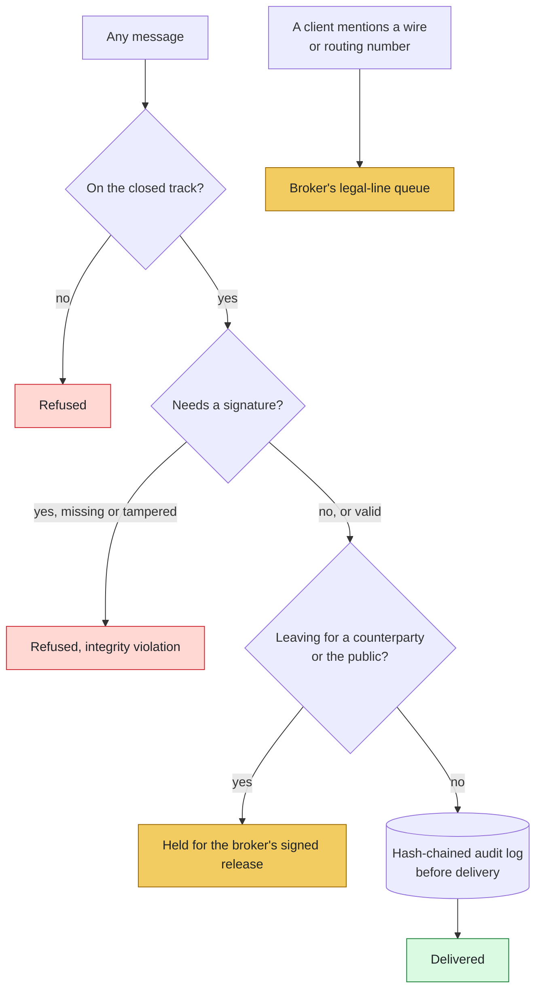

# Security Policy — ListingAssistants

## 1. Security Architecture & Invariants

<!-- diagram:security - drawn in tools/doc_diagrams.py; edit it there, not here -->

<!-- /diagram:security -->

**ListingAssistants** is a governed multi-agent operations platform for licensed real estate professionals. The system is designed with fail-closed security guarantees:

* **Closed Routing Track:** Messages only travel along explicitly approved routes defined in `identity/routes.json`. Lateral or unauthorized communication between agents is rejected at the dispatcher hub.
* **Cryptographic signatures:** listing changes, configuration updates, disclosure releases and human decisions on paused work require an Ed25519 signature the hub verifies; the signature also covers the message's provenance, including who it says signed it. Unsigned or tampered authority messages are rejected and logged as integrity violations. The signer registry, which binds a signature to a named human login, arms once `config/authority_signers.json` is ratified.
* **Tamper-evident audit logging:** every message is recorded in an append-only, SHA-256 hash-chained audit log before delivery; `verify_chain()` names the first altered line.
* **Outbound holds:** messages to a counterparty or the public hold for the broker's signed release.
* **No money movement:** the build contains no payment, transfer or wire capability. Client messages that mention wire instructions or routing numbers go to the broker's legal-line queue.
* **Client drawers:** `dispatcher/client_drawer.py` refuses unsafe paths and cross-client filing (`ComminglingBreachError`). Agents 04, 05, 07, 08, 14 and 15 file each client's records there through `dispatcher/drawer_filing.py`; every filing and every refusal is on the audit chain. Files are stored unencrypted.
* **Model drafting (off by default):** Agent 04 uses a model only on the broker's signed switch, with a model on this machine (other hosts refused unless explicitly allowed), and only while the active checkpoint passed the broker exam on that model. Model remarks go through Agent 17 like every draft.
* **Lead data off the machine:** only to live JEV, only with a key set **and** the broker's signed `decision_engine.allow_external`.
* **Text pages:** off until the broker runs `console.py pager`; a page carries the queue name and client context id only; credentials are stored 0600 and never written to the audit log.
* **Access secrets:** Agent 14 records access grants without the code or key and rejects a grant whose values look like they carry one.

Known limits are listed in the README ("Current limits") and in `docs/FINANCIAL_CAPABILITY.md` ("Where the real risk is").

---

## 2. Supported Versions

| Version | Supported | Notes |
| :--- | :--- | :--- |
| `1.x` / `main` | :white_check_mark: | Active production release ([ListingAssistants.com](https://ListingAssistants.com)) |
| `< 1.0` | :x: | Legacy unhardened prototypes |

---

## 3. Reporting a Vulnerability

We treat all security and compliance concerns with utmost urgency. 

If you discover a potential vulnerability, prompt-injection bypass, routing escape, or data leak:
1. **Do NOT** open a public GitHub issue.
2. Email your findings to: **security@quietfireai.com**.
3. Include:
   - A description of the vulnerability and attack vector.
   - Exact steps or script to reproduce the behavior.
   - Any observed audit log output or bypass traces.
4. You will receive an acknowledgment within 24 hours.

---

## 4. Responsible Disclosure

We request that you give the project team a reasonable window (typically 30 to 90 days depending on severity) to develop, test, and release a patch before disclosing details publicly.
