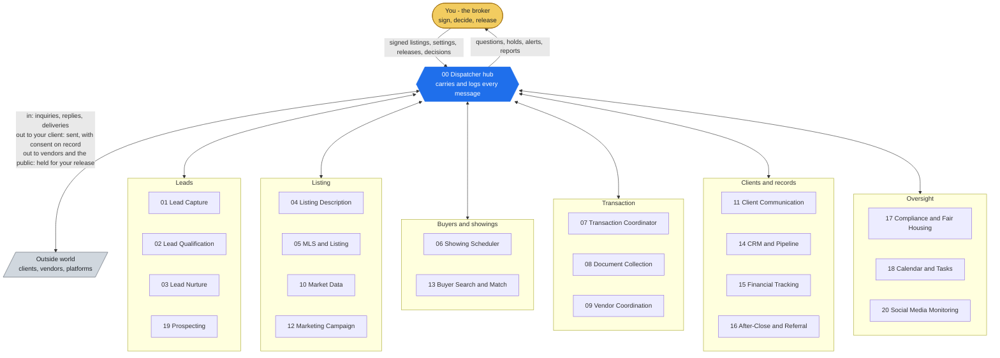
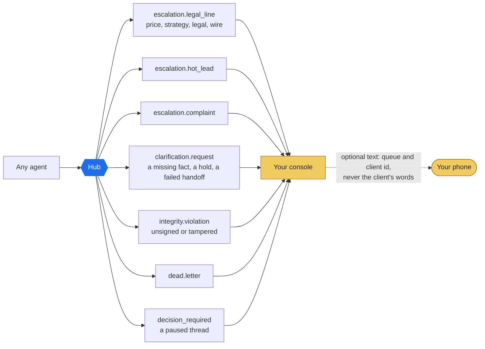
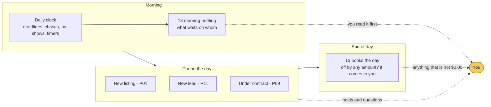
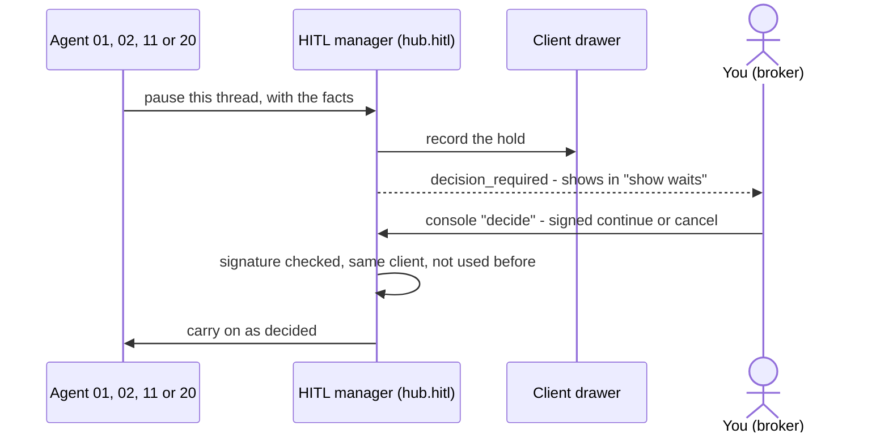
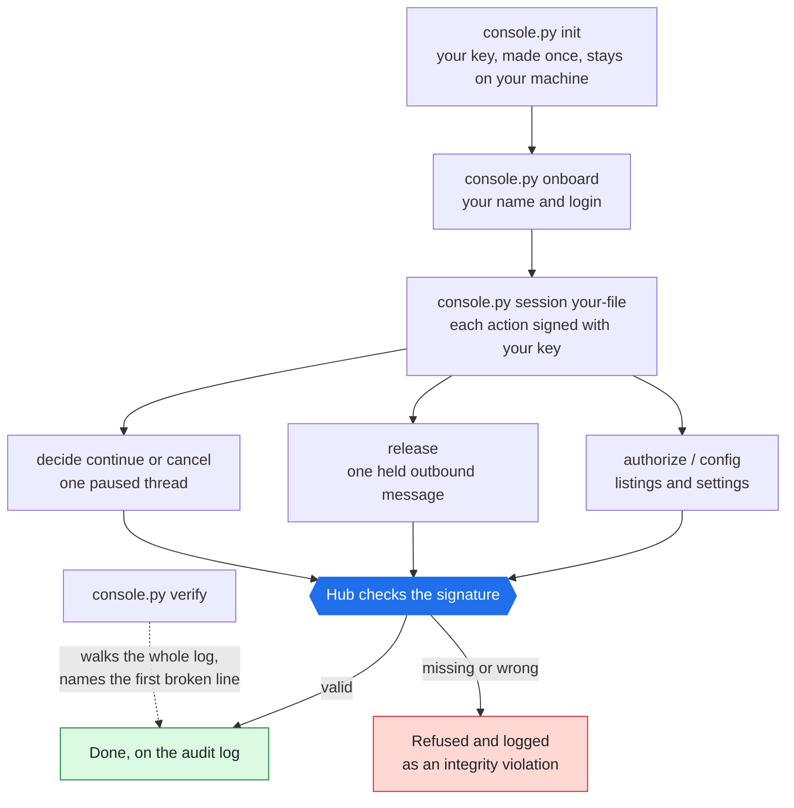

# ListingAssistants - Broker's Manual

This manual is for the licensed broker or agent the swarm works for. It
covers what the agents do for you each day, where your decisions come in,
and how to read what the system tells you. Every behavior described here has
a test in `tests_listing/`; where something is not connected yet (your
outside providers, an identity provider), this manual says so.

> **Fiduciary notice.** Price, terms, and every movement of money stay with the
> licensed broker and the client. ListingAssistants coordinates the work around
> those decisions. Its default build contains no payment, transfer, or wire
> capability, and any disclosure of a client's position to the other side waits
> for the broker's signed release. Details: [FINANCIAL_CAPABILITY.md](FINANCIAL_CAPABILITY.md).

---

## 1. Your operations team

<!-- diagram:team-manual - drawn in tools/doc_diagrams.py; edit it there, not here -->

*No agent talks to another directly: every arrow goes through the hub, and only on lanes listed in `identity/routes.json`. Each agent's own picture is in its folder (for example [05-mls-listing-management](../05-mls-listing-management/README.md)).*
<!-- /diagram:team-manual -->

Twenty agents each own one job, and one dispatcher hub carries every message
between them. No agent talks to another directly, and no agent can use a
route that is not on the closed track in `identity/routes.json`.

| Area | Agents |
|---|---|
| Leads | 01 Lead Capture, 02 Lead Qualification, 03 Lead Nurture, 19 Prospecting |
| Listing | 04 Listing Description, 05 MLS & Listing Management, 10 Market Data, 12 Marketing Campaign |
| Buyers & showings | 06 Showing Scheduler, 13 Buyer Search & Match |
| Transaction | 07 Transaction Coordinator, 08 Document Collection, 09 Vendor Coordination |
| Clients & records | 11 Client Communication, 14 CRM & Pipeline, 15 Financial Tracking, 16 After-Close & Referral |
| Oversight | 17 Compliance & Fair Housing, 18 Calendar & Task Management, 20 Social Media Monitoring |

The agents are rule engines, not chat models. Each one follows its ratified
SKILL.md and its decision tuples (`DECISIONS.md`): a list of the crossings it
can meet and what it does at each. When something comes up that no tuple
covers, the agent stops and puts it in front of you with the facts.

One role per agent: [JOB_DESCRIPTIONS.md](JOB_DESCRIPTIONS.md).

## 2. What stays yours

You decide:

- **Price.** The list price arrives on your signed listing authorization. No
  agent creates or changes it. A client question about price, offers or
  strategy goes to your legal-line queue with the client's own words; the
  client receives only a short acknowledgment.
- **Anything about wiring money.** A client message that mentions wire
  instructions, wiring details, a wire transfer or a routing number goes to
  your legal-line queue before anything else happens. The agents send no wire
  or account details on any channel.
- **Fair housing calls.** Agent 17 screens listing copy and outbound content
  against your ratified ruleset. A flagged draft stops the marketing path;
  Agent 17 never rewrites the copy. You or your copywriter fix it.
- **What reaches the other side.** A message to a counterparty or the public
  (a vendor, a buyer's agent, an ad network) is held until you sign a
  release for that specific message.
- **Representation agreements.** Agent 13 requires a buyer agreement on file
  before it requests a showing; without one, the request comes back to the
  buyer workflow instead of going to the showing scheduler.

## 3. Your queues

<!-- diagram:queues-manual - drawn in tools/doc_diagrams.py; edit it there, not here -->

<!-- /diagram:queues-manual -->

Everything that needs a human lands in a named queue and prints on your
console. To be texted as well, run `python tools/console.py pager` once
(it asks for your Twilio details); a text says which queue and which client
context, never the client's words.

| Queue | What lands there |
|---|---|
| `escalation.legal_line` | price, strategy, legal and wire questions; highest priority |
| `escalation.hot_lead` | a lead scored HOT that needs a human inside the speed-to-lead window (5 minutes by default) |
| `escalation.complaint` | an angry or negative client message, verbatim |
| `clarification.request` | anything an agent cannot finish on its own: a missing fact, an unknown route, a held outbound message, a failed handoff |
| `integrity.violation` | an unsigned or tampered authority message; never auto-resolved |
| `dead.letter` | a message no agent could take; the hub raises a system-error escalation when an agent crashed |
| `decision_required` (HITL hold) | a whole thread an agent cannot finish on its own: the same person under a new lead, a client reply that names no agent, a social reply draft cleared by compliance. Nothing moves until you sign continue or cancel |

## 4. A day with the system

<!-- diagram:day-manual - drawn in tools/doc_diagrams.py; edit it there, not here -->

<!-- /diagram:day-manual -->

**Morning.** Agent 18 builds the morning briefing: calendar items by day,
what each agent is waiting on, unresolved human decisions, and deadline
conflicts it is tracking. The daily clock (`tools/run_sweeps.py`, or the
sweep call in your long-running process) fires the time-based checks:
contract deadlines, document chases, vendor no-shows, follow-up timers.

**A new listing (P01).** You sign the listing package. Agent 05 requests
photography from Agent 09, which books from your approved vendor roster
(the booking holds for your release because it leaves for a vendor). When
the photos arrive, Agent 04 drafts remarks from the property data only;
Agent 17 reviews them. On approval and your signed go-live, Agent 05
marks the listing active before Agent 12 may market it, and the campaign
itself holds for your release. No MLS is connected yet: confirming the
listing on the MLS is yours. Agent 11 keeps the seller informed at each step.

**A buyer lead (P11).** Agent 01 captures the lead with consent on first
touch, Agent 14 checks for an existing record (same context, and the same
phone or email under any other lead), and Agent 02 scores it with your
rubric. The same person arriving under a new lead holds for you: continue
scores it as a separate person, cancel closes it; nothing is ever merged
for you. A pre-approval document outranks a different stated budget;
an expired or unverified letter does not count. A HOT lead goes to your hot
lead queue. A score sitting exactly on a tier boundary takes the lower tier
and is flagged for you. A WARM lead starts the nurture sequence you wrote
(signed configuration to Agent 03: each touch's text and day). Agent 17
reviews the exact touches first; the daily clock then sends each one once,
on its day, inside the weekly cap and contact hours. A sequence you have
not written sends nothing.

**Under contract (P09).** Agent 07 tracks every contract deadline and
counts a milestone done only when its artifact is on file. Agent 08 chases
missing documents on a set cadence and comes to you after the chase limit.
Agent 07 makes no comment on inspection findings and offers no concessions.

**End of day (P17).** Agent 15 assembles the day's figures with their
sources attached; any amount that does not reconcile to $0.00 comes to you.

## 5. When something goes wrong

<!-- diagram:hitl-manual - drawn in tools/doc_diagrams.py; edit it there, not here -->

*A paused thread: the same person under a new lead (01), a low-confidence score (02), a reply nobody owns (11), a social reply draft (20).*
<!-- /diagram:hitl-manual -->

- **An upset client (P14).** Agent 11 puts the message verbatim in your
  complaint queue at once, logs it, and places that client on an outbound
  hold, so no scheduled touch goes out. Nothing is sent to the client: the
  response is yours.
- **A template with a missing fact.** If a client message would go out with
  a blank (an unknown closing date, say), Agent 11 does not send it and asks
  you for the fact.
- **Quiet hours.** Client messages that would land between 21:00 and 08:00
  wait for the next window and notify you instead, unless the alert class is
  marked exempt in configuration.
- **Opt-outs.** "Stop" stops every channel at once, and Agent 14 records it.
  Agent 11 checks 14 before every client message and sends nothing to a client
  without consent on record (a "yes" on at least one channel). A lead's
  consent is recorded at capture; for a seller or any other client, record it
  yourself with a signed `consent_record` to Agent 14. The first message held
  for a client without consent tells you so.
  When consent flags disagree, the most restrictive one wins, and a channel
  that was opted out stays out until you confirm the client's new opt-in.
- **A handoff that fails.** If the hub rejects or cannot deliver a message
  one agent sent another, the sending agent records `handoff.failed` and the
  message lands in your clarification queue.
- **A client reply nobody owns.** A reply that names no agent, or one with no
  rule for replies, holds for you. Continue names the agent to deliver it to;
  cancel closes the thread with the reply kept on the record.
- **A configuration typo.** A signed setting an agent does not recognize is
  held for you with the keys you sent; nothing changes.
- **Social media.** Agent 20 drafts a reply only from your own signed
  templates (question, praise). Agent 17 reviews it; a flagged draft is
  discarded and reported, an approved one holds for you. The swarm never
  posts.

## 6. Signing and releasing

<!-- diagram:signing-manual - drawn in tools/doc_diagrams.py; edit it there, not here -->

<!-- /diagram:signing-manual -->

Your signing key is created once with `python tools/console.py init` and
stays on your machine; `python tools/console.py onboard` records your name
and login once, and your signed console actions carry that login. Signed
actions, all through a console session script
(`python tools/console.py session <file>`; the actions are listed in the
script's help text):

- **Listing authorization and configuration** (rubric, ruleset, vendor
  roster, nurture sequences, reply templates, your listings, the
  do-not-contact list, a client's buyer agreement, expected document
  senders): `authorize` and `config`.
- **Releasing a held outbound message:** `{"do": "release", "ctx": "...", "intent": "..."}`
  signs one `disclosure.authority` per matching held message.
- **Deciding a held thread:** `{"do": "decide", "ctx": "...", "decision": "continue"}`
  or `"cancel"` signs one `hitl.decision.authority`.
- **Checking the record:** `python tools/console.py verify` walks the audit
  chain and reports the first broken line, if any.

The identity-provider binding in `config/authority_signers.json` (which
login, with MFA, may sign which intent) is not armed: no identity provider
is connected. The hub verifies your key's signature and records on the
audit log that the login binding is off.

## 6a. The Broker Desk

The full manual, part by part with pictures, is
[BROKER_DESK_MANUAL.md](BROKER_DESK_MANUAL.md); this section is the summary.

`python tools/desk.py` opens your desk at http://127.0.0.1:8765 (add
`--lan` to open it from a tablet; it prints a link with an access code).
Everything in sections 3 and 6 is on it:

- **Needs you** lists every held message with what would go out and to whom
  (Send signs one release with your key; tap it twice; Don't send signs a
  decline, with your reason if you type one, and that message never goes
  out), every paused
  thread (Continue or Cancel; a client reply that names no agent asks which
  agent to continue to), and your queues with the client's own words (Done
  records that you handled it; it changes nothing in the swarm).
- **Listings**, **Leads** (a hot lead with its five-minute clock), **Your
  team** (each agent: working, waiting, waiting for you, idle, problem) and
  **What just happened** are read from the record as it is written.
- **Run today's checks** runs the daily clock; **Check the record** walks the
  audit chain.

A held message stays held until you answer it, Send or Don't send; both are
signed and both are on the record. In a console session the same answers are
`{"do": "release", ...}` and `{"do": "decline", "ctx": ..., "intent": ...,
"reason": "..."}`. While the desk runs it holds the state folder, so console
sessions and `run_sweeps.py` refuse to start against it.

## 7. Restarts and the daily clock

The swarm saves its state at the end of every console session and clock
run, and restores it at the next start only when the audit log vouches for
that exact save. If the saved state and the log disagree, nothing starts
and nothing is changed: you decide what happens to the file.
`python tools/run_sweeps.py` (run by your scheduler once a day) works on the
same log and state as your console.

## 7a. Client files, plain-language log, scoring engine, model drafting

- **Client drawers.** Each client has a drawer in `console-state/drawers/`
  holding their listing package, approved description, transaction
  timeline, documents, CRM entries, expenses and any holds. Every file's
  fingerprint is on the audit log. `python tools/inspect_client_drawer.py <client>`
  shows one and re-checks the fingerprints; `python tools/dashboard.py --html`
  shows where each client stands. Files are not encrypted; keep the folder
  on an encrypted disk.
- **Plain-language log.** `python tools/show_logs.py` shows what happened in
  plain words; `--eod` writes the day's ledger and checks the audit chain.
- **Lead scores.** Agent 02 scores every lead through the JEV decision
  engine. Without a JEV connection that engine is your signed rubric, so
  nothing changes. Lead data goes to live JEV only if you sign
  `{"decision_engine": {"allow_external": true}}` to Agent 02 and a JEV key is
  set. A score the engine is not confident about waits for you.
- **Model-written remarks.** Off unless you turn it on (signed
  `{"drafting": {"mode": "model"}}` to Agent 04), run a model on this machine,
  and that model passes the four-question broker exam
  (`python tools/restore_point.py --exam ...`). Every draft, model or not,
  goes through Agent 17 before anything is released.

## 8. Good habits

1. Read the morning briefing first; it shows what is waiting on whom, and
   `show waits` lists every thread holding for your decision.
2. Keep your vendor roster's license and insurance dates current; Agent 09
   books only vendors whose credentials are on file and current.
3. Ratify your configuration files (vendor roster, templates, cadences,
   milestones). Drafts are not loaded.
4. Treat a hold as information. It names what stopped and why.
5. Run `python tools/console.py verify` when you want proof the record is
   intact.

---

ListingAssistants is a workflow system for licensed real estate
professionals. It does not practice real estate, give legal advice, or
appraise property. The broker of record keeps responsibility for every
client representation, contract and disclosure.
