# The Broker Desk - User's Manual

> **Words used here.** Tuple, playbook, swarm, hold, release and the other technical words are explained in plain language in [GLOSSARY.md](GLOSSARY.md).

The Broker Desk is one page, on your own computer, that shows everything your
twenty assistants are doing and everything waiting for you. It is the only
place you need to look during the day. Every button that acts signs with your
key, the same signature the console uses, and lands on the audit record.

This manual describes **UI version 1**, the version shown at the bottom of
the page.

For testing the desk step by step, see
[BROKER_DESK_TESTING_GUIDE.md](BROKER_DESK_TESTING_GUIDE.md).

**Contents**

1. [Start the desk](#1-start-the-desk)
2. [The page at a glance](#2-the-page-at-a-glance)
3. [The day's work](#3-the-days-work)
4. [Needs you: what to answer](#4-needs-you-what-to-answer)
5. [Listings](#5-listings)
6. [Leads](#6-leads)
7. [Your team](#7-your-team)
8. [Proof and connections](#8-proof-and-connections)
9. [What just happened](#9-what-just-happened)
10. [The two header buttons](#10-the-two-header-buttons)
11. [Open it on a tablet](#11-open-it-on-a-tablet)
12. [Test scripts and the showcase](#12-test-scripts-and-the-showcase)
13. [Limits to know](#13-limits-to-know)
14. [When something looks wrong](#14-when-something-looks-wrong)
15. [Where your files are](#15-where-your-files-are)

---

## 1. Start the desk

**The first time** (once per computer), from the `listing-assistants` folder:

```bash
pip install -r requirements.txt
python tools/console.py init        # makes YOUR signing key, readable only by you
python tools/console.py onboard     # your name and login, asked once
```

Then open `config/vendor_panel.json` (your approved vendors) and, once you have
checked it, replace its `_status` line with
`RATIFIED <today's date YYYY-MM-DD> <your name>`. The desk never books a
vendor from a list you have not ratified; the "Vendor roster" chip on the page
says which state it is in.

**Every day:**

```bash
python tools/desk.py
```

Open **http://127.0.0.1:8765** in your browser. The page refreshes itself
every second and a half. Its typeface, Manrope, ships with the desk, so the
page looks the same with or without an internet connection. To stop the desk, press **Ctrl+C** in the window that
started it (on Windows, Ctrl+C or Ctrl+Break). Your state is saved after
every button you press, so stopping and starting loses nothing.

On Windows use backslashes: `python tools\desk.py`.

While the desk is open it holds your records folder. The console
(`console.py session`) and the daily clock (`run_sweeps.py`) refuse to start
on the same folder until the desk is stopped, so two programs never write the
same records at once. Use the desk's own **Run today's checks** button instead.

## 2. The page at a glance

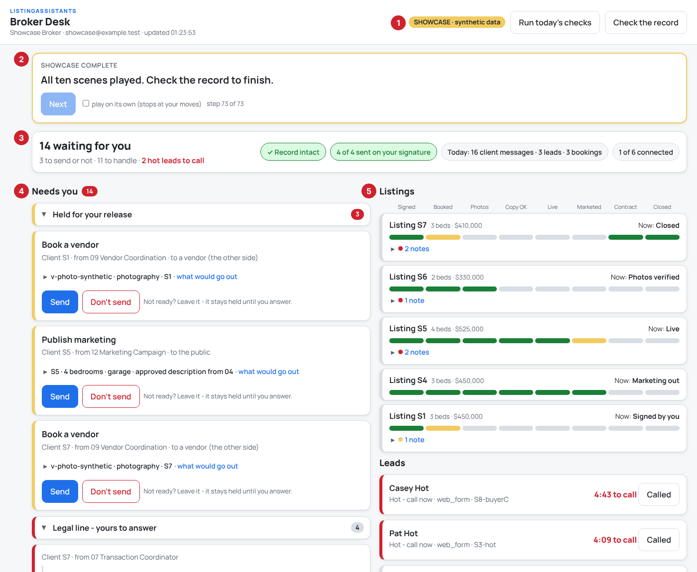

| # | Part | What it tells you |
|---|---|---|
| 1 | **Mode badge and header buttons** | LIVE (your records) or SHOWCASE (synthetic demo data); **Run today's checks** and **Check the record** ([section 10](#10-the-two-header-buttons)) |
| 2 | **Script bar** | Shown only while a test script or the showcase plays ([section 12](#12-test-scripts-and-the-showcase)) |
| 3 | **The recap** | The state of things in one glance; each part opens its detail ([below](#the-recap)) |
| 4 | **Needs you** | Everything waiting for your answer, in sections: held messages first, then paused threads, then items to handle ([section 4](#4-needs-you-what-to-answer)) |
| 5 | **Listings** | One row per listing with its progress track ([section 5](#5-listings)) |
| 6 | **Leads** (below Listings) | Each lead, with a five-minute call clock on a hot one ([section 6](#6-leads)) |
| 7 | **Today's work** (lower on the page) | One line of today's numbers; open it for the full count of what was done, protected and decided ([section 3](#3-the-days-work)) |
| 8 | **Proof and connections** (lower) | The record's check, the signature count, and what is connected to the outside ([section 8](#8-proof-and-connections)) |
| 9 | **Your team** (lower) | One line saying how many agents are working, waiting or idle; open it for each agent ([section 7](#7-your-team)) |
| 10 | **What just happened** (bottom) | The latest line; open it for the last 25 ([section 9](#9-what-just-happened)) |

**Anything with a ▸ opens and closes** when you tap its title: the sections
of Needs you, "What would go out" on a held message, a listing's notes, Today's
work and each of its lines, Your team, and What just happened. The desk
remembers what you opened or closed, on this computer and this browser,
through every refresh and the next time you open it.

A narrow screen (a tablet held upright, a phone) stacks the same parts in one
column; on a phone the header scrolls away instead of staying at the top.

### The recap

The box at the top says, in one glance, where things stand. Tap any part of
it to open its detail.

| Part | Example | Tap it to |
|---|---|---|
| How much waits for you | **14 waiting for you** · 3 to send or not · 11 to handle · **2 hot leads to call** (in red) | jump to Needs you |
| The record | **✓ Record intact** (green), or **✗ Record broken** (red) | open Proof and connections |
| Your signature | **4 of 4 sent on your signature**: messages to vendors or the public, and how many went out on your signed release (green when they match) | open Proof and connections |
| Today | **Today: 16 client messages · 3 leads · 3 bookings** | open Today's work |
| Connections | **1 of 6 connected** | open Proof and connections |

With nothing waiting it reads **Nothing is waiting for you** and "All
quiet."

## 3. The day's work

**Today's work** counts what the system did for you today, from the audit
record. Its title line carries the headline numbers; tap it to open the full
count.

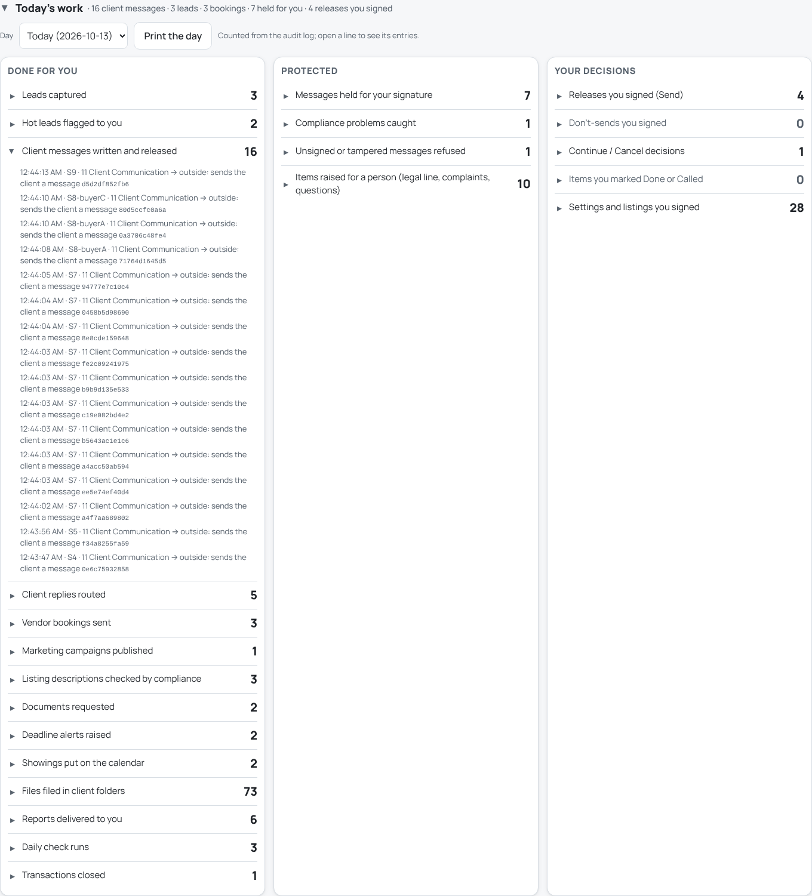

Three groups:

| Group | Lines |
|---|---|
| **Done for you** | Leads captured · Hot leads flagged to you · Client messages written and released · Client replies routed · Vendor bookings sent · Marketing campaigns published · Listing descriptions checked by compliance · Documents requested · Deadline alerts raised · Showings put on the calendar · Files filed in client folders · Reports delivered to you · Daily check runs · Transactions closed |
| **Protected** | Messages held for your signature · Compliance problems caught · Unsigned or tampered messages refused · Items raised for a person (legal line, complaints, questions) |
| **Your decisions** | Releases you signed (Send) · Don't-sends you signed · Continue / Cancel decisions · Items you marked Done or Called · Settings and listings you signed |

**Every number can be checked.** Tap a line and it lists the entries behind
its number, newest first: the time, the client, what happened, and the first
characters of that entry's fingerprint in the audit record. Thirty are listed;
past thirty the line says how many more there are.

**Another day:** pick it in the **Day** list (every day that has entries is
there). **Print the day** prints only this panel, every line opened, ready to
hand to a client or save as a PDF from the print window.

What the numbers are, and are not:

- They are counts of entries in the audit record for that day, by the desk
  computer's clock (a day runs midnight to midnight there). Nothing is
  estimated.
- "Client messages" are not split into emails and texts: no email or SMS
  service is connected yet, so the record holds messages, not channels. Once
  one is connected, the count can be split by channel.
- There is no "time saved" figure. That needs the minutes each task would
  have taken a person, which only you can set.

## 4. Needs you: what to answer

The red number next to **Needs you** counts the cards waiting. They come in
sections you can open and close, always in this order:

1. **Held for your release** (open)
2. **Paused for your decision** (open)
3. One section per kind of item to handle, each titled as in the table in
   4c: the legal line and upset clients open; refusals, undeliverable
   messages and questions closed.

Each section shows its count on the right. When it is your move in a test
script or the showcase, the section holding that card opens by itself.

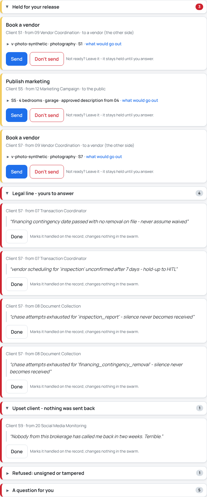

### 4a. A held message (yellow edge)

Some messages would leave your business: a booking sent to a vendor, an ad
sent to the public. Every one of them stops here first, with exactly what
would go out and to whom. The card shows it in one line; tap that line (it
ends "· what would go out") and it gives way to every field. The full content
also opens by itself the moment you tap Send, so you always see it before
your second tap signs.

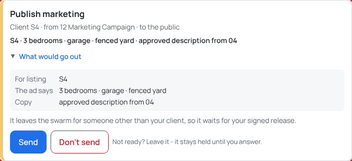

You have three answers:

| Answer | How | What happens |
|---|---|---|
| **Send** | Tap **Send**, then tap **Tap again to sign and send** within 5 seconds | Your key signs a release for this one message; it goes out once; the release is on the record. The two taps stop a stray click from sending. |
| **Don't send** | Tap **Don't send**, type why (optional), tap **Sign: don't send** | Your key signs a decline; the message is removed and never goes out; your reason is on the record. **Keep it held** backs out without answering. |
| **Not yet** | Do nothing | It stays held, for as long as you like, until you answer. |

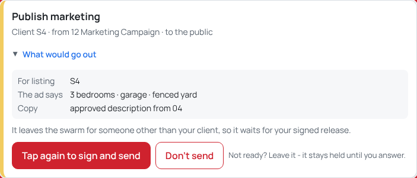

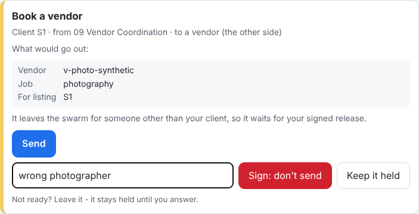

A signed "don't send" can never be used as a "send", nor the other way round:
your choice is inside what your key signs. After a Don't send, the agent that
wrote the message is not told yet (see [section 13](#13-limits-to-know)); if
the work still needs doing, start it again yourself.

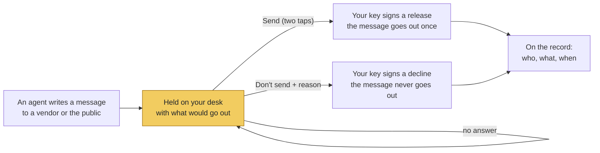

Messages to your own client are not held here; they go out once your client
has given consent (recorded by Agent 14), and Proof and connections counts them.

### 4b. A paused thread (yellow edge, "Paused - your decision")

An agent stopped and asks you to decide before it goes on. The card says why,
in the agent's words, and what each answer means.

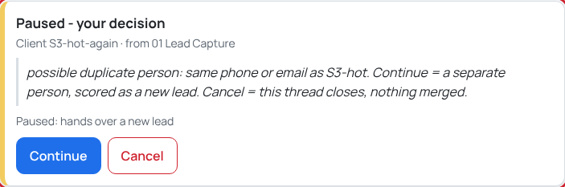

- **Continue** - the agent carries on. If the card shows a list ("Continue to
  which agent?"), pick the agent first; this happens when a client's reply
  does not say which agent it is for.
- **Cancel** - the thread closes and nothing more happens on it.

Both sign a decision with your key; one tap each.

### 4c. Something for you to handle (red edge)

These are items only a person should handle, in a section named for what
they are. Each card shows the client, the agent, and the words that raised
it.

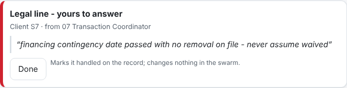

| Title on the card | What it is |
|---|---|
| Legal line - yours to answer | A question no agent may answer: price advice, a contingency deadline, anything with legal weight |
| Upset client - nothing was sent back | A complaint; no agent replied to it |
| A question for you | An agent needs a fact or a correction (a broken setting, photos that contradict the data sheet, no approved vendor) |
| Refused: unsigned or tampered | A message claimed to come from you without your signature; the hub refused it |
| Could not be delivered | A message that had nowhere to go |
| Hot lead - call now | Shown on the lead itself ([section 6](#6-leads)) |

When you have handled it (called the client, fixed the setting), press
**Done**. Done records on the audit log that you handled it, with your login,
and takes the card off your list. It changes nothing in the swarm; the
handling itself is yours.

### 4d. Held after a complaint (yellow edge)

When a client complains, Agent 11 holds every message to that client: no
nurture touch, no update, nothing scheduled goes out. **Done** on the
"Upset client" card does not lift that hold. The card "Messages to this
client are held" stays until you press **Release hold**, which signs the
release with your key (the same signed `resolve_complaint_hold` setting a
session script uses). After that, the next scheduled message goes as normal,
including a nurture touch that was held.

## 5. Listings

One row per listing you have signed, newest activity first: its name, beds
and price, where it stands ("Now: Marketing out"), and its progress track
across the row. The step names are printed once, above the rows, lined up
with every track.

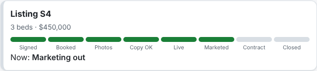

The track reads left to right:

| Step | Turns green when |
|---|---|
| Signed | You signed the new listing |
| Booked | The photographer booking went out |
| Photos | The photo delivery was verified against the data sheet |
| Copy OK | Compliance (Agent 17) approved the listing description |
| Live | The listing went active |
| Marketed | The marketing campaign went out |
| Contract | The executed contract is on file |
| Closed | The settlement statement closed the transaction |

**Green** = done. **Yellow** = waiting for you (a held booking or campaign).
**Grey** = not reached yet.

A listing with something to say has **notes** under its track: a red dot
when one of them is a flag (a compliance phrase caught, photos that
contradict the data sheet, a vendor missing from your roster), a yellow dot
when it only waits for you. Tap the notes to read them.

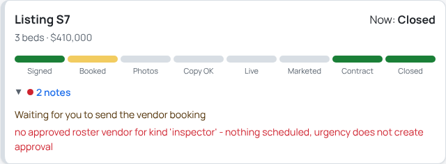

## 6. Leads

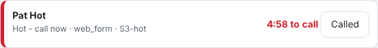

A hot lead has a red edge and a clock: **4:58 to call** counts down five
minutes from when the lead turned hot, then reads "call window passed". When
you have called, press **Called**: it records that you did, with your login,
and the lead becomes "Hot - handled". No agent contacts a hot lead for you.

Other statuses: **Captured** (in your pipeline), **Waiting for your decision**
(a paused thread in Needs you, such as a possible duplicate person),
**Closed by your decision** (you cancelled it).

### Prospects waiting

Under the leads: Agent 19's prospects (from your monitored zip codes and
approved sources) that you have not dealt with yet, each with its zip, source,
status, the day it was found and how many comparables Agent 10 found for it
("no comps yet" until the package arrives). A prospect on your do-not-call list
says so. When you have dealt with one, press **Mark handled**: it signs a
`prospects_handled` setting to Agent 19 with your key, the prospect leaves this
list and the morning briefing's "prospects waiting" section, and the signed
setting is on the record. Agent 19 never contacts a prospect itself.

## 7. Your team

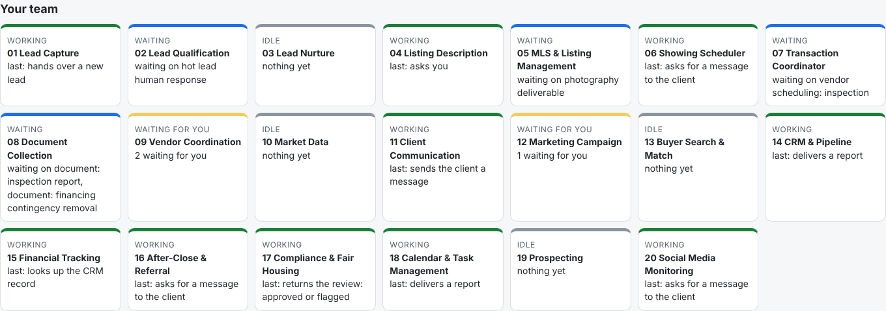

**Your team** shows one line, for example "10 working · 4 waiting · 2
waiting for you · 4 idle". Tap it to see each agent. It opens by itself when
an agent has a PROBLEM, unless you have closed it yourself.

Each tile is one agent, with a colored top edge:

| State | Edge | Meaning |
|---|---|---|
| WORKING | green | Did something recently; "last:" says what |
| WAITING | blue | Waiting on a document or another party, named on the tile |
| WAITING FOR YOU | yellow | Has a held message or a paused thread in Needs you |
| IDLE | grey | Nothing yet |
| PROBLEM | red | A handoff it made was refused; the tile says why. It clears the next time the agent's work goes through. |

## 8. Proof and connections

This section is folded under one line, for example "✓ record intact · 4 of 4
sent on your signature · 3 held · 16 client messages · 1 of 6 connected". The
recap's record, signature and connections buttons open it. It opens by itself
if the record ever fails its check, or if a message to a vendor or the public
went out without your signed release (unless you have closed it yourself).

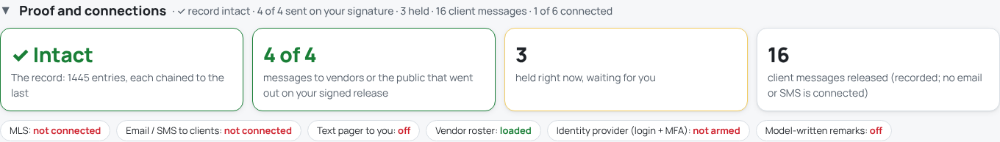

| Tile | Meaning |
|---|---|
| **Intact** / **Broken** | The audit record is checked entry by entry: each entry is chained to the one before, so a changed or deleted entry breaks the chain. "Intact" is what you want to see. |
| **N of N** | Messages that went to vendors or the public, and how many of those went out on your signed release. The two numbers are equal; green when they are. |
| **Held** | Messages held right now, waiting for you; with how many you signed not to send, once there are any |
| **Client messages** | Messages released to your own clients, recorded |

The chips say what is connected: **MLS**, **Email / SMS to clients**, **Text
pager to you** (`python tools/console.py pager` turns it on), **Vendor
roster** (ratified or not), **Identity provider (login + MFA)**, and
**Model-written remarks**. Red means not connected or off. Hover a chip for a
note.

## 9. What just happened

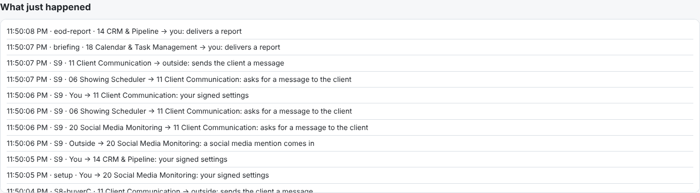

Its title line shows the latest message. Tap it for the last 25, newest
first, in plain words: who sent what to whom, what was held for you, what you
signed. Your own actions are in bold.

## 10. The two header buttons

- **Run today's checks** runs the daily clock now, the same as
  `run_sweeps.py`: contract deadlines and vendor hold-ups (07), document
  chases and disclosure deadlines (08), nurture follow-ups (03), showing
  feedback and seller reports (06), compliance review deadlines (17),
  post-close check-ins (16), client dates (14), no-shows and the morning
  briefing (18), among others. The end-of-day books are not part of it.
  Press it once a day while the desk is open (the clock cannot run on its
  own while the desk holds the folder).
- **Check the record** walks the whole audit chain and answers "The record is
  intact (N entries)" or names the line where it broke and why. When the last
  write was cut off (a crash or power cut), the note says so: stop the desk
  and run `python tools/console.py repair-record`.

## 11. Open it on a tablet

```bash
python tools/desk.py --lan
```

The desk prints a link with an access code (`?t=...`). Open that link on a
tablet or phone on the same office network; replace `<this-computer>` in the
link with your computer's network address. Without the code the page refuses.

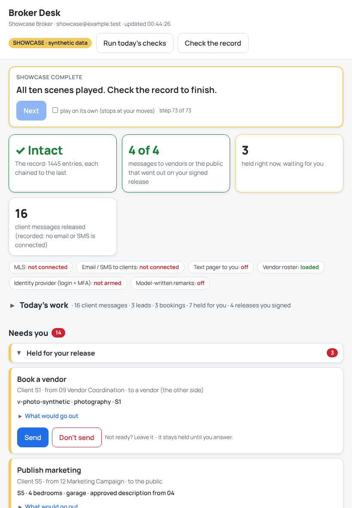

Use `--lan` on a trusted office network only: the page and its code travel
unencrypted.

## 12. Test scripts and the showcase

**A test script** plays prepared work into *your* desk, one step at a time,
signed with *your* key. Use it to practise, to train someone, or to test with
prepared data:

```bash
python tools/desk.py --config-dir scenes/config --script scenes/scene04_new_listing.jsonl
```

A bar appears at the top. Press **Next** for each step, or tick **play on its
own**. When the script reaches something that is yours, the bar turns red,
the card is outlined, and nothing moves until you press it.

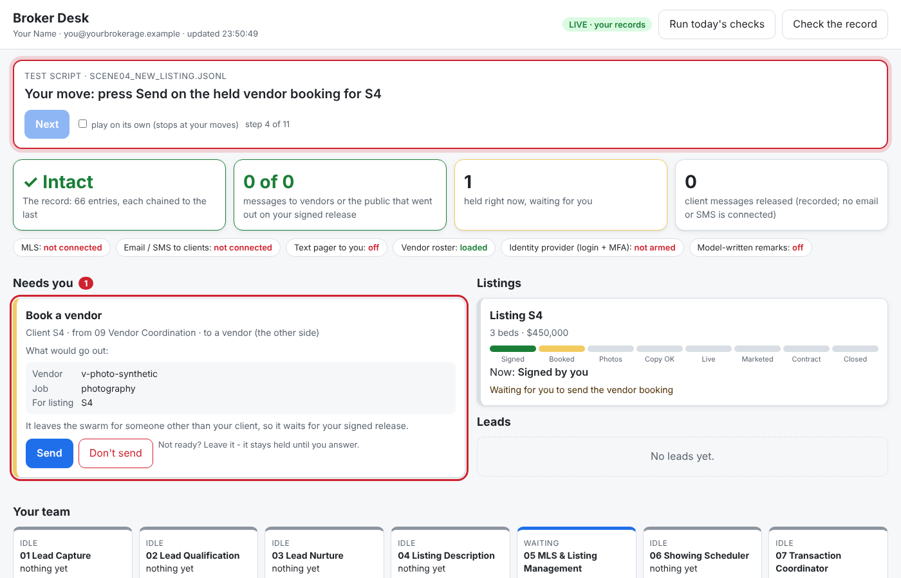

The script's place is saved in your folder: stop the desk and start it again
with the same `--script` and it carries on where it was, without repeating a
step. Change the file and it starts from its first line. A script is a file
of JSON lines in the console's format (the list of line types is at the top
of `tools/console.py`, and `scenes/` has ten examples); a broken line is
refused at start with its line number.

**The showcase** is a separate demonstration desk on synthetic data, in its
own folder (`showcase-state/`), never on your records:

```bash
python tools/desk.py --showcase --fresh
```

It replays the ten operator scenes, stopping at each of your moves. It is
what the client video is recorded on
([OPERATOR_TESTING_GUIDE.md](../OPERATOR_TESTING_GUIDE.md), section 0a).

## 13. Limits to know

- **Messages are recorded, not delivered.** MLS, email and SMS are not
  connected yet. "Sent" means the hub released the message and recorded it.
- **A signature proves your key, not your login.** No identity provider is
  connected; the chip says "not armed".
- **One person per desk.** The desk signs with the one key in its folder;
  everyone who opens the page acts as that broker.
- **After Don't send, the agent is not told yet.** The message is removed and
  your decline recorded; restart the work yourself if it still needs doing.
- **The daily clock runs when you press Run today's checks** while the desk
  is open.
- **Done and Called cannot be undone from the page.** They only record that
  you handled something; nothing in the swarm changes.
- **Tablet access is plain HTTP** on your network.
- **On the narrowest phones** (320 pixels wide, such as the first iPhone SE)
  the step names "Marketed" and "Contract" above the listing tracks are
  slightly clipped; from 360 pixels up they fit.
- **The day's work counts; it does not estimate.** Emails and texts are
  counted together as client messages, and there is no time-saved figure
  (section 3).

## 14. When something looks wrong

| You see | What it means | What to do |
|---|---|---|
| "desk not reachable" at the top of the page | The desk program stopped | Start it again: `python tools/desk.py` |
| `no key in ...` when starting | This folder has no signing key | `python tools/console.py init`, then `onboard` |
| `a desk is already running on ...` | A desk is already open on this folder | Use that one, or stop it first |
| A console session says "the Broker Desk is running" | By design: one program on your records at a time | Stop the desk, or do it from the desk |
| "Not done: that message is no longer held" | It was already answered (perhaps from another screen) | Nothing; the page refreshes |
| **Vendor roster: unratified** | Your vendor list is a draft | Ratify `config/vendor_panel.json` (section 1) |
| **✗ Record broken** in the recap | The audit record does not check; the Proof tile names the line and why | Stop the desk; do not act; keep the folder as it is and contact support |
| The desk will not start: `the record (audit log) is damaged - nothing was started or written`, with `"cut_off_last_write": true` | The last write to the record was cut off part-way (a crash or power cut) | Run `python tools/console.py repair-record`, then start the desk again. It keeps every complete entry and records the repair |
| The page shows `the record (audit log) is damaged - nothing was started or written` while the desk is running, and buttons answer the same | The record was damaged or changed by another program while the desk ran; the desk wrote nothing after that | Stop the desk (Ctrl+C). It prints the same message with "state not saved" and saves nothing, so nothing is left that the record does not show. Then follow the two rows above |
| The same, with `"cut_off_last_write": false` | A line before the end is damaged or was edited: not a cut-off write | Do not repair it yourself. Keep a copy of the folder and contact support; the message names the line |
| `the record (audit log) is in use by another program - nothing was done` | Another program on this folder (a desk, a console session, the daily clock) held the record for more than 30 seconds | Wait and try again; if it stays, stop the other program |
| "Could not reach you about ..." in What just happened | A text page to you failed (the reason is in brackets) | The item is waiting in Needs you. Check the pager: `python tools/console.py pager --test` |
| An agent tile shows PROBLEM | One of its handoffs was refused | Read the tile; it often points at a missing setting or vendor |
| `this desk answers only at its own address` | The desk on this computer was opened by another name (the computer's name or network address) | Open http://127.0.0.1:8765. To use the desk from a tablet, start it with `--lan` and open the link it prints |
| `Address already in use` (Windows: "Only one usage of each socket address") | Another program uses port 8765 | `python tools/desk.py --port 8770`, then open http://127.0.0.1:8770 |

## 15. Where your files are

Everything lives in your records folder, `console-state/` (or the folder in
`LISTINGASSISTANTS_STATE_DIR`):

| File | What it is |
|---|---|
| `operator-key.bin` | Your signing key. Readable only by your account. Never share it. |
| `operator.json` | Your name and login |
| `console-audit.jsonl` | The audit record: every message, hold, release and decline |
| `swarm-state.sqlite` | The saved state, restored only when the audit record vouches for it |
| `drawers/` | Each client's files |
| `desk.lock` | Present while a desk is open on this folder |
| `console-audit.jsonl.lock` | Lets the programs on this folder write the audit record one at a time. Always there; leave it |
| `console-audit.jsonl.torn-...` | Only after a repair: the cut-off piece of a write, kept as it was |
| `script-progress.json` | Where a test script is, when you use one |
