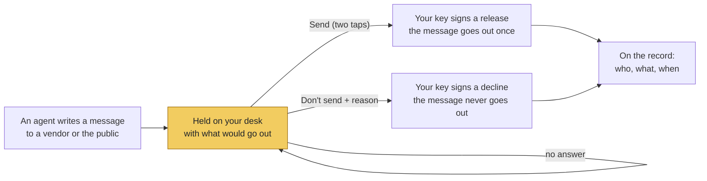

# The Broker Desk - User's Manual

The Broker Desk is one page, on your own computer, that shows everything your
twenty assistants are doing and everything waiting for you. It is the only
place you need to look during the day. Every button that acts signs with your
key, the same signature the console uses, and lands on the audit record.

For testing the desk step by step, see
[BROKER_DESK_TESTING_GUIDE.md](BROKER_DESK_TESTING_GUIDE.md).

**Contents**

1. [Start the desk](#1-start-the-desk)
2. [The page at a glance](#2-the-page-at-a-glance)
3. [Needs you: what to answer](#3-needs-you-what-to-answer)
4. [Listings](#4-listings)
5. [Leads](#5-leads)
6. [Your team](#6-your-team)
7. [The proof strip and the connection chips](#7-the-proof-strip-and-the-connection-chips)
8. [What just happened](#8-what-just-happened)
9. [The two header buttons](#9-the-two-header-buttons)
10. [Open it on a tablet](#10-open-it-on-a-tablet)
11. [Test scripts and the showcase](#11-test-scripts-and-the-showcase)
12. [Limits to know](#12-limits-to-know)
13. [When something looks wrong](#13-when-something-looks-wrong)
14. [Where your files are](#14-where-your-files-are)

---

## 1. Start the desk

**The first time** (once per computer), from the `listing-assistants` folder:

```bash
pip install -r requirements.txt
python tools/console.py init        # makes YOUR signing key, readable only by you
python tools/console.py onboard     # your name and login, asked once
```

Then open `config/vendor_panel.json` (your approved vendors) and, once you have
checked it, replace its `_status` line with
`RATIFIED <today's date YYYY-MM-DD> <your name>`. The desk never books a
vendor from a list you have not ratified; the "Vendor roster" chip on the page
says which state it is in.

**Every day:**

```bash
python tools/desk.py
```

Open **http://127.0.0.1:8765** in your browser. The page refreshes itself
every second and a half. To stop the desk, press **Ctrl+C** in the window that
started it (on Windows, Ctrl+C or Ctrl+Break). Your state is saved after
every button you press, so stopping and starting loses nothing.

On Windows use backslashes: `python tools\desk.py`.

While the desk is open it holds your records folder. The console
(`console.py session`) and the daily clock (`run_sweeps.py`) refuse to start
on the same folder until the desk is stopped, so two programs never write the
same records at once. Use the desk's own **Run today's checks** button instead.

## 2. The page at a glance


| # | Part | What it tells you |
|---|---|---|
| 1 | **Mode badge and header buttons** | LIVE (your records) or SHOWCASE (synthetic demo data); **Run today's checks** and **Check the record** ([section 9](#9-the-two-header-buttons)) |
| 2 | **Script bar** | Shown only while a test script or the showcase plays ([section 11](#11-test-scripts-and-the-showcase)) |
| 3 | **Proof strip** | Is the record intact, did everything that left go out on your signature, how much is waiting ([section 7](#7-the-proof-strip-and-the-connection-chips)) |
| 4 | **Connection chips** | What is and is not connected to the outside world |
| 5 | **Needs you** | Everything waiting for your answer: held messages first, then paused threads, then items to handle ([section 3](#3-needs-you-what-to-answer)) |
| 6 | **Listings** | One card per listing with its progress track ([section 4](#4-listings)) |
| 7 | **Leads** (below Listings) | Each lead, with a five-minute call clock on a hot one ([section 5](#5-leads)) |
| 8 | **Your team** (lower on the page) | What each of the twenty agents is doing ([section 6](#6-your-team)) |
| 9 | **What just happened** (bottom) | The latest messages between agents, you and the outside ([section 8](#8-what-just-happened)) |

A narrow screen (a tablet held upright) stacks the same parts in one column.

## 3. Needs you: what to answer

The red number next to **Needs you** counts the cards waiting. There are three
kinds of card, always in this order: held messages, paused threads, then
items to handle (legal-line items at the top of those).

### 3a. A held message (yellow edge)

Some messages would leave your business: a booking sent to a vendor, an ad
sent to the public. Every one of them stops here first, with exactly what
would go out and to whom.


You have three answers:

| Answer | How | What happens |
|---|---|---|
| **Send** | Tap **Send**, then tap **Tap again to sign and send** within 5 seconds | Your key signs a release for this one message; it goes out once; the release is on the record. The two taps stop a stray click from sending. |
| **Don't send** | Tap **Don't send**, type why (optional), tap **Sign: don't send** | Your key signs a decline; the message is removed and never goes out; your reason is on the record. **Keep it held** backs out without answering. |
| **Not yet** | Do nothing | It stays held, for as long as you like, until you answer. |


A signed "don't send" can never be used as a "send", nor the other way round:
your choice is inside what your key signs. After a Don't send, the agent that
wrote the message is not told yet (see [section 12](#12-limits-to-know)); if
the work still needs doing, start it again yourself.



Messages to your own client are not held here; they go out once your client
has given consent (recorded by Agent 14), and the proof strip counts them.

### 3b. A paused thread (yellow edge, "Paused - your decision")

An agent stopped and asks you to decide before it goes on. The card says why,
in the agent's words, and what each answer means.


- **Continue** - the agent carries on. If the card shows a list ("Continue to
  which agent?"), pick the agent first; this happens when a client's reply
  does not say which agent it is for.
- **Cancel** - the thread closes and nothing more happens on it.

Both sign a decision with your key; one tap each.

### 3c. Something for you to handle (red edge)

These are items only a person should handle. The card shows the words that
raised it.


| Title on the card | What it is |
|---|---|
| Legal line - yours to answer | A question no agent may answer: price advice, a contingency deadline, anything with legal weight |
| Upset client - nothing was sent back | A complaint; no agent replied to it |
| A question for you | An agent needs a fact or a correction (a broken setting, photos that contradict the data sheet, no approved vendor) |
| Refused: unsigned or tampered | A message claimed to come from you without your signature; the hub refused it |
| Could not be delivered | A message that had nowhere to go |
| Hot lead - call now | Shown on the lead itself ([section 5](#5-leads)) |

When you have handled it (called the client, fixed the setting), press
**Done**. Done records on the audit log that you handled it, with your login,
and takes the card off your list. It changes nothing in the swarm; the
handling itself is yours.

## 4. Listings

One card per listing you have signed, newest activity first.


The track reads left to right:

| Step | Turns green when |
|---|---|
| Signed | You signed the new listing |
| Booked | The photographer booking went out |
| Photos | The photo delivery was verified against the data sheet |
| Copy OK | Compliance (Agent 17) approved the listing description |
| Live | The listing went active |
| Marketed | The marketing campaign went out |
| Contract | The executed contract is on file |
| Closed | The settlement statement closed the transaction |

**Green** = done. **Yellow** = waiting for you (a held booking or campaign;
the card says "Waiting for you to send ..."). **Grey** = not reached yet.
Red lines under the track are flags: a compliance phrase caught, photos that
contradict the data sheet, a vendor missing from your roster.

## 5. Leads


A hot lead has a red edge and a clock: **4:58 to call** counts down five
minutes from when the lead turned hot, then reads "call window passed". When
you have called, press **Called**: it records that you did, with your login,
and the lead becomes "Hot - handled". No agent contacts a hot lead for you.

Other statuses: **Captured** (in your pipeline), **Waiting for your decision**
(a paused thread in Needs you, such as a possible duplicate person),
**Closed by your decision** (you cancelled it).

## 6. Your team


Each tile is one agent, with a colored top edge:

| State | Edge | Meaning |
|---|---|---|
| WORKING | green | Did something recently; "last:" says what |
| WAITING | blue | Waiting on a document or another party, named on the tile |
| WAITING FOR YOU | yellow | Has a held message or a paused thread in Needs you |
| IDLE | grey | Nothing yet |
| PROBLEM | red | A handoff it made was refused; the tile says why. It clears the next time the agent's work goes through. |

## 7. The proof strip and the connection chips


| Tile | Meaning |
|---|---|
| **Intact** / **Broken** | The audit record is checked entry by entry: each entry is chained to the one before, so a changed or deleted entry breaks the chain. "Intact" is what you want to see. |
| **N of N** | Messages that went to vendors or the public, and how many of those went out on your signed release. The two numbers are equal; green when they are. |
| **Held** | Messages held right now, waiting for you; with how many you signed not to send, once there are any |
| **Client messages** | Messages released to your own clients, recorded |

The chips say what is connected: **MLS**, **Email / SMS to clients**, **Text
pager to you** (`python tools/console.py pager` turns it on), **Vendor
roster** (ratified or not), **Identity provider (login + MFA)**, and
**Model-written remarks**. Red means not connected or off. Hover a chip for a
note.

## 8. What just happened


The latest messages, newest first, in plain words: who sent what to whom, what
was held for you, what you signed. Your own actions are in bold.

## 9. The two header buttons

- **Run today's checks** runs the daily clock now, the same as
  `run_sweeps.py`: contract deadlines and vendor hold-ups (07), document
  chases and disclosure deadlines (08), nurture follow-ups (03), showing
  feedback and seller reports (06), compliance review deadlines (17),
  post-close check-ins (16), client dates (14), no-shows and the morning
  briefing (18), among others. The end-of-day books are not part of it.
  Press it once a day while the desk is open (the clock cannot run on its
  own while the desk holds the folder).
- **Check the record** walks the whole audit chain and answers "The record is
  intact" or names where it broke.

## 10. Open it on a tablet

```bash
python tools/desk.py --lan
```

The desk prints a link with an access code (`?t=...`). Open that link on a
tablet or phone on the same office network; replace `<this-computer>` in the
link with your computer's network address. Without the code the page refuses.


Use `--lan` on a trusted office network only: the page and its code travel
unencrypted.

## 11. Test scripts and the showcase

**A test script** plays prepared work into *your* desk, one step at a time,
signed with *your* key. Use it to practise, to train someone, or to test with
prepared data:

```bash
python tools/desk.py --config-dir scenes/config --script scenes/scene04_new_listing.jsonl
```

A bar appears at the top. Press **Next** for each step, or tick **play on its
own**. When the script reaches something that is yours, the bar turns red,
the card is outlined, and nothing moves until you press it.


The script's place is saved in your folder: stop the desk and start it again
with the same `--script` and it carries on where it was, without repeating a
step. Change the file and it starts from its first line. A script is a file
of JSON lines in the console's format (the list of line types is at the top
of `tools/console.py`, and `scenes/` has ten examples); a broken line is
refused at start with its line number.

**The showcase** is a separate demonstration desk on synthetic data, in its
own folder (`showcase-state/`), never on your records:

```bash
python tools/desk.py --showcase --fresh
```

It replays the ten operator scenes, stopping at each of your moves. It is
what the client video is recorded on
([OPERATOR_TESTING_GUIDE.md](../OPERATOR_TESTING_GUIDE.md), section 0a).

## 12. Limits to know

- **Messages are recorded, not delivered.** MLS, email and SMS are not
  connected yet. "Sent" means the hub released the message and recorded it.
- **A signature proves your key, not your login.** No identity provider is
  connected; the chip says "not armed".
- **One person per desk.** The desk signs with the one key in its folder;
  everyone who opens the page acts as that broker.
- **After Don't send, the agent is not told yet.** The message is removed and
  your decline recorded; restart the work yourself if it still needs doing.
- **The daily clock runs when you press Run today's checks** while the desk
  is open.
- **Done and Called cannot be undone from the page.** They only record that
  you handled something; nothing in the swarm changes.
- **Tablet access is plain HTTP** on your network.

## 13. When something looks wrong

| You see | What it means | What to do |
|---|---|---|
| "desk not reachable" at the top of the page | The desk program stopped | Start it again: `python tools/desk.py` |
| `no key in ...` when starting | This folder has no signing key | `python tools/console.py init`, then `onboard` |
| `a desk is already running on ...` | A desk is already open on this folder | Use that one, or stop it first |
| A console session says "the Broker Desk is running" | By design: one program on your records at a time | Stop the desk, or do it from the desk |
| "Not done: that message is no longer held" | It was already answered (perhaps from another screen) | Nothing; the page refreshes |
| **Vendor roster: unratified** | Your vendor list is a draft | Ratify `config/vendor_panel.json` (section 1) |
| **✗ Broken** on the proof strip | The audit record does not check | Stop the desk; do not act; keep the folder as it is and contact support |
| An agent tile shows PROBLEM | One of its handoffs was refused | Read the tile; it often points at a missing setting or vendor |
| `Address already in use` (Windows: "Only one usage of each socket address") | Another program uses port 8765 | `python tools/desk.py --port 8770`, then open http://127.0.0.1:8770 |

## 14. Where your files are

Everything lives in your records folder, `console-state/` (or the folder in
`LISTINGASSISTANTS_STATE_DIR`):

| File | What it is |
|---|---|
| `operator-key.bin` | Your signing key. Readable only by your account. Never share it. |
| `operator.json` | Your name and login |
| `console-audit.jsonl` | The audit record: every message, hold, release and decline |
| `swarm-state.sqlite` | The saved state, restored only when the audit record vouches for it |
| `drawers/` | Each client's files |
| `desk.lock` | Present while a desk is open on this folder |
| `script-progress.json` | Where a test script is, when you use one |
