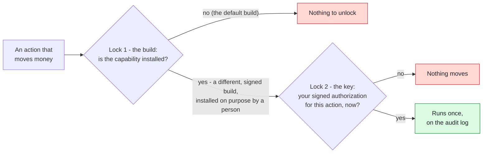
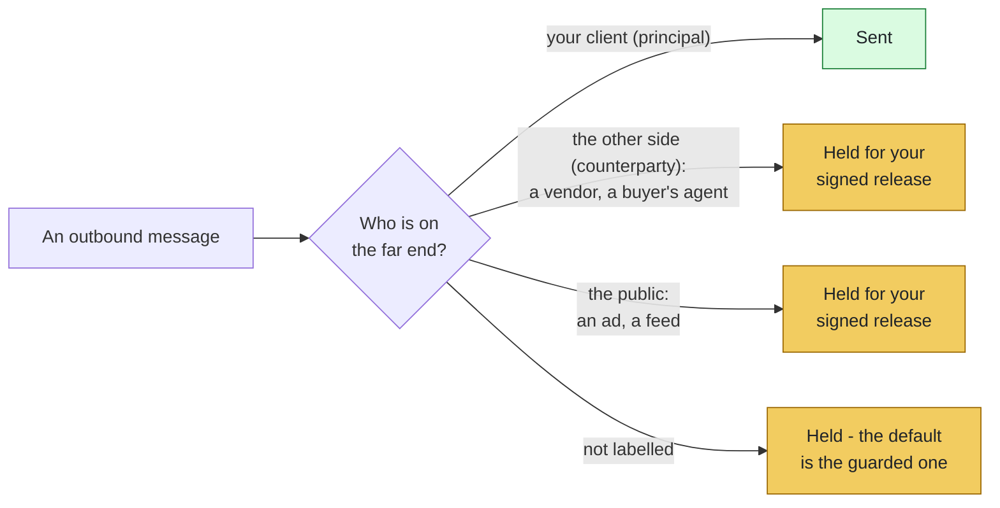
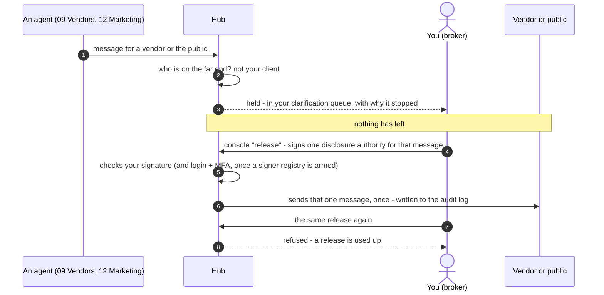

# Financial Capability - status, controls, and how to engage it

> **Words used here.** Tuple, playbook, swarm, hold, release and the other technical words are explained in plain language in [GLOSSARY.md](GLOSSARY.md).

This is the document a held message points you to. If a ListingAssistants agent stopped
and told you it could not send financial or position-bearing content, it linked
here. Nothing broke. The system did exactly what it is built to do.

This document is written to be read by a prospective operator and by that
operator's security or compliance reviewer. It states what the system cannot
do, why, and where the real risks are - including the ones a reviewer would
otherwise have to find on their own.

---

## The one-line version

A ListingAssistants agent **cannot execute a financial transaction, and cannot reveal a
financial position, without a deliberate human authorization** - and financial
*execution* additionally requires a **different, signed software build**. The
default build ships with the execution capability absent, not merely disabled.

---

## The two locks

<!-- diagram:locks-fin - drawn in tools/doc_diagrams.py; edit it there, not here -->

*The default build stops at Lock 1: it contains no payment, transfer or wire code.*
<!-- /diagram:locks-fin -->

Financial action is guarded by two independent locks, in series, both held by
humans. Neither the running system nor any agent can open either one alone.

**Lock 1 - the build.** The capability to execute a financial transaction is not
present in the default artifact. There is no payment SDK, no transfer handler,
no dormant code path waiting to be switched on. Turning it on is not a
configuration change or a permission grant - it requires installing a
different, signed version of the software, deliberately, by a person. Nothing
the running system can do can create a capability the build does not contain.

**Lock 2 - the key.** Even in a build that carries the capability, each action
requires a specific, authenticated authorization from the human principal, for
that action, at that time. An agent cannot grant it, infer it, assume it, or
reuse a prior one.

Update without key: nothing moves. Key without update: there is nothing to
unlock. Both, separately, by a human, on purpose.

---

## What "held" means for a disclosure

<!-- diagram:audience-fin - drawn in tools/doc_diagrams.py; edit it there, not here -->

*In this repository: `client.message.send` is principal, `vendor.schedule` counterparty, `campaign.publish` public (`identity/routes.json`). The gate reads the label, not the words.*
<!-- /diagram:audience-fin -->

Execution is one half. **Disclosure is the other, and in practice the more
common one.** An agent never reveals, to any party outside the principal it
serves:

- a price floor, ceiling, reserve, margin, spread, or the room a principal has
  to move
- a motivation, deadline, or circumstance that weakens a principal's position
- a balance, payment history, or financial standing
- what a principal has already agreed to, declined, or considered

Every outbound message is classified by **who is on the far end**: the
`principal` (the party the identity serves), a `counterparty` (the other side -
a buyer's agent, a carrier, a payer), or the `public` (an open feed). Messages
to the principal pass. Messages to a counterparty or the public **hold for human
authorization** - every time, regardless of how the message is worded. The gate
keys on the recipient, not on scanning the text for forbidden words, so there is
no phrasing that slips past it.

A missing or unrecognized recipient class does not pass - it holds. The default
is the guarded state, never the permissive one.

---

## How to engage a held message (the key, in practice)

<!-- diagram:release-fin - drawn in tools/doc_diagrams.py; edit it there, not here -->

*Checked against `Hub.release_disclosure` in `dispatcher/hub.py` and `tests/test_absolute_signal.py` in dispatcher-agents. A message to your own client (Agent 11) is not held.*
<!-- /diagram:release-fin -->

When a message holds, a human with signing authority authorizes that specific
message. Mechanically:

1. The held message is recorded by id, with a canonical explanation of why it
   stopped (this document, plus the engagement path).
2. An authorized human issues a **signed `disclosure.authority`** naming that
   exact held message.
3. The system verifies the signature (and, when the signer registry is armed,
   the signer's login and MFA), then releases that one message, once. The
   authorization is written to the tamper-evident audit log.

The other answer is **no**. The same signed `disclosure.authority`, with
`"decision": "decline"` (and a reason, if you give one), removes that one held
message: it is never sent, and the decline is written to the audit log with who
declined it and why (`Hub.decline_disclosure`, added 2026-10-12). The decision is
part of what is signed, so a signed "decline" can never be used as a "send", nor
the other way round.

A release or a decline is an authority action held to the same bar as a
financial-execution authorization. There is no weaker path.

To turn on financial *execution* (Lock 1), engage support:
`support/engage-financial-capability`. That is a deliberate, out-of-band process
involving a signed build - not a setting.

---

## In a real estate brokerage

These are the behaviors in the ListingAssistants agents that sit on top of
the two locks. Each one is a code path with a test.

- **Price and strategy questions go to the broker.** When a client message
  asks for an opinion on price, an offer, or strategy ("what would you do",
  "should I offer", "what's it worth", "negotiate"), Agent 11 escalates it to
  `escalation.legal_line` with the client's words and sends only a template
  acknowledgment. It never answers the question.
- **Wire topics go to the broker.** Any client message mentioning wire
  instructions, wiring details, a wire transfer, updated wire details or a
  routing number is escalated to `escalation.legal_line` before anything else
  is checked. The agents send no wire or account details on any channel.
- **Documents outrank stated budgets.** When Agent 02 scores a lead, a
  pre-approval document's amount replaces a different stated budget, and the
  conflict is logged verbatim. An expired letter, or one marked unverified,
  is not used.
- **Ledger figures are carried, not typed.** Agent 15 reports the figures it
  receives with their source attached. The SQLite store
  (`dispatcher/persistence_sqlite.py`) keeps money as exact decimals and its
  ledger tables are append-only. Agent 15 does not write that store; it
  keeps its entries in its saved state and files each expense entry in the
  client's drawer (`financials/`, SHA-256 on the audit chain).
- **Human decisions on paused work are signed.** A paused operation resumes
  only on a signed `hitl.decision.authority` envelope verified by the hub
  (`dispatcher/hitl_protocol.py`), bound to the paused client context.

Who decides price, terms and fund movement: the licensed broker and the
client. That responsibility stays with them.

---

## Where the real risk is (read this if you are the security reviewer)

This section is deliberately honest. The system is strong against the threat it
was built for and average against the threats it inherits. Both are named here.

**Strong - action from inside the swarm.** A compromised or prompt-injected
agent cannot release its own held message or execute a transaction. It holds no
signing key; the key is held outside the running system. This is the property
the architecture was designed around, and it holds.

**Strong - hiding a breach.** The audit log is hash-chained. Any edit, deletion,
or reordering fails verification loudly. An unauthorized release cannot be
retroactively disguised as an authorized one.

**Soft - signing-key hygiene (the main one).** Signatures are Ed25519: the hub
holds only public keys, so a stolen configuration file yields keys that forge
nothing. The private signing key is what matters - whoever holds it can sign.
The signature covers the envelope's provenance, including the signer stamp, so
the claimed signer cannot be changed after signing. The signer registry (login +
MFA) is the second lock - but if an identity ships with the registry unarmed,
verification is key-only, and in that state **theft of the private key is full
compromise.** The system declares an unarmed registry on the audit log rather
than passing silently, but *declared is not prevented.* Production should keep
the private key off the hub's machine and run with an armed registry. (A
shared-secret HMAC tier existed until 2026-10-12; it was removed because any
verifier holding that secret could also sign.)

**Soft - the release channel is the attack surface.** Once the lock and key
exist, security reduces to how well the signing key and MFA session are
protected. A phished MFA session or a keylogged signer defeats the gate. No code
prevents this; it is operational.

**Soft - the build/publish pipeline.** "Execution requires a software update" is
only as strong as the guarantee that no one can push a malicious build. Whoever
controls the publish pipeline can add the capability. Signed-release attestation
(sigstore) exists to bound this; a reviewer should confirm the deploy path
enforces signature verification.

**Soft - supply chain.** Pillar packages install from source repositories. A
compromised upstream repo runs inside the hub. Pin to commit hashes, not branch
tips.

**Not solved by this layer - recipient identity.** The disclosure gate verifies
the recipient *class* (counterparty vs principal). It does not verify recipient
*identity* - that a balance bound for "the patient" reaches the correct patient.
That binding is a separate control and is not claimed here.

---

## What is verifiable today

- No payment SDK is present in the default build (grep-verifiable).
- All financial-authority routes require a human sender and a verified signature.
- The disclosure gate holds counterparty/public sends before persistence, emits
  a byte-identical canonical rebuttal, and records the hold on the audit chain.
- The release path reuses the execution-authority verification exactly, and is
  one-shot (no replay). Every fail-closed branch is covered by a test.

Each of these is asserted by an executable test, not by this document.
