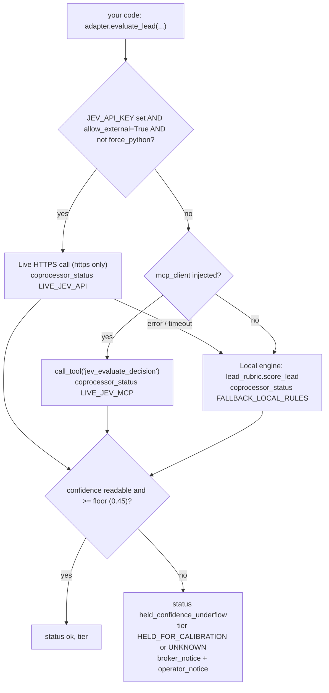

# JEV decision adapter

`dispatcher/decision_adapter.py` connects ListingAssistants to the external
JEV decision service (TypeSafe AI) when you choose to use it, and otherwise
scores locally with the same rules Agent 02 uses. No agent calls the adapter
today: Agent 02 scores leads with `dispatcher/lead_rubric.py` directly, and
Agent 06 arbitrates showings with its own rules. The adapter is ready for a
deployment that wants a second, external opinion.

## Modes



- **Local engine.** `JevPythonDecisionEngine` calls `score_lead` from
  `dispatcher/lead_rubric.py`, so it scores any lead exactly as Agent 02
  does: both key spellings, Agent 01's `{value, source}` capture format, the
  expired-letter rule, document-over-stated-budget, and the boundary rule.
  A rubric missing any of its seven keys, or a lead with every input
  unknown, is a hold. Confidence is the lead's own value when given,
  otherwise 0.85 minus 0.15 per missing input and 0.25 per logged conflict.
- **Injected MCP client.** You supply and run the server; the adapter calls
  `jev_evaluate_decision` on it.
- **Live HTTPS.** Requires `JEV_API_KEY` and `allow_external=True`. Lead data
  leaves the machine in this mode, so the default is off even when a key is
  present; `get_coprocessor_status()` reports that case. The endpoint must
  use `https://`.

Every external result passes the confidence floor. A missing or non-numeric
confidence counts as 0.0, so it is held.

## Example

```python
from dispatcher.decision_adapter import JevDecisionAdapter

rubric = {"budget_threshold": 500_000, "budget_weight": 40,
          "timeline_days_threshold": 30, "timeline_weight": 40,
          "financing_weight": 20, "hot_threshold": 70, "warm_threshold": 40}
adapter = JevDecisionAdapter()                  # local engine; no data leaves the machine
res = adapter.evaluate_lead("ctx-lead-7", {"budget": 650_000, "timeline_days": 15,
                                           "financing_progress": "preapproved"}, rubric)
print(res["status"], res["tier"], res["score"], res["confidence"])   # ok HOT 100 0.85
```

## Settings

| Setting | Default | Effect |
|---|---|---|
| `confidence_threshold` | 0.45 | below it, or unreadable, is a hold |
| `allow_external` | False | live HTTPS only when True and a key is set |
| `JEV_API_KEY` | unset | live-service key (also read from `config/integrations.json`) |
| `JEV_ENDPOINT_URL` | `https://api.typesafe.ai/v1/decisions` | must be https |
| `JEV_FORCE_PYTHON` | 0 | 1 forces the local engine |
| `timeout` | 3.0 s | live call timeout |

## Boot line in the audit log

The vendored core hub (`dispatcher/hub.py`, kept identical to
dispatcher-agents) writes `jev.armed_live` at boot whenever `JEV_API_KEY` is
set and `jev.unarmed_fallback` otherwise. That line reflects only the
environment variable. Whether any decision actually went to the live
service is in each adapter result's `coprocessor_status`, and with no agent
calling the adapter, none does. Aligning the boot line is a change for the
dispatcher-agents core.
