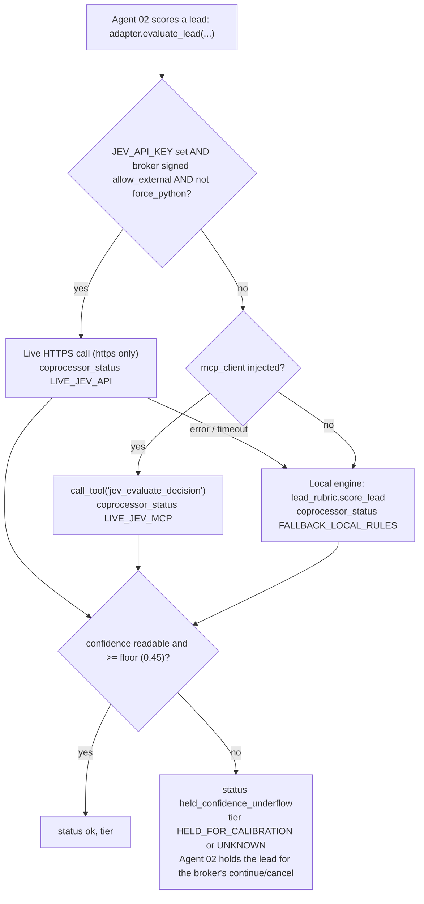

# JEV decision adapter

`dispatcher/decision_adapter.py` connects ListingAssistants to the external
JEV decision service (TypeSafe AI) when you choose to use it, and otherwise
scores locally with the same rules Agent 02 uses. Since 2026-10-12 Agent 02
scores every lead through it (each decision on the audit chain as
`decision.lead`); with no JEV connection the local engine is 02's own rubric,
so tiers are unchanged. Live JEV is used only when `JEV_API_KEY` is set and
the broker signs `{"decision_engine": {"allow_external": true}}` to Agent 02.
A result under the confidence floor holds the lead for the broker. Agent 06
arbitrates showings with its own rules and does not call the adapter.

## Modes



- **Local engine.** `JevPythonDecisionEngine` calls `score_lead` from
  `dispatcher/lead_rubric.py`, so it scores any lead exactly as Agent 02
  does: both key spellings, Agent 01's `{value, source}` capture format, the
  expired-letter rule, document-over-stated-budget, and the boundary rule.
  A rubric missing any of its seven keys, or a lead with every input
  unknown, is a hold. Confidence is the lead's own value when given,
  otherwise 0.85 minus 0.15 per missing input and 0.25 per logged conflict.
- **Injected MCP client.** You supply and run the server; the adapter calls
  `jev_evaluate_decision` on it.
- **Live HTTPS.** Requires `JEV_API_KEY` and `allow_external=True`. Lead data
  leaves the machine in this mode, so the default is off even when a key is
  present; `get_coprocessor_status()` reports that case. The endpoint must
  use `https://`.

Every external result passes the confidence floor. A missing or non-numeric
confidence counts as 0.0, so it is held.

## Example

```python
from dispatcher.decision_adapter import JevDecisionAdapter

rubric = {"budget_threshold": 500_000, "budget_weight": 40,
          "timeline_days_threshold": 30, "timeline_weight": 40,
          "financing_weight": 20, "hot_threshold": 70, "warm_threshold": 40}
adapter = JevDecisionAdapter()                  # local engine; no data leaves the machine
res = adapter.evaluate_lead("ctx-lead-7", {"budget": 650_000, "timeline_days": 15,
                                           "financing_progress": "preapproved"}, rubric)
print(res["status"], res["tier"], res["score"], res["confidence"])   # ok HOT 100 0.85
```

## Settings

| Setting | Default | Effect |
|---|---|---|
| `decision_engine.confidence_floor` (signed to Agent 02) | 0.45 | below it, or unreadable, is a hold |
| `decision_engine.allow_external` (signed to Agent 02) | false | live HTTPS only when true and a key is set |
| `JEV_API_KEY` | unset | live-service key (also read from `config/integrations.json`) |
| `JEV_ENDPOINT_URL` | `https://api.typesafe.ai/v1/decisions` | must be https |
| `JEV_FORCE_PYTHON` | 0 | 1 forces the local engine |
| `timeout` | 3.0 s | live call timeout |

## Boot line in the audit log

The vendored core hub (`dispatcher/hub.py`, kept identical to
dispatcher-agents) writes `jev.key_present` at boot whenever `JEV_API_KEY` is
set and `jev.unarmed_fallback` otherwise. That line reflects only the
environment variable, and says so: a key being present does not mean lead
data goes to JEV. Whether any decision actually went to the live service is
in each `decision.lead` entry's `coprocessor_status`; the swarm builder also
writes a `decision.engine` entry at start-up with the adapter's real mode.
(Until 2026-10-12 the hub wrote `jev.armed_live` whenever the key was set;
owner decision J10 changed it in dispatcher-agents.)
