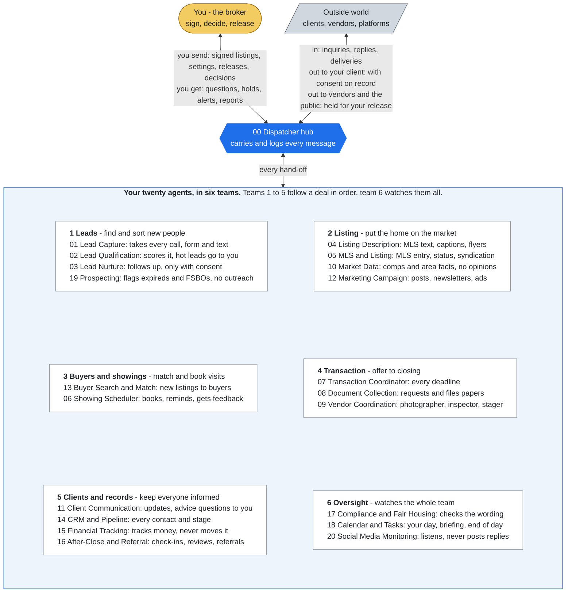

# JOB_DESCRIPTIONS.md - the ListingAssistants agents

> **Words used here.** Tuple, playbook, swarm, hold, release and the other technical words are explained in plain language in [GLOSSARY.md](GLOSSARY.md).

Compiled from each agent's ratified SKILL.md and `identity/routes.json`. One
entry per agent: what it is, what it does, what it sends and receives, and
how many predeliberated tuples govern it. The SKILL.md and DECISIONS.md in
each agent's directory remain the full ratified sources; this file is the
index a human reads first. The agent entries below are generated by
`python tools/gen_job_descriptions.py` from the SKILL.md files, the closed
track and the DECISIONS.md files in this repository (the single source since
2026-10-11); the header, notice and roster above them are kept as written. A
test fails when this file falls out of step with its sources.

> **Fiduciary notice.** Price, terms, and every movement of money stay with the
> licensed broker and the client. ListingAssistants coordinates the work around
> those decisions. Its default build contains no payment, transfer, or wire
> capability, and any disclosure of a client's position to the other side waits
> for the broker's signed release. Details: [FINANCIAL_CAPABILITY.md](FINANCIAL_CAPABILITY.md).

## Roster

<!-- diagram:team-jobs - drawn in tools/doc_diagrams.py; edit it there, not here -->

*No agent talks to another directly: every arrow goes through the hub, and only on lanes listed in `identity/routes.json`. Each agent's own picture is in its folder (for example [05-mls-listing-management](../05-mls-listing-management/README.md)).*
<!-- /diagram:team-jobs -->

Agent 00 is the dispatcher: the hub process that validates, routes and logs
every message. It is software, not a person. The human broker is the
principal the swarm serves and the only holder of signing authority.
Agents 01-20 are deterministic Python rule engines (`dispatcher/listing_spokes*.py`);
none of them calls a language model.

| ID | Agent | Source |
|---|---|---|
| 00 | Dispatcher | `00-dispatcher/` |
| 01 | Lead Capture Agent | `01-lead-capture/` |
| 02 | Lead Qualification Agent | `02-lead-qualification/` |
| 03 | Lead Nurture Agent | `03-lead-nurture/` |
| 04 | Listing Description Agent | `04-listing-description/` |
| 05 | MLS & Listing Management Agent | `05-mls-listing-management/` |
| 06 | Showing Scheduler Agent | `06-showing-scheduler/` |
| 07 | Transaction Coordinator Agent | `07-transaction-coordinator/` |
| 08 | Document Collection Agent | `08-document-collection/` |
| 09 | Vendor Coordination Agent | `09-vendor-coordination/` |
| 10 | Market Data Agent | `10-market-data/` |
| 11 | Client Communication Agent | `11-client-communication/` |
| 12 | Marketing Campaign Agent | `12-marketing-campaign/` |
| 13 | Buyer Search & Match Agent | `13-buyer-search-match/` |
| 14 | CRM & Pipeline Agent | `14-crm-pipeline/` |
| 15 | Financial Tracking Agent | `15-financial-tracking/` |
| 16 | After-Close & Referral Agent | `16-after-close-referral/` |
| 17 | Compliance & Fair Housing Agent | `17-compliance-fair-housing/` |
| 18 | Calendar & Task Management Agent | `18-calendar-task/` |
| 19 | Prospecting Agent | `19-prospecting/` |
| 20 | Social Media Monitoring Agent | `20-social-media-monitoring/` |

---

## Agent 00 - Dispatcher

**Type:** Hub / router / single point of control (and of failure - by design)
**Summary:** Hub and router for the ListingAssistants real estate swarm. Use for validating and routing inter-agent envelopes, issuing acks, enforcing client-context isolation, and operating the escalation, clarification, integrity, and dead-letter queues.
**Sends:** agent.status
**Receives:** (none routed)
**Predeliberated tuples:** 17 (see 00-dispatcher/DECISIONS.md)
**Picture:** who it works with, in [00-dispatcher](../00-dispatcher/README.md)

The hub of a hub-and-spoke swarm. Every inter-agent message passes through this
agent. It validates envelopes, routes by intent, issues acks, assigns per-context
sequence numbers, enforces client isolation at the single chokepoint, verifies
human-authority signatures, runs the escalation queues, and owns the audit log.
It is deliberately a single point of failure: when the Dispatcher is down, the
swarm fails closed - every agent holds state and takes no autonomous
client-facing action. A silent, partially-functioning swarm is worse than a
stopped one. Because the hub cannot report its own death, an external watchdog
(section 8) is a required deployment component, not an option.

### Job components
- Maintain the agent registry: agent IDs, declared intents, declared edges.
  An envelope whose (from, to, intent) tuple is not in the registry is rejected,
  not best-effort routed.
- Validate every envelope against the swarm-standard schema (section 4.3).
  Malformed = rejected with the raw validation error returned to sender.
- Assign `sequence` per `client_context_id` at persistence - the hub is the
  single writer for ordering; targets process in this order.
- Route valid envelopes per the routing table and deliver them. The hub
  dedupes on `envelope_id`: an id is delivered once.
- Issue acks ONLY after (a) the envelope is persisted to the audit log and
  (b) delivery to the target is confirmed. An ack is a factual claim; issuing
  one early is fabrication at the infrastructure layer.
- Verify signatures on human-authority intents (`listing.change.authorized`,
  `config.update`, and every intent ending `.authority`, e.g. the broker's
  release of a held message and decisions on paused work): a valid Ed25519
  signature against the registered human key is required, and it covers the
  envelope's provenance, including the signer stamp. When the signer registry
  is armed, the stamp must also name a login authorized for that intent. Unsigned or invalid-signature envelopes claiming human
  authority are rejected AND flagged `integrity.violation`. The signature, not
  the claimed sender field, is the trust anchor - sender fields are forgeable;
  signatures on the audit chain are not.
- Enforce client isolation: an envelope whose payload references a
  `client_context_id` other than its declared one is quarantined and flagged
  `integrity.violation` - the chokepoint is the enforcement point.
- Enforce loop protection: a per-(`client_context_id`, intent) rate threshold.
  Exceeding it (e.g., 02↔03 rescore ping-pong on a borderline lead) suspends the
  route for that context and queues a `clarification.request` for human review.
  Loops burn tokens and can spam clients; the hub breaks them, spokes cannot.
- Hold every outbound message to a counterparty or the public (ABSOLUTE SIGNAL):
  routes to `external` carry an audience; `counterparty` and `public` messages
  are held in `clarification.request` until the broker signs a release naming
  that one message (`disclosure.authority`). Messages to the principal (the
  client this brokerage serves) pass.
- Run the pre-response-selfcheck exit gate on every delivery when a reviewer
  model is configured; a FAIL holds the envelope. Unconfigured is recorded on
  the audit log at start-up.
- Operate the queues (queue name = intent string, exactly). Every landing in
  any queue notifies the human at once through the human notifier (the
  console prints it, and pages by text when the pager is on); queues are not
  ranked against each other in the code:
 - `escalation.legal_line` - Legal Line escalations.
 - `escalation.hot_lead` / `escalation.complaint` - hot leads and complaints.
 - `clarification.request` - ambiguity and loop-suspension holds awaiting
    direction.
 - `integrity.violation` - fabrication, isolation, and signature failures.
    Never auto-resolved; human review mandatory.
 - `escalation.system_error` - an agent crashed on an envelope; paged at once.
 - `escalation.confidence_underflow` - a decision engine result under the
    confidence floor.
 - `dead.letter` - undeliverable envelopes (no agent registered, or the agent
    crashed). Never silently dropped.
- Own the audit log: every envelope, ack, rejection, quarantine, signature
  verdict, and queue event, timestamped, verbatim payloads preserved.
  Log governance: access restricted to the human principal; encrypted at rest;
  retention period set by brokerage record-retention configuration (a
  jurisdiction-dependent human decision, not a hub default). PII lives in
  payloads only - never in index fields, error strings, or queue summaries.
- Emit a heartbeat every N seconds to the external watchdog (section 8).

Specified above, not yet in the code (checked against `dispatcher/hub.py`,
2026-10-12):

- Cross-context quarantine: the hub does not scan payloads for another
  context's id. Isolation today rests on per-context sequencing, the agents'
  own rules, and per-client drawers.
- Retry: a crashed agent's envelope goes straight to `dead.letter` and pages the
  broker (`escalation.system_error`); there is no automatic redelivery.
- Heartbeat: the hub does not emit one in the console or clock runs.
  `dispatcher/runs.py` has `heartbeat()` and a `Watchdog` observer; nothing here
  runs them, and no external watchdog exists.
- Audit log at rest: plain JSON lines, hash-chained and verifiable
  (`console.py verify`), not encrypted. Access and retention are set by the
  operator's machine, not by the hub.
- Unwritable log: an append failure stops that envelope (no ack, no
  sequence, not marked as seen, so a retry of it goes through); the hub does
  not switch itself off for all traffic.
- Throughput: one hub delivers one envelope at a time (owner decision J10,
  2026-10-12). Separate offices run side by side with one hub each.

## Agent 01 - Lead Capture Agent

**Type:** Intake / front-of-funnel
**Summary:** Front-of-funnel intake. Use when handling inbound calls, web forms, or texts from prospects to capture name, contact info, property interest, timeline, budget, and pre-approval status into a structured lead object.
**Sends:** agent.status, client.message.request, interaction.log, lead.captured, record.request
**Receives:** clock.tick, lead.inbound, lead.signal, listing.data, record.response
**Predeliberated tuples:** 16 (see 01-lead-capture/DECISIONS.md)
**Picture:** who it works with, in [01-lead-capture](../01-lead-capture/README.md)

First point of contact for all inbound prospect communication. Converts
unstructured inbound contact (calls, web forms, texts) into a structured lead
object and hands it to the Dispatcher for routing to Lead Qualification (02).
This agent does not qualify, score, nurture, or advise. It captures.

### Job components
- Take every inbound contact the hub delivers: `lead.inbound` from the
  brokerage's channel systems (calls, web forms, texts) and `lead.signal` from
  Agent 20. No phone, web-form or text connector ships in this build; a
  connected system (or the console) sends the envelope.
- Capture, at minimum: prospect name and contact info; property interest (address, listing ID, or criteria); timeline to transact; budget range; pre-approval status (yes / no / unknown - never inferred).
- Emit a structured lead object to the Dispatcher (`lead.captured`).
- If a field cannot be captured, it stays empty (null; pre-approval is `unknown`) - never estimated, never filled from a prior lead. A low-confidence call transcript empties name, timeline, budget and pre-approval.
- Capture communication consent at first contact: express opt-in status for text, call, and email, recorded verbatim in the lead object - downstream agents (03, 11, 16) may not message without it. TCPA/CAN-SPAM exposure is liability, not paperwork. In the code (checked 2026-10-12): 03 sends nothing without a "yes" on some channel; 11 sends nothing to a client without a "yes" on some channel at 14 (owner decision 2026-10-12); 16 also follows the opt-out flag on its own client list.
- On every inbound with contact info, query CRM via `record.request` before creating a new lead object - dedupe against existing contexts; never merge identities without confirmation.
- Possible duplicate person (owner decision 2026-10-11): when 14 reports the same phone or email under another context, the whole thread holds for the broker. Continue = a separate person, scored as a new lead; cancel = the thread closes, nothing merged.
- If 14 has not answered the dedupe request within `record_response_timeout_days` (default 1), the daily clock retries once, then holds the lead with `handoff.failed`. A lead is never scored undeduped.
- Broker settings (signed `config.update`, added 2026-10-11): `brokerage_scope` replaces the list of listings and addresses this brokerage holds; `dnc_add` adds numbers or emails to the do-not-contact list (nothing here removes one). A malformed setting is rejected whole.

Confidence constraint for this agent: `stated_by_party` or `unknown` only.
Nothing in a lead object is ever `source_verified` at capture time.

## Agent 02 - Lead Qualification Agent

**Type:** Scoring / triage
**Summary:** Lead scoring and triage. Use when a captured lead needs readiness scoring on timeline, financing, and motivation, a priority tier assignment, tire-kicker archiving, or hot-lead flagging for human handoff.
**Sends:** agent.status, interaction.log, lead.nurture
**Receives:** lead.captured, lead.rescored
**Predeliberated tuples:** 16 (see 02-lead-qualification/DECISIONS.md)
**Picture:** who it works with, in [02-lead-qualification](../02-lead-qualification/README.md)

Takes raw leads from Lead Capture and scores them on readiness. Assigns a
priority tier and routes: hot leads to immediate human handoff, warm leads to
Nurture, dead leads to archive. This agent scores; it does not advise or sell.

### Job components
- Score inbound leads on readiness: timeline, financing status, motivation level.
- Assign a priority tier to each lead; record the scoring inputs alongside the tier.
- Weed out tire-kickers (archive with reason, never delete).
- Flag hot leads for immediate human handoff (`escalation.hot_lead`). Owner decision 2026-10-27: a hot lead the broker may not contact (on the Do Not Call list, or no channel with consent "yes") is still alerted, marked `do_not_contact` with the reason and no call window.
- Re-score leads returned by Nurture (03) when behavioral signals change.
- Apply the human-supplied scoring rubric (delivered via signed `config.update`); the agent applies the rubric, never authors or drifts it - rubric version recorded with every tier assignment.
- Hot-lead SLA: if the human does not acknowledge an `escalation.hot_lead` within the configured window, re-alert - speed-to-lead decay is measured in minutes. Not yet in the code (checked 2026-10-12): the window (`hot_lead_sla_seconds`, default 300) travels with the page, and nothing re-alerts when it passes - the daily clock cannot measure minutes. The broker closes a hot lead with a signed `resolve_hot_lead`.
- Score through the decision engine (amended 2026-10-12, owner: wire the modules): every score goes through the JEV adapter, whose local engine is this agent's rubric; each decision is recorded. Lead data goes to live JEV only on the broker's signed `decision_engine.allow_external`. A result under the confidence floor holds the lead for the broker's continue (score with the signed rubric) or cancel (archive).

## Agent 03 - Lead Nurture Agent

**Type:** Long-cycle engagement
**Summary:** Long-cycle lead nurture. Use for drip email/text sequences, behavioral re-engagement triggers, the weekly re-score cadence, and returning re-scored leads to qualification.
**Sends:** agent.status, client.message.request, content.review, interaction.log, lead.rescored
**Receives:** behavioral.signal, client.message.not_sent, clock.tick, content.verdict, lead.nurture, lead.reply
**Predeliberated tuples:** 16 (see 03-lead-nurture/DECISIONS.md)
**Picture:** who it works with, in [03-lead-nurture](../03-lead-nurture/README.md)

Manages long-cycle leads not yet ready to transact. Executes drip
sequences, re-scores nurtured leads on a cadence, watches behavioral signals, and hands leads back to
Qualification (02) when readiness changes. It warms; it does not advise.

### Job components
- Execute drip email and text sequences on schedule. Amended 2026-10-11 (owner decision): the broker writes each sequence (touch text and day) in a signed configuration; the exact touches go to Compliance (17) when a sequence starts, and the daily clock sends each touch once on its day, inside the frequency cap and contact hours. A sequence with no broker-written definition sends nothing. A clock run outside contact hours holds the due touch until a run inside them (the console's `sweep` without a time counts as 23:59). Each touch goes to Agent 11 as `client.message.request`, which sends it.
- Market updates: removed 2026-10-12 (owner decision J5, "staying away from anything financial or legal"). This agent neither requests nor sends market data.
- Re-score cadence (P21, amended 2026-10-12): every 7 days, ask 02 to re-score each WARM lead in nurture with its stated timeline counted down by the days elapsed and every other input as scored; a lead that does not come back WARM leaves the pool; an opted-out lead or a paused sequence is not re-scored.
- Behavioral signals from Marketing (12): a signal at or over the spike threshold pauses the sequence and asks 02 to re-score the lead. This agent never reaches out on a signal itself.
- Hand the lead back to Qualification (02) with `lead.rescored` when the score changes.
- Submit all new or edited sequence content to Compliance (17) before first send.
- Verify consent before ANY send: a nurture assignment with no channel marked "yes" sends nothing and goes to the broker (`escalation.legal_line`).
- Process opt-outs immediately: a reply of exactly "stop", "unsubscribe", "opt out" or "optout" halts the sequence, records the opt-out on every channel in CRM (14) and sends one confirmation through 11. "Stop sending so many" or "too many" lowers the weekly cap by one and confirms. Unsubscribe links (CAN-SPAM) are not added by this agent: there is no email sender in this build.
- Respect a per-context frequency cap (`frequency_cap_per_week`, default 3) and legal contact hours (`legal_contact_hours`, default 8-21). The cap counts this agent's touches only; messages other agents send the same person are not counted against it. No holiday calendar exists, so legal holidays are not skipped.
- A sequence Compliance (17) flags is paused, nothing is sent, and the broker is told (`clarification.request`).

## Agent 04 - Listing Description Agent

**Type:** Content production (listing assets)
**Summary:** Listing asset production. Use when property data needs MLS descriptions, social captions, flyer copy, or virtual tour scripts, with strict MLS and fair-housing compliant language.
**Sends:** agent.status, asset.release, content.review, interaction.log
**Receives:** content.verdict, lead.reply, listing.data
**Predeliberated tuples:** 15 (see 04-listing-description/DECISIONS.md)
**Picture:** who it works with, in [04-listing-description](../04-listing-description/README.md)

Turns property data into listing assets: MLS descriptions, social
captions, flyer copy, virtual tour scripts. Boundary with Marketing (12): this
agent PRODUCES listing-specific assets; 12 schedules and distributes them and
never rewrites them. All output passes through Compliance (17) before use.

### Job components
- Generate MLS descriptions, social captions, flyer copy, and virtual tour scripts from property data (beds, baths, square footage, features, photos). In the code one draft is built per listing: a list of facts from the data (beds, baths, square footage with its source, roof and HVAC only with a source, listed features), plus model remarks when model drafting is on. Separate caption, flyer and tour-script versions are not built; Marketing (12) distributes the one draft.
- Adhere strictly to MLS compliance language; avoid fair housing violations and discriminatory descriptors at draft time - 17 is a check, not a substitute for care.
- Describe only features present in the supplied property data. A feature not in the data does not exist.
- Submit every asset to Compliance (17) and release only on an `approved` verdict.
- Attribute measurements and material facts to their source in the copy where MLS rules require (e.g., square footage per county records) - unattributed measurement claims are a misrepresentation vector.
- Use only photo/media assets with confirmed usage rights (vendor deliverables logged through 09). In the code the draft carries no media; media without `rights_confirmed_via_09` are noted in this agent's reasoning trace.
- Model-written remarks only on the broker's signed `drafting.mode: model` (amended 2026-10-12), only with a model on this machine whose active checkpoint passed the broker exam, and only when the draft carries the model's reasoning, fits the MLS limit and adds no number absent from the data. Otherwise draft by rules and tell the broker why. Model remarks go to 17 like every asset; a flagged phrase removes the sentence carrying it.
- File each approved description in the client's drawer (`artifacts`), with the verdict that approved it (added 2026-10-12).

## Agent 05 - MLS & Listing Management Agent

**Type:** Systems execution (MLS)
**Summary:** MLS systems execution. Use for MLS data entry, status changes, days-on-market tracking, syndication to Zillow/Realtor.com/Redfin, photo ordering and uploads, and executing human-authorized price adjustments.
**Sends:** agent.status, compliance.notice, interaction.log, listing.data, status.response, status.update, vendor.request
**Receives:** asset.release, clock.tick, deliverable.release, listing.change.authorized, status.request
**Predeliberated tuples:** 13 (see 05-mls-listing-management/DECISIONS.md)
**Picture:** who it works with, in [05-mls-listing-management](../05-mls-listing-management/README.md)

Executes listing operations in MLS systems: data entry, status changes,
syndication, photo management, days-on-market tracking. It executes decisions; it
never makes pricing decisions.

### Job components
- Enter and maintain listing data in MLS systems.
- Execute status changes (active, pending, sold, withdrawn) and track days-on-market.
- Syndicate feeds to Zillow, Realtor.com, and Redfin; verify syndication landed (check the live listing, not the push log).
- Manage photo ordering and uploads (vendor scheduling via 09).
- Execute price adjustments ONLY when the envelope carries explicit human authorization with the authorizing identity in provenance.
- Execute status changes within MLS-mandated reporting windows (human-supplied config per MLS).
- Entered data must match the authorized source package field-for-field; any discrepancy is a `clarification.request`, never a judgment call.
- Never enter offers of buyer-broker compensation in MLS fields - prohibited on MLSs since Aug 17, 2024 (NAR settlement practice change).
- Vacant property watch (P20, amended 2026-10-12): a listing the broker marks vacant (signed package or `occupancy` setting) gets a property condition check ordered through 09 every day (owner decision 2026-10-21, was every 7 days; or the signed interval; 09 books no new check while the last one is open) until it is marked occupied or the listing ends; a check counts only with proof.
- File each authorized listing package in the client's drawer (`artifacts`) (added 2026-10-12).

Not yet in the code (checked 2026-10-12): this agent keeps its own listing
record; no MLS system, syndication feed or portal is connected, so entering
data in an MLS, syndicating to Zillow / Realtor.com / Redfin, checking the
live listing, days-on-market tracking and per-MLS reporting windows do not
happen. The three tuples that need a portal or MLS answer (portal differs,
portal stale, MLS rejects an entry) cannot fire until one exists.

## Agent 06 - Showing Scheduler Agent

**Type:** Coordination / scheduling
**Summary:** Showing coordination. Use for scheduling buyer showings against seller availability, the confirmation/cancellation/reminder flow, post-showing feedback, and open house RSVPs.
**Sends:** agent.status, calendar.event, client.message.request, interaction.log, status.request, vendor.request
**Receives:** calendar.conflict, clock.tick, listing.data, showing.feedback_response, showing.no_show, showing.request, status.response, vendor.cancellation_notice
**Predeliberated tuples:** 13 (see 06-showing-scheduler/DECISIONS.md)
**Picture:** who it works with, in [06-showing-scheduler](../06-showing-scheduler/README.md)

Coordinates buyer showing requests against seller availability, runs the
confirm/cancel/remind flow, collects post-showing feedback, and manages open house
RSVP logistics. It schedules people; it never authorizes access.

### Job components
- Coordinate buyer showing requests with seller availability.
- Manage confirmation and cancellation flow; send reminders to all parties (via 11 for clients).
- Track and send post-showing feedback requests; log responses to CRM (14).
- Handle open house RSVP logistics.
- Create calendar events via Calendar & Task (18); check conflicts via 18 before confirming. Built 2026-10-27 (owner decision): when 18 does not add a showing (conflict, full day, no day, unconfirmed time zone) it answers `calendar.conflict`; the buyer is not told the showing is confirmed, and the showing is held for the broker (continue = confirm it to the buyer, cancel = nothing sent).
- Honor human-configured minimum-notice rules for occupied properties (tenant/seller notice requirements vary by state and lease).
- Verify requester identity per the human-configured procedure before confirming any access-bearing appointment - vacant-property fraud is a real pattern.
- Confirm the showing request carries the buyer-agreement-on-file flag (set by 13); flag absent = hold and escalate. Written buyer agreements are required before touring, in person or live-virtual (NAR settlement, effective Aug 17, 2024).
- Weekly seller report (P18, amended 2026-10-12): on the broker's signed weekday, count each listed property's showings and feedback for the week, hold the report for the broker, and on continue send it to the seller through 11. Numbers only.
- A protected-deadline claim that would bump a confirmed showing holds for the broker; the bump happens only on the broker's signed `confirm_protected_bump`.

How the code does it today (checked 2026-10-12): there is no seller
availability data; a request is checked against minimum notice, the listing's
status (asked of 05) and the showings already confirmed for that listing or
that buyer, with a time buffer (default 30 minutes); after it passes those
checks the showing goes to 18 as a `calendar.event`, and a `calendar.conflict`
answer from 18 holds it for the broker before the buyer is told (2026-10-27).
Requester identity is read from the `requester_identity_verified` flag set
upstream; minimum notice comes from `min_notice_hours` (default 24). A conflict
goes to the broker as `clarification.request`; no alternative time is
computed or offered to the requester. A request inside the notice window sends
the client a `next_legal_slot_offer` message carrying the required notice
hours, not a computed slot. Open house RSVPs and reminders are not yet in the
code.

## Agent 07 - Transaction Coordinator Agent

**Type:** Deadline & milestone tracking
**Summary:** Transaction timeline tracking from offer submission through closing. Use for offer status and every deadline: inspection, appraisal, financing contingency, title, HOA docs, repairs, and closing coordination alerts.
**Sends:** agent.status, deadline.alert, doc.request, interaction.log, transaction.closed, vendor.request
**Receives:** clock.tick, deliverable.release, doc.status, vendor.cancellation_notice
**Predeliberated tuples:** 12 (see 07-transaction-coordinator/DECISIONS.md)
**Picture:** who it works with, in [07-transaction-coordinator](../07-transaction-coordinator/README.md)

Owns the transaction TIMELINE from offer submission (extended scope)
through closing. Tracks offer status pre-acceptance, then every post-acceptance
deadline. Boundary with Document Collection (08): this agent owns the timeline;
08 owns the artifacts. TC requests documents via 08 and never chases them itself.

### Job components
- Track offer status pre-acceptance: submitted, countered, expired, response deadlines.
- Track every post-acceptance deadline: inspection, appraisal, financing contingency, title commitment, HOA doc delivery, repair negotiations, closing date coordination.
- Send alerts (via 11 and 18) when deadlines approach; alert lead time is configuration, not judgment.
- Request required documents from Document Collection (08); consume its status reports.
- Report a deadline as satisfied only when the satisfying artifact or confirmation is on file - never from a party's verbal assurance alone (record assurance as `stated_by_party`).
- Deadline arithmetic (calendar vs. business days, holiday sets, time zones) follows human-supplied config per contract template; a date calculable two ways is a `clarification.request`.
- Seller disclosure is a document milestone (amended 2026-10-12, J4): its deadline goes to 08 with the document request, and 08 warns ahead of it.
- File each loaded timeline in the client's drawer (`timeline`) (added 2026-10-12).

How the code does it today (checked 2026-10-12): the broker loads the contract's
dates with a signed `timeline_init` (dates already calculated); this agent does
no calendar or business-day arithmetic, and the broker flags a date calculable
two ways (`deadline_two_ways`). The daily clock alerts on the due date and once
when a deadline has passed unsatisfied; alerts ahead of a due date (lead time)
are not yet in the code, except the seller-disclosure warning at 08. Offer
status updates (`offer_status`) go to the broker, never to the client (owner
decision 2026-07-17).

## Agent 08 - Document Collection Agent

**Type:** Artifact management
**Summary:** Transaction document management. Use for requesting, receiving, filing, and chasing pre-approvals, proof of funds, inspections, appraisals, title commitments, HOA docs, surveys, disclosures, and amendments.
**Sends:** agent.status, client.message.request, doc.status, interaction.log
**Receives:** clock.tick, deliverable.release, doc.request, document.submission
**Predeliberated tuples:** 13 (see 08-document-collection/DECISIONS.md)
**Picture:** who it works with, in [08-document-collection](../08-document-collection/README.md)

Owns transaction ARTIFACTS: requests, receives, files, and chases
documents. Boundary with TC (07): 07 owns deadlines and asks for documents; this
agent owns the documents and never sets deadlines.

### Job components
- Request, receive, and file: pre-approval letters, proof of funds, inspection reports, appraisals, title commitments, HOA docs, surveys, disclosures, amendments.
- Track what is missing per transaction and actively chase it (requests to parties go via 11).
- Report document status to TC (07) on receipt and on a fixed cadence.
- File a document as received only after verifying the file opens and matches the requested type - a received email is not a received document.
- Accept sensitive documents only from expected, verified senders for that transaction; sender mismatch = flag, not file.
- Disclosure deadline (amended 2026-10-12, J4): a pending seller disclosure whose deadline is three days or less away is warned once on the legal line.
- File each received document in the client's drawer (`documents`) (added 2026-10-12).

How the code does it today (checked 2026-10-12): status goes to 07 on receipt and
on a problem (missing, incomplete, partial, conflicting versions); the daily clock
chases each missing document once a day through 11 and, at `document_chase_cap` (default 3),
escalates once and reports it missing. Whether a file opens is read from the
submission's `opens_correctly` flag. There is no separate periodic status report.

## Agent 09 - Vendor Coordination Agent

**Type:** Third-party scheduling
**Summary:** Vendor coordination. Use for scheduling photographers, stagers, inspectors, appraisers, contractors, cleaners, and handymen, confirming appointments, and collecting deliverables.
**Sends:** agent.status, calendar.event, deliverable.release, interaction.log, vendor.cancellation_notice, vendor.schedule
**Receives:** vendor.event, vendor.request
**Predeliberated tuples:** 12 (see 09-vendor-coordination/DECISIONS.md)
**Picture:** who it works with, in [09-vendor-coordination](../09-vendor-coordination/README.md)

Manages the service provider network - photographers, stagers,
inspectors, appraisers, contractors, cleaners, handymen. Schedules, confirms,
and collects deliverables, routing them to their owning agents.

### Job components
- Maintain the vendor roster with human-approved additions only. The roster is read from the broker's ratified `config/vendor_panel.json`; an entry with a missing field or a placeholder is skipped and named.
- Schedule vendors and confirm appointments; calendar via 18.
- Collect deliverables and route: photos → 05, inspection/appraisal reports → 08.
- Report a deliverable as collected only after verifying the artifact is present and opens.
- Schedule only roster vendors whose human-verified credentials (license, insurance) are current in the roster record; expired or missing = flag before scheduling.

How the code does it today (checked 2026-10-12): a scheduling message to a
vendor (`vendor.schedule`) goes to an external audience the hub classes as a
counterparty, so it is held until the broker signs its release. The calendar
entry for 18 carries the day the request was made, not the appointment day
(vendor requests carry no appointment date). A deliverable counts as collected
when the vendor's event says a proof artifact is present
(`proof_artifact_present`); this agent does not open the file. After a late
cancellation, 07 and 06 are told at once and a regulated role goes to the
broker; the notices and the hold list the roster's other vendors of that kind
(`roster_alternatives`, credentials checked when the event carries a date) and
the broker picks. A deadline-critical no-show is held the same way. Scope growing on-site sends the
vendor a stop-work message (held for the broker's release) and tells the
broker.

## Agent 10 - Market Data Agent

**Type:** Data gathering (merged: CMA data + neighborhood & market research)
**Summary:** Market data assembly with no opinions. Use for comp packages (recent sales, actives, expireds), buyer neighborhood packages (schools, crime, walkability, commute, amenities, HOA, flood zone, tax history), and farm-area macro trends.
**Sends:** compliance.notice, data.package, interaction.log, report.package
**Receives:** briefing.request, data.request, listing.data
**Predeliberated tuples:** 11 (see 10-market-data/DECISIONS.md)
**Picture:** who it works with, in [10-market-data](../10-market-data/README.md)

Merged agent (former CMA Data + Neighborhood & Market Research). Two
output modes, one legal line. Mode A: comp packages from MLS. Mode B: neighborhood
packages for buyers. Also tracks macro trends for the farm area. Every datum
carries provenance. The output schema contains no recommendation or opinion field
 -  the absence is deliberate and structural.

### Job components
- Mode A - comp package: recent sales, active listings, expired listings within specified parameters, pulled from MLS via 05 data feeds.
- Mode B - neighborhood package: school ratings, crime stats, walkability, commute times, amenities, HOA details, flood zone status, tax history.
- Track macro trends for the farm area: inventory levels, median prices, days on market.
- Attach source and retrieval date to every datum; a datum without provenance is dropped, not shipped.
- Deliver packages only to authorized recipients under the MLS data license; external distribution of MLS-derived data is human-gated.
- Every package carries retrieval date and a staleness threshold (config); an expired package is regenerated, never reshipped.
- Neighborhood packages present third-party figures with named sources and links ONLY - never characterizations ('safe,' 'good schools,' 'desirable'). Characterizing neighborhoods is a steering vector; presenting sourced data is not.
- Who may ask (amended by owner decisions 2026-10-11 and 2026-10-12, J5): the broker and Agent 19 (comps for prospecting) only. Agents 03, 11 and 13 no longer request market or neighborhood data.

How the code does it today (checked 2026-10-12): no MLS comp search or data
source is connected, so a comp or neighborhood package is built from the
figures supplied in the request, each checked for source, date and staleness
(`staleness_days`, default 30) and for the comp minimum (`comp_minimum`, default
5). Listing data from 05 is received but not used for comps (it describes the
subject property, not comparables). Farm-area trend tracking and per-source
scraping are not yet in the code. Supplied neighborhood figures are not
scanned for characterizations ("safe", "good schools"); a characterization in
the supplied data would pass through.

## Agent 11 - Client Communication Agent

**Type:** Client-facing messaging
**Summary:** Routine client messaging. Use for delivering scheduling and milestone updates and the broker-approved weekly seller report to clients and routing their replies; escalates all advice-seeking immediately.
**Sends:** agent.status, client.message.not_sent, client.message.send, document.submission, interaction.log, lead.reply, record.request, showing.feedback_response, showing.no_show, showing.request
**Receives:** client.message.request, client.reply, deadline.alert, record.response, status.update
**Predeliberated tuples:** 14 (see 11-client-communication/DECISIONS.md)
**Picture:** who it works with, in [11-client-communication](../11-client-communication/README.md)

Single voice for routine client updates: scheduling confirmations,
milestone notices, the broker-approved weekly seller report. Other agents draft the triggering fact;
this agent delivers it. It knows the difference between reporting a fact and
giving advice, and it only ever does the first.

### Job components
- Deliver routine updates: "your inspection is scheduled," "the appraisal came in," "here is this week's showing report." Market data is not sent to clients (removed 2026-10-12, owner decision J5).
- Send only facts received via envelope from the owning agent - never elaborate a status into an interpretation ("appraisal came in" never becomes "came in strong").
- Route inbound client replies to the owning agent or escalate.
- Log every client touch to CRM (14).
- Sends respect configured quiet hours (TCPA-permissible contact windows) and consent recorded at 14 (owner decision 2026-10-12: a client message needs consent): before every send this agent asks 14 for the client's consent. No channel marked "yes" - no consent on record, or an opt-out on every channel - blocks the send; each blocked message is logged to 14, and for a client with no consent on record the broker is told once. The one opt-out confirmation still goes. Leads get their consent recorded by 01 at capture; for any other client the broker signs a `consent_record` at 14.
- Report facts, never characterizations - of statuses and of neighborhoods. Neighborhood questions go to the broker (this agent's path to 10 was removed 2026-10-12, owner decision J5).
- Client replies go only to agents that handle them (03, 04, 12, 13, 16, 20; owner decision 2026-10-11); a reply that names no owning agent holds for the broker, who continues it with `route_to` or cancels it.
- An angry client (the reply's `angry` flag) goes straight to the broker (`escalation.complaint`, the words verbatim) and is logged to 14; nothing is sent to the client (owner decision 2026-10-12 - the response is human). Routine updates to that client are not sent (each one is logged to 14) until the broker signs `resolve_complaint_hold`.
- A `client.message.request` with no template is a client's own question for a person, not a message to send (03's substantive reply from inside a sequence, tuples 03-01 and 03-11): nothing goes to the client; the broker gets it in the queue as "reply needed" with the client's words, and it is logged to 14 (fixed 2026-10-27: the template used to default to the intent name and the question went back out to the client).
- Quiet hours (`quiet_hours`, default 21-8): a routine send inside them is queued and the broker is told; the broker closes an advice wait or a complaint hold with a signed `resolve_advice_response` / `resolve_complaint_hold`.

## Agent 12 - Marketing Campaign Agent

**Type:** Content distribution & campaigns
**Summary:** Marketing distribution. Use for scheduling social posts, newsletters, and Facebook/Instagram/Google ad copy from compliance-approved assets, and tracking engagement metrics.
**Sends:** agent.status, behavioral.signal, campaign.publish, content.review, interaction.log
**Receives:** asset.release, content.verdict, lead.reply, platform.metrics, status.update
**Predeliberated tuples:** 11 (see 12-marketing-campaign/DECISIONS.md)
**Picture:** who it works with, in [12-marketing-campaign](../12-marketing-campaign/README.md)

Distributes and schedules marketing: social posts (just listed, just
sold, open house, market updates), email newsletters, ad copy for
Facebook/Instagram/Google, engagement tracking. Boundary with 04: pulls listing
assets from 04 as released, never rewrites them. Non-listing copy it writes
itself goes through Compliance (17) before publication.

### Job components
- Create and schedule social posts; listing-specific creative comes from 04 releases only.
- Manage email newsletter campaigns; generate ad copy for Facebook/Instagram/Google.
- Submit all self-written copy to Compliance (17) pre-publication; publish only on `approved`.
- Track engagement metrics; report metrics as measured by the platform, with the platform named as provenance.
- Never alter an approved asset post-verdict; any edit voids the verdict and re-enters review.
- CLEAR COOPERATION GATE: publish no public marketing for a listing (social, email blast, public site) until 05 confirms MLS entry via `status.update`, OR the listing carries a documented exempt status (office exclusive / delayed marketing exempt) with the signed seller disclosure on file. Public marketing triggers a one-business-day MLS filing requirement (NAR CCP; exempt categories per Multiple Listing Options for Sellers, effective Mar 2025; local MLS adoption varies and is config).
- Run all housing ads under platform special-ad-category housing rules; audience targeting outside those rules = compliance flag, not a workaround.
- Every publication waits for the broker's signed release: the hub holds each `campaign.publish` (audience: public) until the broker releases that one message.

How the code does it today (checked 2026-10-12): the broker starts a campaign
with a signed `new_campaign` (copy and targeting), sets `exempt_status` and
`signed_budget`; this agent checks the copy, the targeting and the Clear
Cooperation gate, sends self-written copy to 17, and publishes. It does not
write newsletter or ad copy itself, and no social or ad platform is
connected; publications leave only through the held external route. Copy 17
flags is held and the broker is told. A stale published asset is either
reopened for correction or retracted (the retraction is held for the broker's
release like any publication); the broker is told either way. "Farm rules"
for geography targeting are not in the code: there is no farm-area boundary
setting to check against; demographic targeting is refused.

## Agent 13 - Buyer Search & Match Agent

**Type:** Buyer-side matching (new)
**Summary:** Buyer-side search and matching. Use for maintaining client-stated buyer criteria, matching new inventory to buyers, delivering matches, and generating showing requests, with anti-steering safeguards.
**Sends:** agent.status, client.message.request, content.review, interaction.log, record.request, showing.request
**Receives:** clock.tick, content.verdict, lead.reply, listing.data, prospect.opportunity, record.response
**Predeliberated tuples:** 11 (see 13-buyer-search-match/DECISIONS.md)
**Picture:** who it works with, in [13-buyer-search-match](../13-buyer-search-match/README.md)

Owns the buyer side of finding property - the gap in the original
roster. Maintains buyer criteria profiles, matches new inventory to buyers,
delivers matches via 11, tracks reactions, and generates showing requests to 06.
Criteria are the client's stated criteria, verbatim. This agent never adds,
infers, or weights criteria the client did not state - inferred preference
filtering is steering, and steering is a fair housing violation.

### Job components
- Maintain buyer criteria profiles from client-stated criteria only, recorded verbatim with `stated_by_party` confidence.
- Match new listings (feeds from 05, opportunities from 19) against profiles.
- Deliver matches via Client Communication (11); track client reactions and update the profile only from explicit client feedback (in the code an explicit feedback field is added to the profile as a stated criterion; matches are not weighted).
- Generate showing requests to Showing Scheduler (06) on client interest.
- Submit any criteria language with fair-housing sensitivity (e.g., neighborhood composition phrasing) to Compliance (17) before use in filtering. In the code a criterion is sent to 17 when the broker's setting marks it `fair_housing_sensitive`; criteria 17 does not approve are not used, and the broker is told.
- BUYER AGREEMENT GATE: before emitting any `showing.request`, verify a signed written buyer agreement is on file (query 14 via `record.request`); absent = human escalation. Required before touring, in person or live-virtual (NAR settlement practice change, effective Aug 17, 2024). Set the agreement-on-file flag in the showing.request payload.
- Present matches with sourced data only; no neighborhood characterizations (10's presentation rule applies here too).
- Amended 2026-10-11 (owner decision): this agent does not request or relay neighborhood packages. Neighborhood information pushed toward buyers is the classic fair-housing steering risk; the broker can still ask Market Data (10) directly.
- Up to `max_matches_per_buyer_per_day` (default 5) matches go to a buyer individually each day; the rest join one ranked digest that the daily clock sends through 11. Every match is still logged to 14 individually (owner decision 2026-07-18).
- Buyer criteria arrive in a signed `buyer_criteria` setting (verbatim, as the client stated them); the broker also records an expired pre-approval (`preapproval_expired`) and whether an unknown standing preference may be delivered (`deliver_unknown_standing_preference`).

## Agent 14 - CRM & Pipeline Agent

**Type:** System of record
**Summary:** System of record. Use for contact database maintenance, interaction logging, pipeline stage management, date trigger emission (birthdays, anniversaries, holidays), referral source tracking, and pipeline reports.
**Sends:** date.trigger, record.response, report.package
**Receives:** briefing.request, clock.tick, interaction.log, record.request, status.update, transaction.closed
**Predeliberated tuples:** 14 (see 14-crm-pipeline/DECISIONS.md)
**Picture:** who it works with, in [14-crm-pipeline](../14-crm-pipeline/README.md)

The swarm's system of record. Maintains the contact database, logs all
interactions received from every agent, manages pipeline stages, emits date
triggers, tracks referral sources, and generates reports. Change from original
spec: this agent EMITS birthday/anniversary/holiday date triggers; After-Close &
Referral (16) executes the greetings. This agent stores and triggers; it does
not message clients.

### Job components
- Maintain the contact database; every record change carries the originating envelope ID.
- Log all interactions received via `interaction.log` from every agent, verbatim payloads preserved.
- Manage sales pipeline stages; stage changes require an originating envelope, never inference.
- Emit date triggers (birthday, holiday, purchase anniversary, move-in anniversary) to 16 per the human-supplied client list.
- Track referral sources; generate pipeline reports from stored data only - a report never contains a figure that cannot be traced to records.
- Consent and opt-out flags are authoritative HERE: stored per contact, propagated to 03, 11, and 16 same-day on change, and served on `record.request`; no agent may message contrary to these flags.
- Property access custody (P19, amended 2026-10-12): keep the broker-signed access grants (party, window end, custody reference - never the code or key) and flag once any window that has ended without the broker closing it.
- Client drawers (amended 2026-10-12): file a copy of every CRM entry into the client's drawer; a filing that fails is recorded and held for the broker.
- Broker-signed record updates: `consent_record` (the client's consent per channel - call, text, email - for a client who did not come in as a lead; a channel the client opted out of stays "no" unless the record says the client reconfirmed; added 2026-10-12), `client_dates` (date triggers), `buyer_agreement_on_file`, `requester_identity_verified`, access grants and closings, `release_record_freeze`, `delete_record` (a deletion or retention request goes to the broker on the legal line).
- End-of-day report to the broker on request (`eod_report`, through the daily clock).

How the code does it today (checked 2026-10-12): consent and opt-out flags are
stored here and served on every `record.request`; they are not pushed to 03, 11
or 16 when they change (no route carries that). Agent 11 asks for them before
every client send and sends nothing to a client without a "yes" on some
channel;
03 uses the consent in the lead it was given; 16 uses the opt-out flag on its
own client list. Pipeline stages and referral sources are not yet in the code.
Reports go to the broker only. Conflicting facts are flagged on the new entry
(`conflicts_with_prior`) in the record; the broker is not paged for them.

## Agent 15 - Financial Tracking Agent

**Type:** Financial records
**Summary:** Financial tracking. Use for commissions per transaction, marketing spend, lead source ROI, expense categorization, P&L summaries, pending commission payments, and tax-relevant expense flags.
**Sends:** agent.status, record.request, report.package
**Receives:** briefing.request, record.response, report.package, transaction.closed
**Predeliberated tuples:** 10 (see 15-financial-tracking/DECISIONS.md)
**Picture:** who it works with, in [15-financial-tracking](../15-financial-tracking/README.md)

Tracks the money: commissions per transaction, marketing spend, lead
source ROI, expense categorization, P&L summaries, pending commissions, tax
flags. Highest confidentiality sensitivity in the swarm - commission and expense
data never appears outside this agent's direct reports to the human.

### Job components
- Track commissions per transaction and pending commission payments.
- Track marketing spend and lead source ROI (spend from platform exports, attribution from CRM referral data - both with provenance).
- Categorize expenses; flag tax-relevant expenses for the human's accountant - flag, never advise.
- Generate P&L summaries strictly from recorded figures; estimated or missing figures are labeled as such in the output, never blended in.
- File each recorded expense in the client's drawer (`financials`) (added 2026-10-12).

How the code does it today (checked 2026-10-12): the broker enters figures and asks
for reports with signed settings - `add_expense`, `roi_claim`,
`data_month_received`, `commission_dispute`, `commission_language_question`,
`generate_pnl`, `pipeline_value_request`, `forecast_request`. A commission is
recorded from `transaction.closed`. No platform export or accounting system is
connected.

## Agent 16 - After-Close & Referral Agent

**Type:** Post-close relationship & referral (merged: After-Close Nurture + Referral Agent)
**Summary:** Post-close relationship and referrals. Use for 30/90/365 check-ins, home anniversary and maintenance touches, refinance rate alerts, periodic referral solicitation, review requests, and birthday and holiday greetings per the supplied client list.
**Sends:** agent.status, client.message.request, content.review, interaction.log, lead.captured
**Receives:** clock.tick, content.verdict, date.trigger, lead.reply, transaction.closed
**Predeliberated tuples:** 10 (see 16-after-close-referral/DECISIONS.md)
**Picture:** who it works with, in [16-after-close-referral](../16-after-close-referral/README.md)

Merged agent (former After-Close Nurture + new Referral Agent - 60%
overlap eliminated). Owns the post-closing relationship end to end: timed
check-ins, home anniversary and maintenance touches, refinance alerts, periodic
referral solicitation, review/testimonial requests, and birthday/holiday
greetings. Operates strictly from the human-supplied client list; CRM (14) emits
the date triggers, this agent executes the greetings.

### Job components
- Execute check-ins at 30, 90, and 365 days post-close.
- Send home anniversary reminders and maintenance tips.
- Send refinance trigger alerts when rates drop - rate facts from a provenance-carrying source only, and the alert states the fact, never advice ("rates dropped to X" not "you should refinance").
- Solicit referrals on a periodic cadence per the supplied client list.
- Send birthday and holiday greetings on `date.trigger` from CRM (14), per the human-supplied list - no list entry, no greeting.
- Solicit reviews and testimonials post-close.
- Check consent/opt-out flags before every touch; opt-out halts all touches for that contact. In the code this agent checks the `opt_out` flag on its own client list (set by the broker's signed setting); every touch goes through Agent 11, which also sends nothing to a client without a "yes" on some channel at 14.

How the code does it today (checked 2026-10-12): the daily clock sends the 30,
90 and 365-day check-ins from the close date; greetings and anniversaries come
from 14's `date.trigger`. The broker drives the rest with signed settings -
`client_list_entry`, `refi_rate_alert` (with its source), `referral_solicitation_due`,
`review_request_due`, `opt_out`, `reinstate_contact`, `contact_bounced`,
`adverse_event`. Maintenance tips and a self-running referral cadence are not
yet in the code. Touch content is a template sent through 11; it does not go
to Compliance (17) before sending. The one item that goes to 17 is a past
client's message mentioning a referral reward (the client's own words); the
verdict goes to the broker, who answers the client.

## Agent 17 - Compliance & Fair Housing Agent

**Type:** Guardrail / validator
**Summary:** Compliance guardrail, validation only. Use for reviewing outbound listings, ads, emails, sequences, and criteria language for fair-housing compliance, prohibited language, steering, and required disclosures.
**Sends:** agent.status, content.verdict, interaction.log, report.package
**Receives:** clock.tick, compliance.notice, content.review
**Predeliberated tuples:** 10 (see 17-compliance-fair-housing/DECISIONS.md)
**Picture:** who it works with, in [17-compliance-fair-housing](../17-compliance-fair-housing/README.md)

Guardrail agent. Mandatory pre-publication hop for content from 03, 04,
12, 13 (criteria language), 16 (a past client's message mentioning a referral
reward) and 20 (draft responses). Validates; does not create.
Returns a verdict with specific flags. It never rewrites content - rewriting
makes the validator an author, and an author cannot be its own guardrail.

### Job components
- Review all submitted outbound content (listings, ads, emails, sequences, criteria language) for fair housing compliance.
- Flag prohibited language and inadvertent steering language, citing the specific phrase and the specific rule.
- Verify required disclosures are present for the content type.
- Return verdicts: `approved` or `flagged` with itemized findings - never a rewrite, never a softened summary of findings.
- Maintain the prohibited-language ruleset as human-supplied configuration; the agent applies the ruleset, it does not author it.
- Every verdict records the ruleset version applied; verdicts are reproducible against that version.
- Operate within a configured turnaround SLA so the guardrail does not become the bottleneck; SLA breach = alert, not silent queue growth.

How the code does it today (checked 2026-10-12): the ruleset arrives as a signed
`ruleset` + `version`; matching of prohibited phrases is case-insensitive. The
daily clock checks the turnaround (`sla_days`, default 1) and alerts the broker on a
breach. A pattern of near-misses from one agent (`near_miss_pattern_threshold`,
default 3) goes to the broker as a report. Checking that required disclosures are
present is not yet in the code. "Uncovered construction" and "state rule
uncertain" are flags the submitter sets on the review (`uncovered_construction`,
`state_rule_uncertain`); this agent does not detect either from the text.
Advertising without brokerage identification is caught from the submitter's
`content_type` and `brokerage_id_present` fields. A `compliance.notice` from
05 or 10 is logged to 14; nothing else happens with it.

## Agent 18 - Calendar & Task Management Agent

**Type:** Personal assistant to the licensed agent
**Summary:** Personal assistant to the licensed agent. Use for calendar and to-do management, daily priorities, morning briefings, end-of-day summaries, and time blocking.
**Sends:** briefing.request, calendar.conflict, interaction.log, report.package, showing.no_show
**Receives:** agent.status, calendar.event, clock.tick, deadline.alert, report.package
**Predeliberated tuples:** 9 (see 18-calendar-task/DECISIONS.md)
**Picture:** who it works with, in [18-calendar-task](../18-calendar-task/README.md)

Personal assistant to the licensed human agent. Manages the calendar,
to-do lists, and daily priorities; produces morning briefings and end-of-day
summaries; blocks time for prospecting, showings, and admin work.

### Job components
- Manage the human agent's calendar and to-do lists; consume `calendar.event` envelopes from 06, 07, 09. A showing from 06 that is not added (conflict, full day, no day, unconfirmed time zone) is answered to 06 with `calendar.conflict`, so 06 does not confirm it to the buyer (owner decision 2026-10-27); the question to the broker stands as before.
- Maintain daily priorities from human direction plus deadline alerts.
- Generate morning briefings and end-of-day summaries - built only from logged envelopes and calendar records; a briefing never contains a status the system cannot source.
- Block time for prospecting, showings, and administrative work per human-set rules.
- Deadline blocks originating from 07 are protected: never moved or deleted without explicit human confirmation.
- Track every agent's open waits (`agent.status`) so the briefing lists what is waiting on whom, and since when.

How the code does it today (checked 2026-10-12): the daily clock produces the
morning briefing (calendar days, open waits, unresolved decisions, tracked
deadlines, and since 2026-10-21 the sections it asks 14, 15, 19 and 10 for:
overnight leads, yesterday's books, prospects waiting, market changes) and
checks showings for no-shows; the end-of-day report is Agent 14's, with Agent
15's figures, on the evening clock.
A protected block moves only on the broker's signed `move_protected_block`.
To-do lists, time-blocking rules and recurring-task tracking are not yet in the
code (nothing in the swarm reports a recurring task as completed).

## Agent 19 - Prospecting Agent

**Type:** Opportunity discovery (new)
**Summary:** Prospecting discovery with zero outreach. Use for monitoring predefined zip codes for new listings and flagging expired and FSBO opportunities into the human review queue.
**Sends:** agent.status, data.request, interaction.log, prospect.opportunity, report.package
**Receives:** briefing.request, data.package, discovery.feed
**Predeliberated tuples:** 10 (see 19-prospecting/DECISIONS.md)
**Picture:** who it works with, in [19-prospecting](../19-prospecting/README.md)

Monitors predefined zip codes for new listings and surfaces
opportunities to the human review queue. Value-add included per invitation:
also flags expired listings and FSBOs in the target zips - classic prospecting
targets - under the same hard rule: this agent discovers and reports; it never
initiates contact. Solicitation of represented sellers violates REALTOR Code of
Ethics Article 16 and MLS rules; do-not-call and anti-solicitation rules apply to
the rest. Outreach is a human decision, every time.

### Job components
- Monitor human-predefined zip codes for new listings on a set cadence.
- Flag expired listings and FSBO properties in the same zips (value-add, removable).
- Assemble opportunity records with provenance: source, retrieval timestamp, listing status at retrieval.
- Deliver `prospect.opportunity` to the human review queue and to Buyer Search & Match (13) where a buyer profile matches.
- Never contact any party. Never queue outbound messages. Discovery only.
- Opportunity records carry two decision-support fields: representation status (listed / expired / FSBO / unknown, with source) and DNC-registry status - the human decides outreach; the record makes the legal posture visible first.
- Expired/FSBO discovery uses only human-configured, MLS-rule-compliant sources (many MLSs restrict use of MLS data to solicit expireds); the source is recorded in provenance.
- Article 16 distinction, encoded: general geographic marketing is permitted; targeted solicitation of owners identified as exclusively listed is not. Flag any requested use of opportunity data that crosses from general to targeted.

How the code does it today (checked 2026-10-12): this agent works on what an
external `discovery.feed` delivers; it does not poll sources on a cadence
itself, and no prospecting source is connected yet. A feed record outside the
monitored zips is not recorded; an expired or FSBO record from a source the broker
has not approved is excluded and flagged. A signed `bulk_outreach_instruction` is
recorded and changes nothing - this agent still only discovers. The "human +
compliance gate" on an expired or FSBO record is the broker's Legal Line
queue; Compliance (17) is not asked. When two sources disagree on a
property's status, the later feed record replaces the earlier one; the
disagreement is not flagged.

## Agent 20 - Social Media Monitoring Agent

**Type:** Listening & routing (new)
**Summary:** Social listening and routing with no public replies. Use for monitoring human-designated channels, classifying mentions by sentiment (question, complaint, lead signal), and routing to intake, client communication, or human escalation.
**Sends:** agent.status, client.message.request, content.review, interaction.log, lead.signal
**Receives:** content.verdict, lead.reply, social.mention
**Predeliberated tuples:** 6 (see 20-social-media-monitoring/DECISIONS.md)
**Picture:** who it works with, in [20-social-media-monitoring](../20-social-media-monitoring/README.md)

Monitors human-designated social channels and listens for questions and
complaints via user sentiment. Hard rule added to your spec: this agent never
posts a public reply autonomously. It monitors, classifies, and routes. A wrong
public reply is a permanent public artifact; drafts go to the human, publication
is a human act.

### Job components
- Monitor only the channels on the human-designated list; channel additions are human configuration.
- Classify inbound mentions by sentiment and type: question, complaint, lead signal, noise.
- Route: prospect questions → Lead Capture (01) as inbound; existing-client matters → Client Communication (11); complaints → HITL queue at priority.
- Optionally draft a suggested response attached to the routed envelope - clearly labeled DRAFT, never published by this agent. Amended 2026-10-11 (owner decision): drafts come only from the broker's signed reply templates (question, praise); Compliance (17) reviews each; a flagged draft is discarded and reported, an approved draft holds for the broker to continue (approve for the broker to post) or cancel.
- Sentiment classifications carry the classified text verbatim in provenance; the classification is this agent's output, the text is the source.
- Drafted responses never state or imply pricing, legal, or contractual content, and never confirm any person's client relationship - confirming representation is itself confidential client information.

How the code does it today (checked 2026-10-12): mentions arrive as
`social.mention` from outside; no social platform is connected yet, and this
agent never posts. The sentiment arrives with the mention (`sentiment`:
question, complaint, lead_signal, praise, noise or mixed) from whatever
system delivers it; this agent does not classify the text itself (mixed is
treated as a complaint). A question that may involve an existing client sends
that person a "team will follow up" message through 11.
