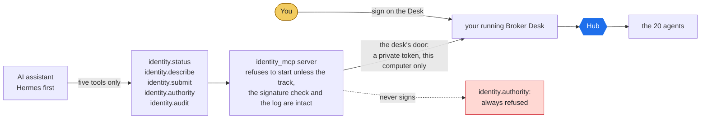

# Mounting this identity as an MCP server

> **Words used here.** Tuple, playbook, swarm, hold, release and the other technical words are explained in plain language in [GLOSSARY.md](GLOSSARY.md).

This identity ships a generic MCP wrapper (`dispatcher/identity_mcp.py`)
that runs as a standard **stdio MCP server**, so an AI assistant app (the
*host*) can work with it without any code written for that host. Hermes
comes first (owner decision 2026-10-22); a general setup for Claude or
Gemini apps comes later. OpenClaw is not supported for now: its open skill
market has carried malicious skills, and the owner judged it too risky.

**The assistant works inside your running Broker Desk** (the default since
2026-10-22). It reads the same records you see on the Desk, and what it
brings in shows on the Desk at once. It never signs: anything that needs
your signature you do yourself, on the Desk, with your own key.

The server runs a **boot conformance gate**: it refuses to start unless
the closed track, the signer gate, and the audit chain are intact. The
governance guarantee travels with the server - it cannot be silently
mounted broken.

## The tools

<!-- diagram:mcp-mount - drawn in tools/doc_diagrams.py; edit it there, not here -->


*The assistant works inside your running Broker Desk, on the same records you see (owner decision 2026-10-22). It can read the desk and bring in an inquiry; it never routes inside the swarm and never signs. Signing, releasing and every other act are yours, on the Desk (see FINANCIAL_CAPABILITY.md).*
<!-- /diagram:mcp-mount -->

- `identity.status` - read-only: what needs you, your listings and where
  each stands, leads, prospects waiting, the Outbox count, and whether the
  record is intact. Read from your running desk.
- `identity.describe` - read-only: the closed track (legal intents),
  playbooks, and governance guarantees.
- `identity.submit` - brings a new inquiry onto your desk: intent
  `lead.inbound` only. Every other act is refused with "done by you on the
  Broker Desk".
- `identity.authority` - always refused. The assistant cannot sign.
- `identity.audit` - hash-chain verification (entries, chain_verified,
  dead letters) so the assistant can show the record is intact.

Hermes names them `mcp_listingassistants_identity_status` and so on (it
puts `mcp_<server>_` in front and turns dots into underscores).

**How the door works.** When you start the Desk, it writes a private file,
`desk-mcp.json`, in your state folder: the port and a fresh random token.
The server reads that file and calls the desk at `POST /api/mcp` on
127.0.0.1 with the token. The desk refuses a wrong or missing token, and it
refuses any call from a web page. Every call is written to your record as
`mcp.call`, and an inquiry the assistant brings in is marked
`via: AI assistant (MCP host)`. When the Desk stops, the file is removed;
with no desk running, every tool answers "Your Broker Desk is not running.
Start it." The Playbook Show and the demo desk never open this door.

## Hermes on Windows (the installer does it)

The Windows installer (`install.ps1`, step 6) finds Hermes' `config.yaml`
(in `HERMES_HOME`, else `%LOCALAPPDATA%\hermes`, else `%USERPROFILE%\.hermes`),
keeps a copy of it as `config.yaml.bak-listingassistants`, and adds this
under `mcp_servers:` (with your own folders):

```yaml
mcp_servers:
  listingassistants:
    command: 'C:\Users\you\AppData\Local\ListingAssistants\venv\Scripts\python.exe'
    args: ['-m', 'dispatcher.identity_mcp']
    enabled: true
    env:
      IDENTITY_ROOT: 'C:\Users\you\AppData\Local\ListingAssistants\app'
      PYTHONPATH: 'C:\Users\you\AppData\Local\ListingAssistants\app'
      LISTINGASSISTANTS_STATE_DIR: 'C:\Users\you\AppData\Local\ListingAssistants\state'
```

It always saves the same block as `hermes-mcp.yaml` in the install folder.
It leaves Hermes alone when Hermes is not found, when the entry is already
there, when `mcp_servers` is written on one line, or when you set
`LA_NO_HERMES=1`; in those cases it tells you where the block is so you can
add it yourself. Full paths matter on Windows: a bare `python` can fail
there with WinError 193.

Then: double-click **ListingAssistants Desk**, and in Hermes type
`/reload-mcp` (or restart Hermes). CI checks this on a real Windows machine
on every push: it installs with a Hermes config already present, starts the
desk, starts the server exactly as the config says, brings in an inquiry,
sees it on the desk, and sees signing refused.

## Hermes on Linux or macOS

Add the same entry to `~/.hermes/config.yaml` (or a profile's
`config.yaml`) with your paths, start the desk (`python3 tools/desk.py`),
then `/reload-mcp`.

## Prove it locally first

```
python3 -m pytest tests_listing/test_mcp_desk_mode.py -q
```
Starts a real desk and the real server over stdio, the way a host does:
the assistant reads the desk, brings in an inquiry that appears on the
desk, is refused when it tries to sign, and the door refuses a wrong token
and a web page.

```
python3 tools/mcp_roundtrip.py
```
The older standalone demo: the server builds its own swarm (with
`--demo-signing`) and calls the tools through the real MCP protocol.

## Standalone mode, and Claude Desktop

`python -m dispatcher.identity_mcp --standalone` builds a separate swarm in
the server process instead of using your desk. Nothing it does reaches your
Desk's records. It is there for testing other hosts, such as Claude Desktop
(`claude_desktop_config.json`, `mcpServers`, same command, args and env).
A general setup for Claude or Gemini apps is planned after Hermes.

## Signing over MCP

The assistant never signs (owner decision 2026-10-22: "Prepare the
documents, yes. Sign, no."). In desk mode `identity.authority` is always
refused, and `identity.submit` takes only new inquiries.

`python -m dispatcher.identity_mcp --demo-signing` makes a standalone
server sign with its own boot key so `tools/mcp_roundtrip.py` can show the
signed path; never pass that flag in a host configuration.

**One limit you should know.** The refusal is enforced by this server and
by the desk's door. It is not a wall around your files. Hermes can run
commands and read files as your Windows user; if it does, it can reach the
same files the Desk uses, including your key in the state folder, and it
can call the Desk the way your browser does. Keeping the assistant from
ever signing needs one of these: Hermes' terminal set to run in its sandbox
(Docker) backend, Hermes run as a separate Windows account that cannot read
your ListingAssistants folder, or a key that needs a step only you can do
(a passphrase, or signing on your phone). This is an open decision.

## Governance note (why the surface is deliberately narrow)

Hermes, like other assistant apps, extends agents by letting the host LLM decide
when to call a tool. Exposing this identity's 20 agents (plus the dispatcher) as separate
free tools would hand routing back to the host and dissolve the closed
track - the identity would become a toolbox wearing the name, not a
governed system. The narrow front door is the fix: the host can only
read and submit intents; the hub enforces the track, the signatures, the $0.00
rule, and the sealed custody internally. **The MCP shell is the open
socket; the governed hub is the licensed cartridge.**

## Optional JEV decision adapter

`dispatcher/decision_adapter.py` is the adapter Agent 02 scores every lead
through (wired 2026-10-12; the MCP server builds the same swarm). Nothing in
this MCP server starts or mounts a JEV service. It runs three ways:

- **Local (default):** `JevPythonDecisionEngine` scores leads in-process
  with the same rules as Agent 02 (`dispatcher/lead_rubric.py`).
- **Injected MCP client:** pass `mcp_client=` an object with
  `call_tool("jev_evaluate_decision", args)`; you supply and run the server.
- **Live HTTPS:** requires `JEV_API_KEY` **and** the broker's signed
  `{"decision_engine": {"allow_external": true}}` to Agent 02. Lead data
  leaves the machine in this mode, so it is off unless you opt in.

In every mode a result below the confidence floor (default 0.45), or with
no readable confidence, is returned as a hold for human review.

## License

The MCP wrapper is the mounting socket; the identity it serves is
licensed under the QuietFire Identity License over an AGPL-3.0 floor (see
LICENSE). Running this as a network service in production requires a
commercial license or full AGPL compliance.
