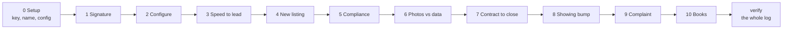

# OPERATOR_TESTING_MANUAL.md - Test It Like a Customer Would

> **Words used here.** Tuple, playbook, swarm, hold, release and the other technical words are explained in plain language in [GLOSSARY.md](GLOSSARY.md).

This is the script for operational testing: you, set up as the broker any
buyer of this product would be, driving the swarm through the console with
no Python, and a camera running. The ten scenes are ready-made files in
`scenes/` with synthetic data; you run each one and compare the screen with
the **Expected** below. A test (`tests_listing/test_operator_scenes.py`) runs
the same ten files on every build and checks every Expected, so what you
film is what the suite checks.

Two ground rules for the recordings. Never cut between action and outcome:
the footage is the unbroken line from "I did this" to "the log shows this."
End every session with `verify` on camera: the chain check and the anchor
are the proof the footage was not staged.

If what you see differs from what is written here, that difference is a
finding: capture it, do not work around it.

## How the console works (read once)

- Each scene is one console session: `python tools/console.py session scenes/<file> --config-dir scenes/config`.
- **State carries between sessions.** At the end of every session the swarm's
  state (every agent's records, held messages, open holds) is saved to
  `console-state/swarm-state.sqlite`, and its fingerprint is written to the
  audit log. The next session restores it only when the audit chain vouches
  for it; otherwise it refuses, changes nothing and tells you why. Run the
  scenes in order, in one folder, and Scene 10's briefing covers all of them.
- **Everything that needs you prints the moment it lands** as
  `{"HUMAN_QUEUE": ...}`: escalations, clarifications, integrity violations,
  held outbound messages, and decisions waiting on you (`decision_required`).
- **Messages leaving for a vendor, a counterparty or the public hold** until
  you release them: `{"do": "release", "ctx": "...", "intent": "..."}` signs one
  release per held message with your key. `{"do": "show", "what": "held"}` lists them.
- **Threads an agent cannot finish on its own hold** until you sign
  `{"do": "decide", "ctx": "...", "decision": "continue"}` or `"cancel"`.
  `{"do": "show", "what": "waits"}` lists them.
- **No client hears from the swarm without consent on record.** Agent 11
  sends nothing to a client until Agent 14 holds a "yes" on at least one
  channel (owner decision 2026-10-12). A lead brings its consent in at
  capture; for a seller, a buyer or a party to a deal, the scene's first
  lines record it with your signed `consent_record` - the same step you take
  for a real client. Without it the message is logged as blocked and you
  are told once.
- `{"do": "send", ...}` injects a message as if from the named sender. Use
  `external` (the outside world) or `human` where the closed track has a
  route; the hub applies every check either way.
- **Everything is also written in plain language** to
  `console-state/readable/stream.log` (`python tools/show_logs.py` shows the
  last 25 lines), and each client's records are filed in that client's
  drawer under `console-state/drawers/` (`python tools/inspect_client_drawer.py --list`).
  Good B-roll between scenes: the stream scrolling, and one drawer's files
  with their hashes re-checked.

## Scene 0 - One-time setup

```
git clone https://github.com/QuietFireAI/listing-assistants.git
cd listing-assistants
pip install -r requirements.txt
python -m pytest tests_listing/          # expect: 1312 passed, 1 skipped
python tools/console.py init             # generates YOUR signing key
python tools/console.py onboard          # your name and login, asked once
```

Expected: the test count; `{"initialized": ..., "operator_key": "generated, private: mode 0o600", ...}`
(on Windows: `"generated, private: only <your account> has access ..."`);
then `{"onboarded": {...}, "not_armed": {...}}`. The `not_armed` block says
plainly what is not switched on: the identity-provider signer binding (no
identity provider is connected) and the text pager, which
`python tools/console.py pager` turns on if you want pages on your phone
while filming (optional; every page also prints on screen).

**Ratify the test vendor roster on camera.** Open `scenes/config/vendor_panel.json`.
Its `_status` line says UNRATIFIED. Replace that line's text with
`RATIFIED <today's date YYYY-MM-DD> <your name>` and save. This is the same
rule every configuration file follows: a draft is never loaded. (Run any
scene before you do this and the first line says `"vendor_roster": "unratified"`,
and Scene 4 cannot book a photographer.)

## Running order

<!-- diagram:order-testing - drawn in tools/doc_diagrams.py; edit it there, not here -->


*One console session per scene, in this order, in the same folder: each scene builds on the state the last one saved.*
<!-- /diagram:order-testing -->

Run the scenes in this order, one console session each, in the same folder:

```
python tools/console.py session scenes/scene01_signature.jsonl --config-dir scenes/config
python tools/console.py session scenes/scene02_configure.jsonl --config-dir scenes/config
...
python tools/console.py session scenes/scene10_books.jsonl --config-dir scenes/config
python tools/console.py verify
```

The same ten scenes play in the Broker Desk, with buttons instead of
`release` and `decide` lines: `python tools/desk.py --showcase` (README,
"The Broker Desk").

Each scene below lists its lines in file order with what the screen shows.
The console prints each line's result as `{"line": N, ...}`; a page
(`HUMAN_QUEUE`) prints just before the line that caused it.

## Scene 1 - The signature matters (`scene01_signature.jsonl`)

1. An unsigned listing change. `"status": "reject", "reason": "unverified
   signature on authority intent"`, and an `integrity.violation` page.
2. A new listing, signed by your key. `"status": "ack"`. 05 also orders the
   photos, so the photography booking holds for you (page with
   `"absolute_signal"`). It is never released in these scenes; Scene 10's
   briefing still lists it as waiting.
3. `show external`: `[]` - nothing left the swarm.
4. `show queues`: the integrity violation and the held booking.

**The opening shot of any demo: the unsigned command bounces, yours lands.**

## Scene 2 - Configure your business (`scene02_configure.jsonl`)

1. Your scoring rubric to 02 (signed): `ack`.
2. Your fair-housing ruleset to 17, version `r1` (signed): `ack`.
3. A broken ruleset (a phrase with no rule id), version `r2`: `ack` from the
   hub, then a `clarification.request` page: `"malformed compliance ruleset
   rejected"`, naming the problem. Version `r1` stays active - Scene 5 uses it.
4. `show queues`.

## Scene 3 - Speed to lead, and the same person twice (`scene03_speed_to_lead.jsonl`)

1. Which listings are yours, to 01 (signed): `ack`.
2. A hot web lead asking about L1: an `escalation.hot_lead` page for `S3-hot`
   with `"sla_s": 300`. Nothing is sent to the lead.
3. The briefing: `hot_lead_human_response` waiting for `S3-hot`, since today.
4. The same person again under a new context (same phone, written
   differently): **no second hot-lead page**; a `decision_required` page -
   possible duplicate person, held.
5. `show waits`: that hold.
6. You cancel it: `"handler_result": "cancelled"`. Nothing merged or scored.
   (Sign `continue` instead and it is scored as a separate person and pages
   you.)
7. A lead that refuses all contact: captured, consent recorded as "no" on
   every channel.
8. `show external`: `[]` - no message ever goes to either lead.

## Scene 4 - New listing, end to end (`scene04_new_listing.jsonl`)

1. The seller's consent, to 14 (signed `consent_record`): `ack`. Without it
   Agent 11 would send the seller nothing.
2. A ruleset for this listing, to 17: `ack`.
3. Your brokerage identification, to 12 (signed): `ack`. Every ad carries
   it; without it an approved ad is held and you are asked for it.
4. The same, to 17 (signed): `ack`. Compliance checks every ad for it.
5. The new listing with go-live (signed): `ack`; the photography booking
   holds for you (page).
6. `show held`: the booking (and Scene 1's, still held).
7. You release the S4 booking.
8. A photo delivery with `"proof_artifact_present": false`.
9. `show external`: only the booking. The claim is not the artifact.
10. The real delivery: 04 drafts, 17 approves, the assets go to 05 and 12, the
   listing goes active (11, 12 and 14 told), and the campaign holds for you
   (page).
11. `show held`: the campaign, with your brokerage identification on it.
12. You release the campaign.
13. `show external`: the booking, the seller's "active" notice and the
    campaign.

## Scene 5 - Compliance catches your planted phrase (`scene05_compliance.jsonl`)

1. The seller's consent, to 14: `ack`.
2. A ruleset to 17: `ack`.
3. and 4. Your brokerage identification, to 12 and to 17 (signed): `ack`.
5. A listing whose features include the phrase from your Scene 2 ruleset
   (signed): `ack`; the booking holds (page).
6. You release the booking.
7. The photo delivery. On the audit log: `content.verdict: flagged` citing
   the phrase and rule FH-1; 04 removes exactly that phrase and resubmits;
   the second verdict is `approved`. The campaign holds for you (page).
8. `show held`: the S5 campaign (left held).
9. `show queues`. No released asset contains the phrase.

## Scene 6 - Photos versus data sheet (`scene06_photo_contradiction.jsonl`)

1. A listing whose data sheet claims an in-ground pool (signed): `ack`; the
   booking holds (page).
2. You release the booking.
3. The photos arrive without a pool: a `clarification.request` page,
   `"photos contradict data sheet"`, naming `in-ground pool`. No draft
   reaches 17.
4. `show held`.

## Scene 7 - Under contract to close (`scene07_contract_to_close.jsonl`)

1. The client's consent, to 14: `ack`.
2. The listing (signed): `ack`; the booking holds (page).
3. The executed contract arrives by email, through 11.
4. The signed status change to pending.
5. The signed timeline (inspection 10-10, financing contingency 10-20,
   closing 11-01). 07 asks 08 for the inspection report and the
   financing-contingency removal by their real document names, and asks 09
   for an inspector. There is no inspector on your roster: page `"no approved
   roster vendor for kind 'inspector'"`.
6. `show held`.
7. Clock run for 2026-10-21: the inspection and financing-contingency
   deadlines alert as overdue (to 11, which sends them to the client, and to
   18); legal-line pages for the financing contingency and for the inspection
   hold-up; the morning briefing.
8. Clock run for 2026-10-22: no repeat alerts - **once** means once.
9. The title company named as the expected sender of the settlement
   statement (signed).
10. The settlement statement arrives by email. The inspection and the
    financing contingency were never marked done, so 07 does not close: a
    decision page names them ("these milestones are still open:
    financing_contingency, inspection") and 18 shows the close waiting.
11. Your decision: `continue`. 07 records the two as waived by you and closes
    the transaction to 14, 15 and 16 with the sale price and close date.
    (Cancel leaves the transaction open.)
12. The client's entry on 16's past-client list (signed).
13. Clock run for 2026-12-02: `{"agent": "16", "sweep":
    "post_close_milestones", "result": "sent:30"}` - the 30-day check-in, from
    the clock, with nobody asking, and it reaches the client because the
    consent is on record. Two legal-line pages: the inspection report and
    the financing-contingency removal never arrived, and 08's chases are
    exhausted - silence never becomes "received".

## Scene 8 - Showing bump needs hotness AND you (`scene08_showing_bump.jsonl`)

Three buyers want the same house Saturday morning.

1. Your rubric, to 02.
2. Buyer A's signed representation agreement and identity check, to 14.
3. The same for buyer B.
4. Buyer A's consent, to 14.
5. Buyer B's consent, to 14.
6. Buyer A asks for Saturday 10:00: booked.
7. Buyer B claims a deadline for 10:15 but is not a hot lead: page - plain
   conflict sequencing, the reason names the tier gate, **no bump offered**.
8. Buyer C arrives as a web lead (with consent) and scores hot: an
   `escalation.hot_lead` page.
9. Buyer C's agreement and identity check, to 14.
10. Buyer C claims the same deadline: the bump **holds for you** (page); A's
    showing stands.
11. Your signed confirmation of the bump.
12. `show external`: A's confirmation, A's `showing_bumped_notice`, C's
    confirmation.

## Scene 9 - Complaint containment (`scene09_complaint.jsonl`)

1. The monitored channels, to 20.
2. The seller's consent, to 14.
3. A viral complaint on Facebook: an `escalation.complaint` page with the
   verbatim text and `"priority": "viral"`. Nothing is sent to the client.
4. A scheduled weekly report to that client.
5. `show external`: `[]` - the touch is held while the complaint is open.
6. Your signed release of the hold.
7. The next weekly report.
8. `show external`: it goes out.

## Scene 10 - The books don't lie (`scene10_books.jsonl`)

Expected: the briefing lists every wait left open across Scenes 1-9
(for example 02's hot lead from Scene 3 and 08's missing inspection report
from Scene 7), because the state carried between sessions. The end-of-day
report's `logging_gaps` is `[]`, and its `readable_ledger` names the ledger
file with `"chain_ok": true`. Then the anchor.

Off the console, three checks of what the scenes left behind:

```
python tools/show_logs.py --eod                  # the day's ledger, built from the chain
python tools/inspect_client_drawer.py S7         # Scene 7's client: package, timeline,
                                                 # contract, settlement statement, CRM entries;
                                                 # ends "[OK] ... match their recorded SHA-256"
python tools/dashboard.py --html                 # S7 shows CLOSED, S4/S5 MARKETING READY
```

Close the recording with:

```
python tools/console.py verify
```

`{"chain": {"ok": true, ...}}`. Then, off camera, copy
`console-state/console-audit.jsonl`, change one word on any line of the copy,
and run `python tools/console.py verify --audit-log <copy>` ON camera:
expected `"ok": false` with `break_at` naming that line, and exit code 1.
That is the closing shot: the record defends itself.

## Optional Scene 11 - model-written remarks (needs a local model)

Not part of the ten scenes and not run by the suite against a real model
(the suite uses a stand-in model over real HTTP). Run it only if a model is
served on this machine, for example by Ollama at `http://localhost:11434/v1`.

1. `python tools/restore_point.py --exam my-model-1 --model-url http://localhost:11434/v1 --model-name <model>`.
   Expected: four graded answers and `[PASSED]` or `[FAILED]`. Only a pass
   activates the checkpoint. A model that fails stays off; that is the
   correct outcome, not a bug.
2. A session with `--model-url ... --model-name <model>`: its first line shows
   `"model_drafting": {"ok": true, "checkpoint": "my-model-1"}`. Sign
   `{"do": "config", "to": "04", "ctx": "setup", "payload": {"drafting": {"mode": "model"}}}`,
   then run Scene 4 or 5's listing. Expected: the `content.review` to 17
   carries `remarks` and `"remarks_source": "model:my-model-1"`; if the model
   added a number or skipped its reasoning, the draft says
   `"remarks_source": "rules"` and you are told why.

## Resolving what is left open

- A hot lead: `{"do": "config", "to": "02", "ctx": "<any>", "payload": {"resolve_hot_lead": "<ctx>"}}`.
- A complaint hold: `{"do": "config", "to": "11", "ctx": "<ctx>", "payload": {"resolve_complaint_hold": "<ctx>"}}`.
- A held thread: `decide` continue or cancel, as above.
- A held outbound message: `release`.

## Starting over

The console never replaces your log silently. To start clean, move the
`console-state/` folder aside yourself and run `init` and `onboard` again.

## Filing what you find

Anything that deviates from an Expected: file it with the scene file, the
line number, the actual JSON output and the anchor from that session. That
tuple is a complete, replayable bug report. No deviations across all ten
scenes, on camera, with the chain verified at the end, is the operational
sign-off this manual exists to produce.
