# PLAY-BY-PLAY.md - What Actually Happens, Step by Step

<!-- diagram:map-pbp - drawn in tools/doc_diagrams.py; edit it there, not here -->
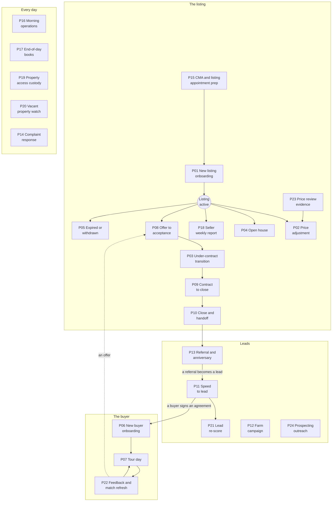

*Arrows show what usually leads to what; any playbook can also start on its own trigger (listed in [PLAYBOOKS.md](PLAYBOOKS.md)). The "Every day" group runs alongside all of it.* *Each playbook below has its own picture: one recorded test run, numbered in order. The yellow notes are holds waiting for you.*
<!-- /diagram:map-pbp -->

> **Words used here.** Tuple, playbook, swarm, hold, release and the other technical words are explained in plain language in [GLOSSARY.md](GLOSSARY.md).

This is the walkthrough for the person who asks "okay, but what does it
actually *do*?" Each playbook below is narrated the way it executes: who
talks to whom, what rides in each message, where the gates sit, and
where you - the human - are in the loop. Every step described here is a
real message on a closed track: only pre-approved sender→intent→receiver
lanes exist, the hub lines every switch, and every message lands on a
tamper-evident audit log. Nothing described below is aspirational; each
of these flows runs end-to-end in the test harness against the same hub
that runs in production.

A quick cast of characters, by number, so the narration reads cleanly:
**01** lead capture, **02** lead qualification, **03** lead nurture,
**04** listing description, **05** MLS listing management, **06**
showing scheduler, **07** transaction coordinator, **08** document
collection, **09** vendor coordination, **10** market data, **11**
client communication, **12** marketing campaigns, **13** buyer search &
match, **14** CRM (the system of record), **15** financial tracking,
**16** after-close & referral, **17** fair-housing compliance, **18**
calendar & tasks, **19** prospecting, **20** social monitoring. The hub
(00) is the dispatcher - it owns the track; nobody talks around it.

---

## The listing lifecycle

### P01 - New Listing Onboarding
<!-- diagram:P01 - generated by tools/gen_diagrams.py from `test_p01_new_listing_onboarding_all_three_phases`; edit the generator, not this block -->
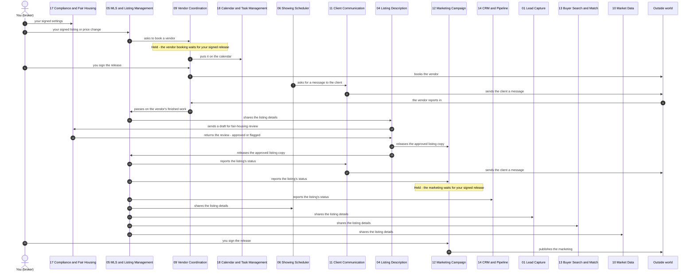

*One recorded run of this playbook's test (`test_p01_new_listing_onboarding_all_three_phases`), read top to bottom. Left out to keep it readable: each agent logging the step in the CRM (14), telling the calendar (18) what it is waiting on, and CRM look-ups.*
<!-- /diagram:P01 -->

It starts with one envelope: you sign a `listing.change.authorized`
carrying the property package and your go-live authorization. That
signature is checked cryptographically before the message is even
delivered - an unsigned or tampered copy is rejected at the hub, not by
convention but by math.

From that single message the swarm chains itself. **05** records the
listing and immediately asks **09** for photography (`vendor.request`).
09 doesn't guess a photographer: it selects from your approved vendor
roster, checks the vendor's license and insurance dates, and books the
shoot - the booking (`vendor.schedule`) is the first message bound for
the outside world, and because a vendor is a counterparty it holds until
you sign its release. Meanwhile 05 tells **18** to
block the calendar, and **11** sends your seller the onboarding message
(consent already recorded in **14**).

Then the swarm *waits* - deliberately. The Phase 2 gate is the
photographer's deliverable, and not just its arrival: **09** verifies
the package is present *and opens* before releasing it
(`deliverable.release`). A corrupt or empty delivery never advances the
playbook. Once verified, **05** hands the full property package to
**04**, which drafts the listing description under hard rules: facts
before adjectives, sourced claims only, roof and HVAC ages only from
inspection documents, and any photo/data contradiction (a pool in the
data sheet that isn't in the photos) halts the whole asset into your
review queue.

The draft never goes anywhere without **17**. Every asset rides a
`content.review` to the fair-housing agent, which screens it against
your ruleset and returns a `content.verdict`. Flagged? 04 applies the
required changes *exactly* - never "approved with a note" - and
resubmits. Approved? The asset releases to **05** (MLS entry) and
**12** (marketing) simultaneously.

Phase 3: 05 marks the listing active only when the approved description
is in and your signed package authorized go-live, then fans out
`status.update: active` to 11, 12, and 14. No MLS or portal is connected
yet, so "active" means authorized and recorded here; checking the MLS is
yours until a connection exists. That status is 12's Clear
Cooperation gate: only now does the campaign publish. 13 gets the
listing for buyer matching, and your seller gets the "you're live"
message. Completion isn't a claim; it's a checklist of artifacts on the
audit log - and the run ends with zero dead letters or it isn't done.

**You did exactly two things:** signed the authorization, and handled
anything 17 flagged. The price was yours before the playbook ever
started; no step touches it.

### P02 - Price Adjustment
<!-- diagram:P02 - generated by tools/gen_diagrams.py from `test_p02_price_adjustment`; edit the generator, not this block -->
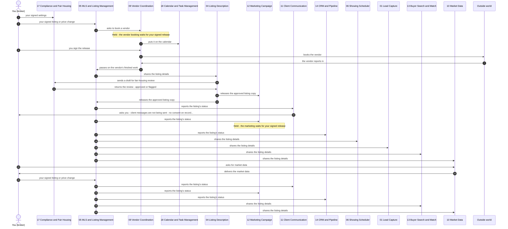

*One recorded run of this playbook's test (`test_p02_price_adjustment`), read top to bottom. Left out to keep it readable: each agent logging the step in the CRM (14), telling the calendar (18) what it is waiting on, and CRM look-ups.*
<!-- /diagram:P02 -->

Before the decision: if you ask, **10** sends you a comp package -
data with provenance on every number, no opinion field, structurally.
After the decision: your signed price envelope hits **05**, which
executes the change in its record and fans out `status.update` so
11, 12, and 14 are never quoting different numbers. Any asset that
references the old price goes back through 04 → 17 → 12. The swarm
never produces or suggests a price - there is no lane for it.

### P03 - Under-Contract Transition
<!-- diagram:P03 - generated by tools/gen_diagrams.py from `test_p03_under_contract_transition`; edit the generator, not this block -->
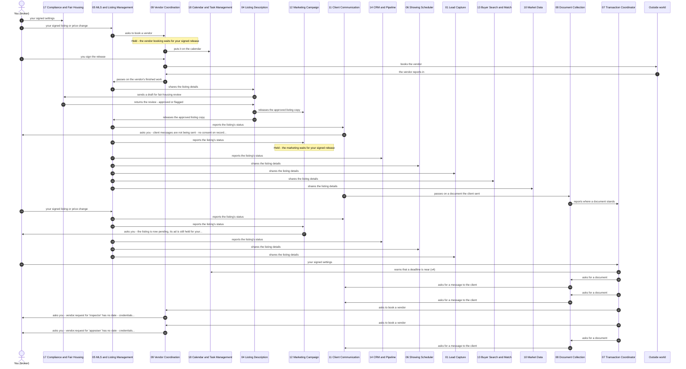

*One recorded run of this playbook's test (`test_p03_under_contract_transition`), read top to bottom. Left out to keep it readable: each agent logging the step in the CRM (14), telling the calendar (18) what it is waiting on, and CRM look-ups.*
<!-- /diagram:P03 -->

The executed contract is filed through **08** first (verified: it
opens, it's the right document type). Then your signed status change
flips the MLS to pending - and 05 *requires* the contract artifact
reference before it will execute; a pending status without a contract
on file is a clarification, not a change. **12** consumes the status
and halts active marketing the same moment. **07** loads the full
deadline map - inspection, appraisal, financing, closing - and opens
document chases through 08. Your client gets the "here's what happens
next" message through 11. From this moment, P09's engine is running.

### P04 - Open House Cycle
<!-- diagram:P04 - generated by tools/gen_diagrams.py from `test_p04_open_house_cycle`; edit the generator, not this block -->
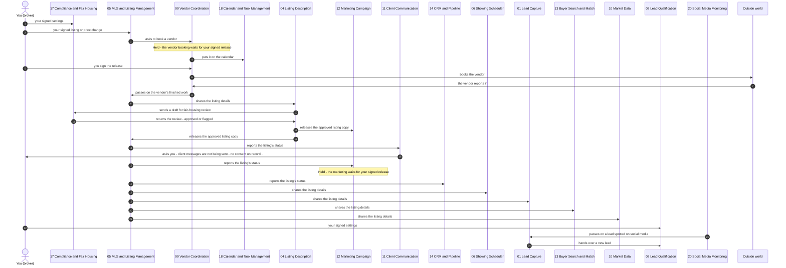

*One recorded run of this playbook's test (`test_p04_open_house_cycle`), read top to bottom. Left out to keep it readable: each agent logging the step in the CRM (14), telling the calendar (18) what it is waiting on, and CRM look-ups.*
<!-- /diagram:P04 -->

Promotion is compliance-gated like everything client-facing: **04**'s
open-house materials go through **17** before **12** promotes anything,
with special-ad-category rules applied to the placement. RSVP handling
is not yet in the code. After the event, attendance and feedback go in
the books (an `interaction.log` entry to 14), and - the part that pays for itself - every walk-in and
registrant enters through **01**'s front door: consent recorded on the
spot, deduped against 14, scored by 02, and a hot one hits your phone
inside the SLA while they're still in the driveway. The sign-in sheet
that used to die in a drawer is a tiered pipeline by dinner.

### P08 - Offer to Acceptance
<!-- diagram:P08 - generated by tools/gen_diagrams.py from `test_p08_offer_to_acceptance`; edit the generator, not this block -->
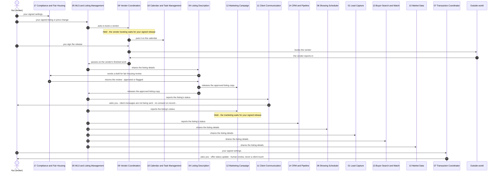

*One recorded run of this playbook's test (`test_p08_offer_to_acceptance`), read top to bottom. Left out to keep it readable: each agent logging the step in the CRM (14), telling the calendar (18) what it is waiting on, and CRM look-ups.*
<!-- /diagram:P08 -->

Every offer state change is artifact-backed - "received," "countered,"
"accepted" each carry a document reference, logged to **14**, with the
status update landing in your review queue rather than on the client
channel. The negotiation is yours, every round. Acceptance hands off to
P03; rejection and expiry close the record with the artifact trail
intact. Six months later, "what did we hear back on that one" is a
lookup.

### P09 - Contract to Close (the deadline engine)
<!-- diagram:P09 - generated by tools/gen_diagrams.py from `test_p09_contract_to_close_deadline_engine`; edit the generator, not this block -->
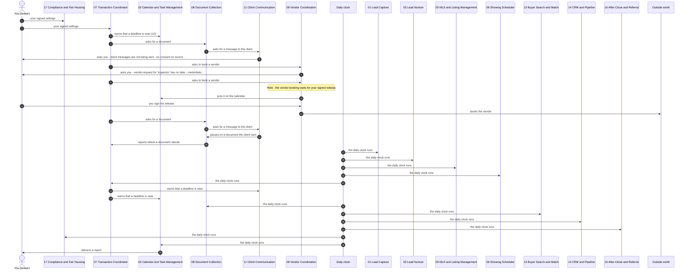

*One recorded run of this playbook's test (`test_p09_contract_to_close_deadline_engine`), read top to bottom. Left out to keep it readable: each agent logging the step in the CRM (14), telling the calendar (18) what it is waiting on, and CRM look-ups.*
<!-- /diagram:P09 -->

This is the playbook that replaces the 6am dread. **07** holds every
deadline and enforces a rule the industry mostly honors in the breach:
*a milestone isn't done until its artifact is on file.* The inspection
isn't "done" because someone said so - it's done when 08 holds a
report that opens.

The cycle, continuously: 07 requests milestone documents through
**08** (`doc.request`), which chases them - politely, on a capped
cadence, escalating to you when the cap hits rather than nagging
forever. Vendors (inspector, appraiser) are scheduled through **09**'s
roster with credential checks; their reports come back through the same
verified-deliverable gate as photos. Milestone facts go to your client
through **11** - facts, never characterizations. Deadline alerts fire
to 11 and 18 on the configured lead time, and - because the clock layer
runs on its own schedule - a deadline that *passes* unsatisfied alerts
as overdue rather than going quiet. A financing contingency date
passing with no removal on file is never assumed waived; it escalates
to you the same hour, as a legal-line event.

Closing week: 07 runs the completeness check through 08, you do the
closing - every signature, every legal act - and then 07 emits
`transaction.closed` carrying the close date and the settlement
figures, verbatim from the settlement statement. That one message arms
three agents at once: 16, 14, and 15.

### P10 - Close & Post-Close Handoff
<!-- diagram:P10 - generated by tools/gen_diagrams.py from `test_p10_close_postclose_handoff`; edit the generator, not this block -->
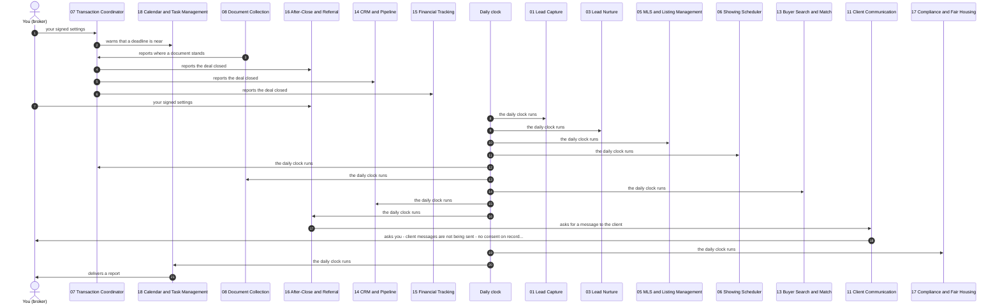

*One recorded run of this playbook's test (`test_p10_close_postclose_handoff`), read top to bottom. Left out to keep it readable: each agent logging the step in the CRM (14), telling the calendar (18) what it is waiting on, and CRM look-ups.*
<!-- /diagram:P10 -->

The close fan-out lands and three things happen without anyone
remembering to do them: **16** schedules the 30/90/365 check-ins
(consent-checked, sent through 11 as they come due - by the clock
layer, not by memory); **15** opens the commission reconciliation and
cross-checks its figure against 14's independent record of the same
close - a mismatch escalates to you; **14** flips the context to
past-client and arms the date triggers (anniversaries) that feed P13.
"Just sold" marketing, if configured, goes 17-verdict-first like
everything else.

### P05 - Expired/Withdrawn Wind-down
<!-- diagram:P05 - generated by tools/gen_diagrams.py from `test_p05_expired_withdrawn_winddown`; edit the generator, not this block -->
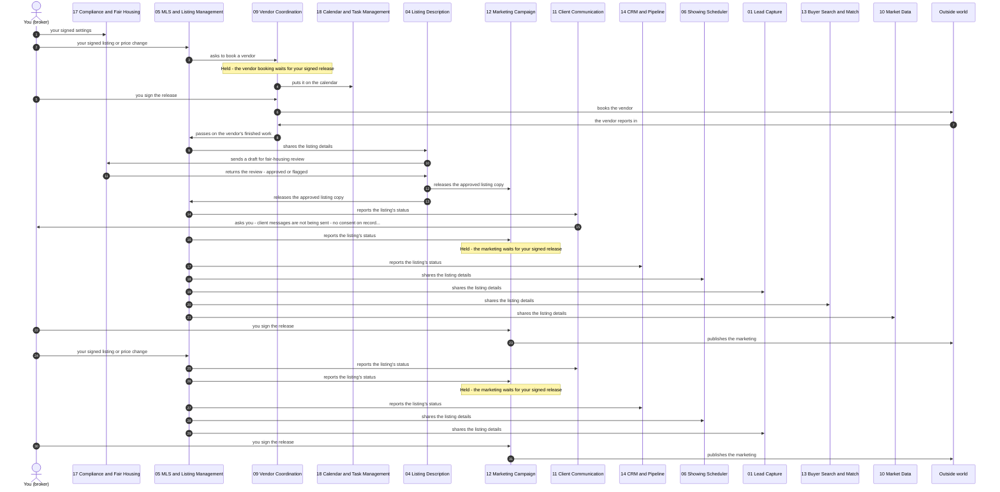

*One recorded run of this playbook's test (`test_p05_expired_withdrawn_winddown`), read top to bottom. Left out to keep it readable: each agent logging the step in the CRM (14), telling the calendar (18) what it is waiting on, and CRM look-ups.*
<!-- /diagram:P05 -->

The status flips (withdrawal requires your confirmation on file;
expiration runs off the agreement dates), and **12** halts *every*
published campaign for that listing the moment it consumes the status -
the halt leaves the swarm per platform and goes in the books. A live ad
for a dead listing is a compliance exposure and a seller wound; success
here is verified absence. Your seller hears from you via
human-approved messaging, 14 annotates the outcome, and if the seller
relists, they re-enter through the front door - no one auto-enrolls a
former client into anything.

---

## The buyer side

### P06 - New Buyer Onboarding
<!-- diagram:P06 - generated by tools/gen_diagrams.py from `test_p06_new_buyer_onboarding`; edit the generator, not this block -->
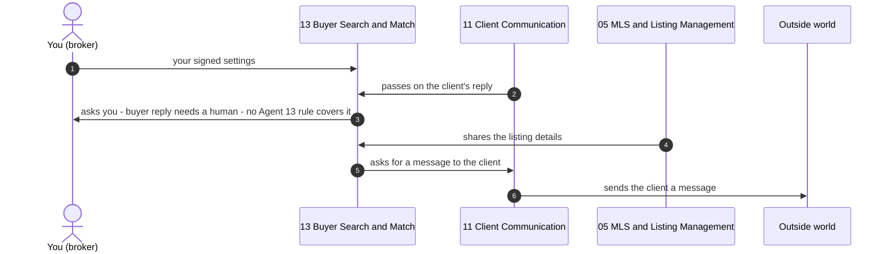

*One recorded run of this playbook's test (`test_p06_new_buyer_onboarding`), read top to bottom. Left out to keep it readable: each agent logging the step in the CRM (14), telling the calendar (18) what it is waiting on, and CRM look-ups.*
<!-- /diagram:P06 -->

The playbook will not start without the signed buyer agreement on file -
**13** verifies it against **14**'s records before any tour can be
requested, because that's the law of the land post-NAR-settlement, and
here it's a structural gate rather than a habit. The buyer's criteria
are recorded *verbatim* - what they said, marked as what they said,
never an inference. 13 enters the standing listing feed from 05, and
the first matches go out through 11 the moment inventory fits.

### P07 - Tour Day Coordination
<!-- diagram:P07 - generated by tools/gen_diagrams.py from `test_p07_tour_day_coordination`; edit the generator, not this block -->
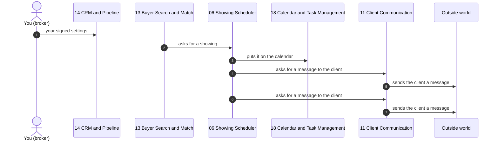

*One recorded run of this playbook's test (`test_p07_tour_day_coordination`), read top to bottom. Left out to keep it readable: each agent logging the step in the CRM (14), telling the calendar (18) what it is waiting on, and CRM look-ups.*
<!-- /diagram:P07 -->

**13** fires `showing.request` per property, each carrying the
agreement flag. **06** does the choreography: seller availability,
identity verification per your config, occupied-property notice rules,
buffer enforcement between showings (a conflict inside the buffer goes
to sequencing, not double-booking), calendar events to **18**,
confirmations to every party through 11. Afterward, feedback requests
go out - capped at two asks, never a third - and the buyer's profile
updates *only from what the buyer explicitly said*. Lingering in the
kitchen is not a criteria change.

### P22 - Buyer Feedback Match Refresh
<!-- diagram:P22 - generated by tools/gen_diagrams.py from `test_p22_buyer_feedback_match_refresh`; edit the generator, not this block -->
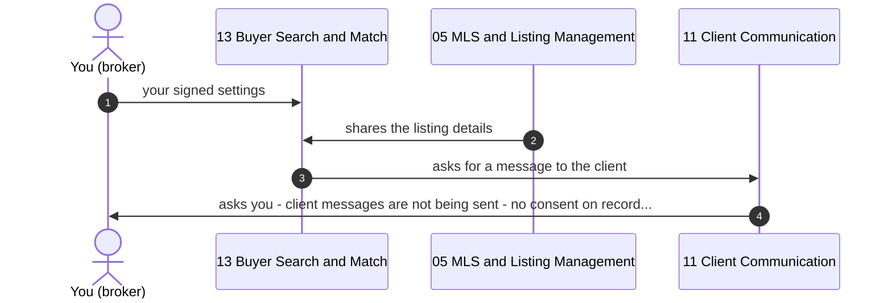

*One recorded run of this playbook's test (`test_p22_buyer_feedback_match_refresh`), read top to bottom. Left out to keep it readable: each agent logging the step in the CRM (14), telling the calendar (18) what it is waiting on, and CRM look-ups.*
<!-- /diagram:P22 -->

Same-day loop instead of next-check-in-call loop: feedback logs to 14,
13 pulls the current criteria record, requests fresh inventory from 10,
recomputes the match set, logs the delta, and the refreshed matches go
out. If showings are wanted, they route through the P07 machinery -
agreement flag and all.

---

## Lead flow

### P11 - Speed to Lead
<!-- diagram:P11 - generated by tools/gen_diagrams.py from `test_p11_speed_to_lead_hot_path`; edit the generator, not this block -->
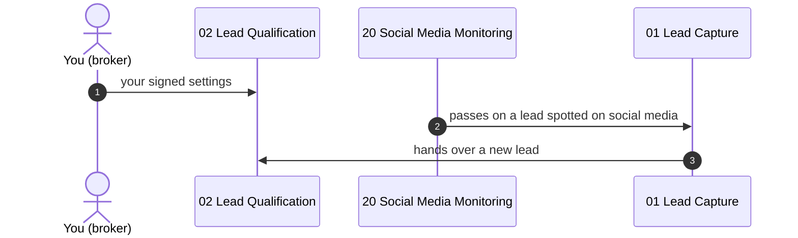

*One recorded run of this playbook's test (`test_p11_speed_to_lead_hot_path`), read top to bottom. Left out to keep it readable: each agent logging the step in the CRM (14), telling the calendar (18) what it is waiting on, and CRM look-ups.*
<!-- /diagram:P11 -->

A lead arrives - web form, call transcript, portal - and **01**
captures it with consent state recorded at first contact (that's your
TCPA posture, on the record, from minute zero). 01 dedupes against
**14** before anything else: the same phone or email already on record
under another lead holds the new one for you (continue = a separate
person, cancel = closed); nothing is ever merged or double-counted on
its own. **02** scores it against *your* rubric - every threshold and
weight is your signed configuration, versioned, and the version used is
recorded on every tier decision. A HOT lead does exactly one thing: it
escalates to *you*, inside the SLA, with the clock attached. The swarm
never talks to a hot lead on your behalf. WARM routes to nurture, and
02 logs every tier to 14 so the rescore cycle has ground truth.

If 14 doesn't answer the dedupe question, the lead doesn't fall on the
floor: 01 opens a wait in 18's briefing, retries on the clock, and
escalates to your queue if the answer never comes - held and named,
never lost.

### P21 - Lead Rescore Cycle
<!-- diagram:P21 - generated by tools/gen_diagrams.py from `test_p21_lead_rescore_cycle`; edit the generator, not this block -->
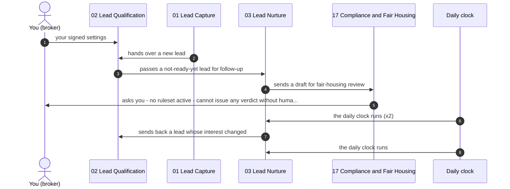

*One recorded run of this playbook's test (`test_p21_lead_rescore_cycle`), read top to bottom. Left out to keep it readable: each agent logging the step in the CRM (14), telling the calendar (18) what it is waiting on, and CRM look-ups.*
<!-- /diagram:P21 -->

*Started by the daily clock every 7 days for WARM leads in nurture (since 2026-10-12).*
On cadence, **03** sends each lead's scoring inputs back to **02** with
the stated timeline counted down by the days elapsed (no market data;
removed by owner decision J5) - 02 owns the tier decision and routes a
promotion to HOT straight into the P11 SLA path. The completion rule is the point: every lead in
the cycle ends re-scored *or* explicitly marked no-change - no lead
left in an unknown state, ever.

### P13 - Referral & Anniversary Cycle
<!-- diagram:P13 - generated by tools/gen_diagrams.py from `test_p13_referral_anniversary_cycle`; edit the generator, not this block -->
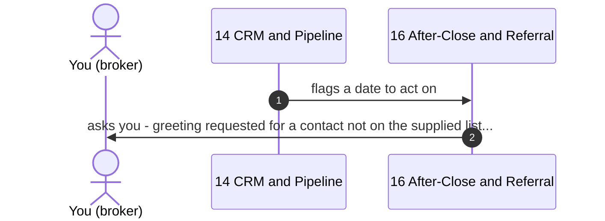

*One recorded run of this playbook's test (`test_p13_referral_anniversary_cycle`), read top to bottom. Left out to keep it readable: each agent logging the step in the CRM (14), telling the calendar (18) what it is waiting on, and CRM look-ups.*
<!-- /diagram:P13 -->

**14** owns the dates; on each trigger it fires `date.trigger` to
**16**, which composes the touch. Agent 11, which sends it, checks 14's
records first and sends nothing to a client without consent on record. Responses come back through capture and
get tiered like any lead. The criterion that matters most is negative:
zero touches against opt-out flags, and you can verify that from the
CRM's records, not from a promise.

### P24 - Prospecting Outreach (probation mode)
<!-- diagram:P24 - generated by tools/gen_diagrams.py from `test_p24_prospecting_outreach_probation`; edit the generator, not this block -->
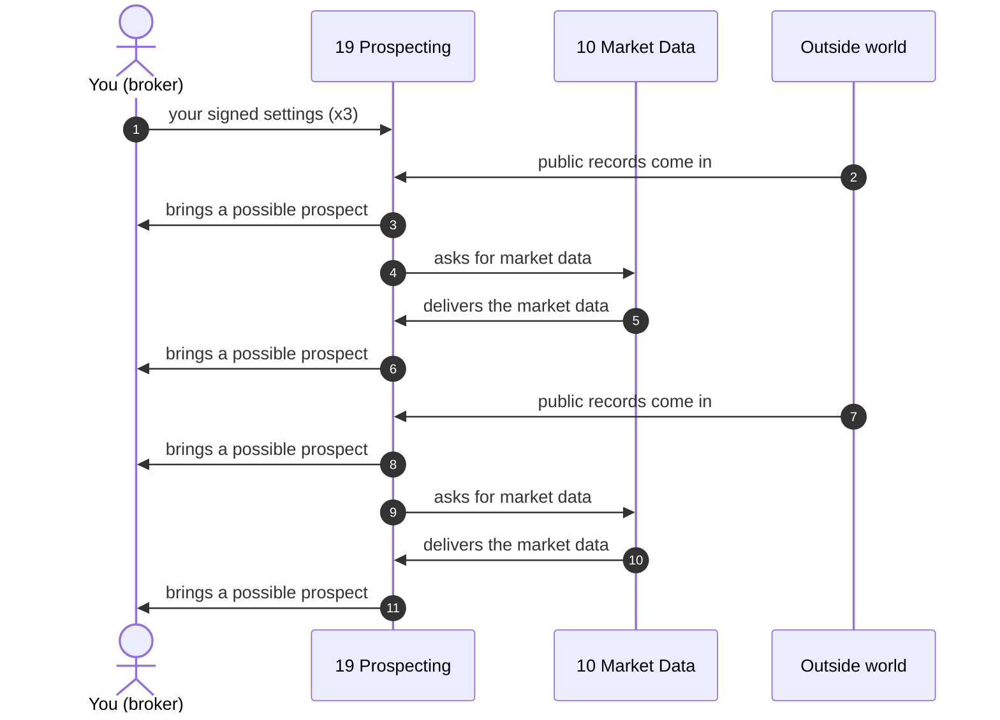

*One recorded run of this playbook's test (`test_p24_prospecting_outreach_probation`), read top to bottom. Left out to keep it readable: each agent logging the step in the CRM (14), telling the calendar (18) what it is waiting on, and CRM look-ups.*
<!-- /diagram:P24 -->

**19** scrapes only your configured sources over your configured zips -
it structurally cannot widen either. Each surfaced prospect gets
supporting evidence from 10, a DNC check, and expired/FSBO
representation rules applied *before* you ever see a name. Then the
hard gate: every prospect goes to you, one by one, with its evidence
(`prospect.opportunity`). A DNC hit doesn't vanish - it goes in the
books as suppressed-by-rule, so the audit trail shows the rule working.
In probation, 19 contacts no one, period. Discovery is the swarm's job;
outreach is yours.

### P12 - Geographic Farm Campaign
<!-- diagram:P12 - generated by tools/gen_diagrams.py from `test_p12_geographic_farm_campaign`; edit the generator, not this block -->
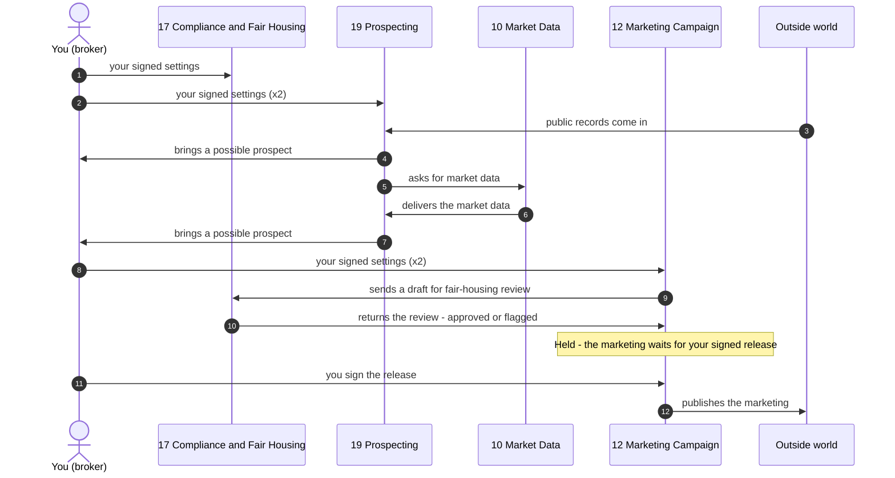

*One recorded run of this playbook's test (`test_p12_geographic_farm_campaign`), read top to bottom. Left out to keep it readable: each agent logging the step in the CRM (14), telling the calendar (18) what it is waiting on, and CRM look-ups.*
<!-- /diagram:P12 -->

19's intelligence feeds your view of the farm; the campaign itself goes
to *general geography only*. The audience parameters provably never
derive from identified opportunity records - that separation is the
fair-housing discipline, and it's verifiable from the audience logs,
not asserted. Creative goes through 17 like everything else;
demographic targeting parameters are refused outright, not worked
around. Responders enter through the standard intake - consent
captured, scored, tiered.

---

## Operations & vigilance

### P16 - Morning Operations
<!-- diagram:P16 - generated by tools/gen_diagrams.py from `test_p16_morning_operations`; edit the generator, not this block -->
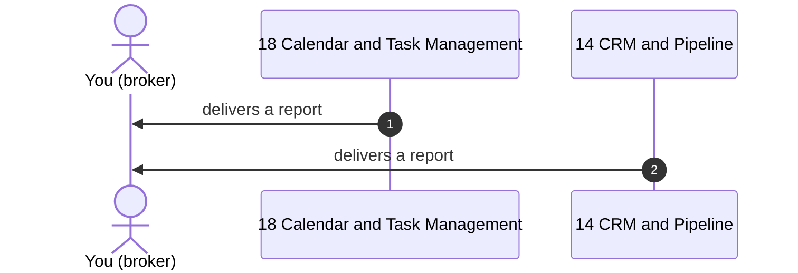

*One recorded run of this playbook's test (`test_p16_morning_operations`), read top to bottom. Left out to keep it readable: each agent logging the step in the CRM (14), telling the calendar (18) what it is waiting on, and CRM look-ups.*
<!-- /diagram:P16 -->

Five packages assemble in parallel while the coffee brews: **18**'s
calendar and deadlines, **14**'s overnight interactions and open leads,
**10**'s configured market scans (every datum with provenance),
**19**'s ranked prospect suggestions with reasoning traces, **15**'s
pipeline numbers. One brief, delivered for *your* review - nothing in
it has been acted on. Your verdicts (act, park, discard) are the day's
first recorded decisions.

### P17 - End-of-Day Books
<!-- diagram:P17 - generated by tools/gen_diagrams.py from `test_p17_end_of_day_books`; edit the generator, not this block -->
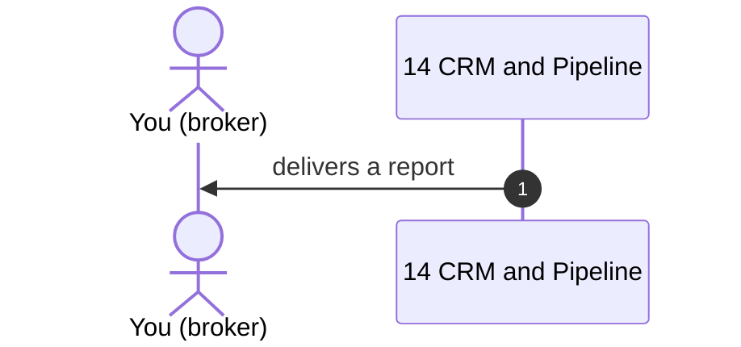

*One recorded run of this playbook's test (`test_p17_end_of_day_books`), read top to bottom. Left out to keep it readable: each agent logging the step in the CRM (14), telling the calendar (18) what it is waiting on, and CRM look-ups.*
<!-- /diagram:P17 -->

The close-out mirror image: 14's interaction log and tier movements,
15's financial deltas, 18's tomorrow-view, and the missed-item sweep -
unanswered client messages, stale HOT leads, documents pending past
SLA. The books are dated and hashed, and they're honest: a context
with activity but no log entries is *named as a logging gap*, never
smoothed over. Tonight's books are tomorrow's P16 input.

### P18 - Seller Weekly Report
<!-- diagram:P18 - generated by tools/gen_diagrams.py from `test_p18_seller_weekly_report`; edit the generator, not this block -->
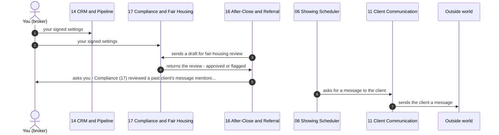

*One recorded run of this playbook's test (`test_p18_seller_weekly_report`), read top to bottom. Left out to keep it readable: each agent logging the step in the CRM (14), telling the calendar (18) what it is waiting on, and CRM look-ups.*
<!-- /diagram:P18 -->

*Started by the daily clock on the weekday you sign to 06 (since 2026-10-12).*
The report sellers judge you by, assembled from what actually happened:
06 counts each listing's confirmed showings for the week and how many
came back with feedback. Numbers only, so there is nothing for 17 to
screen; the report waits for *your* continue before 11 sends it, and a
cancel skips the week.

### P19 - Property Access Custody
<!-- diagram:P19 - generated by tools/gen_diagrams.py from `test_p19_property_access_custody`; edit the generator, not this block -->
```mermaid
sequenceDiagram
    autonumber
    participant A07 as 07 Transaction Coordinator
    participant A18 as 18 Calendar and Task Management
    A07->>A18: warns that a deadline is near
```

*One recorded run of this playbook's test (`test_p19_property_access_custody`), read top to bottom. Left out to keep it readable: each agent logging the step in the CRM (14), telling the calendar (18) what it is waiting on, and CRM look-ups.*
<!-- /diagram:P19 -->

*Started by the daily clock from the access grants you sign to 14 (since 2026-10-12): a window that ends without your `access_closed` is flagged once. The vendor-window scheduling and exposure events below are what the playbook describes; the clock check covers expiry.*
Who can get into which property, until when - as a ledger. Grants are
recorded in 14, vendor windows scheduled through 09 with entry/exit
confirmations, and the one rule that matters most: *the secret itself
never rides a message.* No lockbox code, ever, in any payload -
parties are routed to your custody protocol instead. 18's cadence
audit flags any grant past its window; an exposure event escalates to
you same-day with a rotation task.

### P20 - Vacant Property Watch
<!-- diagram:P20 - generated by tools/gen_diagrams.py from `test_p20_vacant_property_watch_cycle`; edit the generator, not this block -->
```mermaid
sequenceDiagram
    autonumber
    actor B as You (broker)
    participant A07 as 07 Transaction Coordinator
    participant A09 as 09 Vendor Coordination
    participant A18 as 18 Calendar and Task Management
    participant A05 as 05 MLS and Listing Management
    participant A04 as 04 Listing Description
    participant A17 as 17 Compliance and Fair Housing
    participant X as Outside world
    A07->>A09: asks to book a vendor
    Note over A09: Held - the vendor booking waits for your signed release
    A09->>A18: puts it on the calendar
    B->>A09: you sign the release
    A09->>X: books the vendor
    X->>A09: the vendor reports in (x2)
    A09->>A05: passes on the vendor's finished work
    A05->>A04: shares the listing details
    A04->>A17: sends a draft for fair-housing review
    A17->>B: asks you - no ruleset active - cannot issue any verdict without huma...
```

*One recorded run of this playbook's test (`test_p20_vacant_property_watch_cycle`), read top to bottom. Left out to keep it readable: each agent logging the step in the CRM (14), telling the calendar (18) what it is waiting on, and CRM look-ups.*
<!-- /diagram:P20 -->

*Started by the daily clock for listings you mark vacant (since 2026-10-12): 05 orders a property check from 09 every 7 days. Utility tracking and activity anomalies below are what the playbook describes; they are not built.*
Standing vigilance over the riskiest asset class you touch: 18
schedules the walkthrough cadence, 09 books the vendor, and here's the
tooth in it - a walkthrough report *without a proof artifact does not
count as done*. The claim "we checked it" releases nothing; the
artifact does. Utility status rides the 14 record; anomalies (a
zero-activity streak, unusual access) surface in your morning brief;
a condition event escalates same-day with the raw report.

### P14 - Complaint Response
<!-- diagram:P14 - generated by tools/gen_diagrams.py from `test_p14_complaint_response`; edit the generator, not this block -->
```mermaid
sequenceDiagram
    autonumber
    actor B as You (broker)
    participant A20 as 20 Social Media Monitoring
    participant A11 as 11 Client Communication
    participant A06 as 06 Showing Scheduler
    participant X as Outside world
    B->>A20: your signed settings
    X->>A20: a social media mention comes in
    A20->>A11: asks for a message to the client
    A06->>A11: asks for a message to the client
```

*One recorded run of this playbook's test (`test_p14_complaint_response`), read top to bottom. Left out to keep it readable: each agent logging the step in the CRM (14), telling the calendar (18) what it is waiting on, and CRM look-ups.*
<!-- /diagram:P14 -->

The containment playbook. A complaint - caught by 20 on social or
arriving through 11 - escalates to you *verbatim*, viral ones at
priority, and in the same breath every scheduled touch for that client
context freezes. No drip email lands on a complaining client mid-
dispute. If it's public, 20 can attach a labeled, compliance-checked
*draft* to your queue item - but the response, the channel, and the
resolution are entirely yours, and the hold releases only on your
direction. The swarm's success in a complaint is measured in speed of
escalation and completeness of the hold - never in its own words in
public.

---

## Decision support

### P15 - CMA / Listing Appointment Prep
<!-- diagram:P15 - generated by tools/gen_diagrams.py from `test_p15_cma_prep`; edit the generator, not this block -->
```mermaid
sequenceDiagram
    autonumber
    actor B as You (broker)
    participant A10 as 10 Market Data
    participant A06 as 06 Showing Scheduler
    participant A18 as 18 Calendar and Task Management
    B->>A10: asks for market data
    A10->>B: delivers the market data
    A06->>A18: puts it on the calendar
```

*One recorded run of this playbook's test (`test_p15_cma_prep`), read top to bottom. Left out to keep it readable: each agent logging the step in the CRM (14), telling the calendar (18) what it is waiting on, and CRM look-ups.*
<!-- /diagram:P15 -->

You ask 10 for the comp package; you get numbers with sources and
retrieval dates, actives and expireds per your parameters - and if the
parameters return three comps, you're told *three*, never a silently
widened radius pretending to be five. 18 blocks your prep time. The
CMA's conclusion, the price opinion, the pitch: entirely, structurally
yours.

### P23 - Price Review Evidence
<!-- diagram:P23 - generated by tools/gen_diagrams.py from `test_p23_price_review_evidence`; edit the generator, not this block -->
```mermaid
sequenceDiagram
    autonumber
    actor B as You (broker)
    participant A10 as 10 Market Data
    participant A14 as 14 CRM and Pipeline
    B->>A10: asks for market data
    A10->>B: delivers the market data
    A14->>B: delivers a report
```

*One recorded run of this playbook's test (`test_p23_price_review_evidence`), read top to bottom. Left out to keep it readable: each agent logging the step in the CRM (14), telling the calendar (18) what it is waiting on, and CRM look-ups.*
<!-- /diagram:P23 -->

Everything a price decision needs, nothing pretending to be one: 10's
comparable and absorption package, 14's activity summary (showings,
feedback, days on market), 15's financial context if you asked for it -
each delivered to you, each verified on the log. The swarm produces no
number. Your decision gets recorded, and if it's a change, P02 executes
it.

---

## The thread through all of it

Watch what repeated in every walkthrough above: messages you can
audit, gates that verify artifacts instead of accepting claims,
compliance review on every client-facing word, your signature on every
authority action, and holds-with-names instead of silent failures.
That's not a feature list - it's the same six or seven mechanisms
showing up in every flow, because there's one hub, one track, and one
log under all twenty-four playbooks. When a broker asks "what happens
if it breaks?" the answer is the same in every playbook: it stops,
it's named, it's on your queue, and the log shows exactly where.
