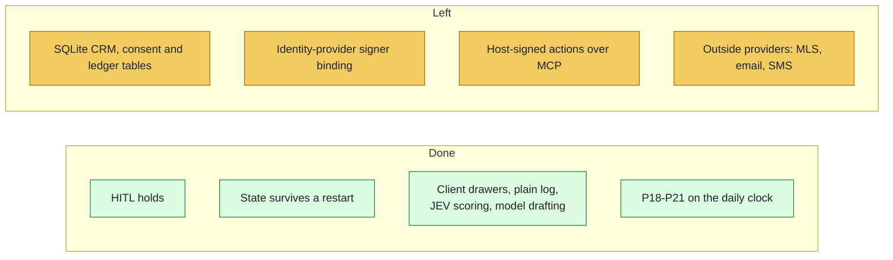

# ListingAssistants Roadmap

<!-- diagram:roadmap - drawn in tools/doc_diagrams.py; edit it there, not here -->

<!-- /diagram:roadmap -->

> **Words used here.** Tuple, playbook, swarm, hold, release and the other technical words are explained in plain language in [GLOSSARY.md](GLOSSARY.md).

Released tags: `archetype-v1.0.0`, `v1.1.0`. The audit-fix branch of
2026-10-11 is not tagged; tagging the release commit is the owner's step.

## Done on 2026-10-11 (moved off this list)

- HITL protocol wired: Agents 01, 11 and 20 hold threads for the broker's
  signed continue or cancel.
- State survives a restart: snapshots in the SQLite store, vouched for by
  the audit chain.
- Untriggered code resolved by owner decision: Agent 03 sends nurture
  touches from the daily clock; Agent 19 requests comps for every
  opportunity; Agent 20 drafts from the broker's templates for approval;
  Agent 13's neighborhood path and Agent 20's `behavioral.signal` lane were
  removed. A client reply with no named owner holds for the broker.

## 1. Modules (wired 2026-10-12) and what is left

Wired: client drawers (Agents 04, 05, 07, 08, 14, 15 and the HITL holds),
the plain-language log and end-of-day ledger from the chain, the JEV adapter
in Agent 02, and model drafting for Agent 04 behind the broker exam. Left:

- SQLite CRM, consent and ledger tables: Agents 14 and 15 keep these
  records in their state (saved in the snapshot) and file copies in the
  drawers; they do not write the SQLite tables.
- Agent 11's outbound client messages are not filed in the drawer (they are
  on the audit chain and logged to Agent 14, whose entries are filed).
- Model drafting is for listing remarks only (Agent 04); no other agent
  calls a model. The Hermes learning loop is not run on live drafts.
- Agent 06 does not use the JEV adapter's showing resolver.
- Drawer files are not encrypted.

## 2. Identity-provider signer binding

`config/authority_signers.json` binds signers to an identity provider with
MFA. Connecting an identity provider that stamps each signed envelope with
the login, MFA and session is what arms it.

## 3. Playbooks started by the clock (done 2026-10-12)

P18, P19, P20 and P21 now start from the daily clock (owner decision J3).
What still needs real data from you: the weekday and the listing-to-seller
map for P18 (signed to Agent 06), the access grants for P19 (signed to
Agent 14), a vacant flag on a listing for P20, and a vendor of kind
`property_check` on your roster so P20's checks can be booked.

## 4. Scheduled checks (done 2026-10-12)

Agent 08's disclosure-deadline warning runs on the clock (J4). The market
update paths in Agents 03 and 11 were removed (J5): market data goes only to
the broker and to Agent 19.

## 5. Signed actions over MCP

The MCP server signs for a host only in `--demo-signing` mode. A production
lane where the host forwards an envelope signed with the broker's own key is
not built.

## 6. Providers and hardware

- Connect the external adapters (MLS writes, client messaging, ad publishing)
  to your providers; until then they queue visibly.
- Twilio details for text pages: `python tools/console.py pager` asks for them.
- Storage: keep drawers and the SQLite file on a local disk, on an encrypted
  volume if encryption at rest is required.
- Offline updates: the signing and verification tools exist
  (`tools/sign_manifest.py`, `tools/verify_update_pack.py`); the transport
  (for example an encrypted USB drive) is an operating procedure.

## 7. Commercial real estate (future archetype)

The hub, closed-track routing, signed authority and hash-chained audit log
are sector-agnostic. A commercial identity would need its own agents, routes
and tuples for offering memorandums, confidentiality agreements, NOI / cap
rate / DSCR analysis, lease abstraction, and the commercial statutory frame
(securities rules, accredited-investor thresholds, environmental diligence,
zoning).
