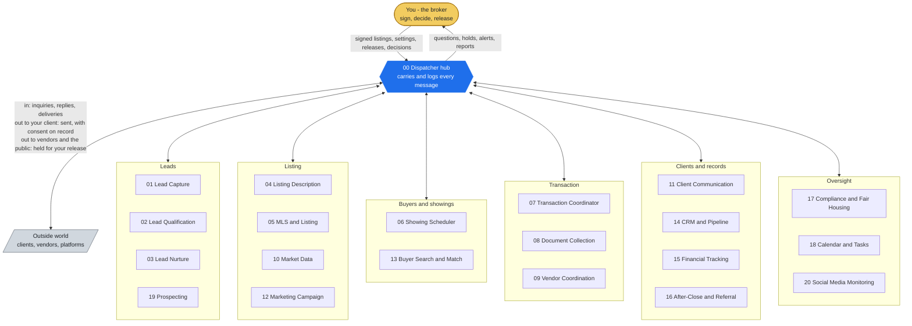

# START HERE — The 60-Second Version

<!-- diagram:team-start - drawn in tools/doc_diagrams.py; edit it there, not here -->


*No agent talks to another directly: every arrow goes through the hub, and only on lanes listed in `identity/routes.json`. Each agent's own picture is in its folder (for example [05-mls-listing-management](../05-mls-listing-management/README.md)).*
<!-- /diagram:team-start -->

**What this is.** Twenty specialized agents, coordinated by one dispatcher hub, that run the coordination
layer of a residential listing business — lead intake, listing
go-to-market, transaction deadlines, document chasing, showing
logistics, client updates, follow-up, and the books — under one
dispatcher, on one auditable track. You keep every decision that makes
you a fiduciary: prices, offers, negotiations, legal calls, and every
word that goes out under your name past a hold.

**Name.** ListingAssistants ([ListingAssistants.com](https://ListingAssistants.com)),
formerly `listing-agents`. The agents are deterministic rule engines: the
same input always produces the same, testable result.

**What makes it different, in one sentence.** Nothing here trusts a
claim: listings are live-*verified* not push-logged, milestones need
their artifact on file, every client-facing word passes a Fair Housing
screen, every authority action needs your cryptographic signature, and
when something can't complete it stops with a named reason on your
queue instead of failing quietly.

**What you need.** A machine that can run Python, your MLS/CRM/email
adapter credentials when you're ready to connect them, and about ten
minutes:

```bash
git clone https://github.com/QuietFireAI/listing-assistants.git
cd listing-assistants
pip install -r requirements.txt
python -m pytest tests_listing/     # watch all 24 playbooks prove themselves (988 passed)
```

That last command isn't a formality — it executes every playbook,
end to end, against the same hub that runs in production, and it's the
same check our CI runs on every change.

**What day one looks like.** You configure what only you can: your
lead-scoring rubric (the thresholds are yours, signed, versioned),
your approved vendor roster with credential dates, your compliance
ruleset, your nurture sequences, your message templates, your cadences.
Then a daily scheduler
invokes the clock layer (`tools/run_sweeps.py` — one cron line), and
the swarm starts doing what the docs describe. Until your external
adapters are connected, outbound actions (MLS writes, client sends,
ad publishes) queue visibly rather than pretending — the system tells
you what's dark.

**Test it yourself on camera.** `docs/OPERATOR_TESTING_MANUAL.md` walks
ten ready-made scenes (`scenes/`), each with the exact output to expect;
the suite runs the same ten files on every build.

**Where to read next, in order:**
1. `docs/AGENT_USER_MANUAL.md` — your day with ListingAssistants, as a broker
2. `docs/OPERATOR_TUNING_GUIDE.md` — setup, storage, offline updates, and the optional modules
3. `docs/WHAT_SUCCESS_MEANS.md` — what each playbook delivers and what it takes off your plate
4. `docs/PLAY-BY-PLAY.md` — the step-by-step narration of what actually moves between agents
5. `docs/JOB_DESCRIPTIONS.md` — every agent's role and rules
6. `docs/PLAYBOOKS.md` — all 24 playbooks: triggers, agents, gates
7. `docs/TUNING_MANUAL.md` — every number you can turn, and its default

**The four guarantees, which every document above keeps repeating
because they're the product:** completion is verified, never claimed;
the audit trail sits under every deliverable; your judgment is
protected by structure, not politeness; and failures get names and
queues, never silence.
