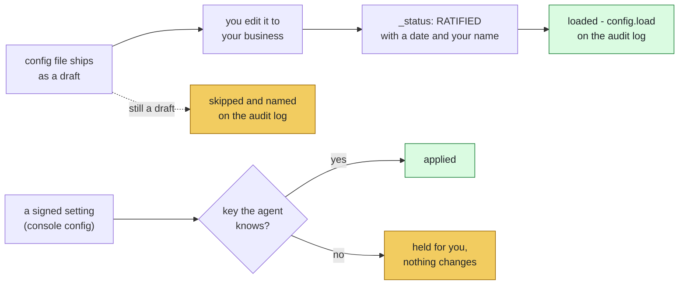
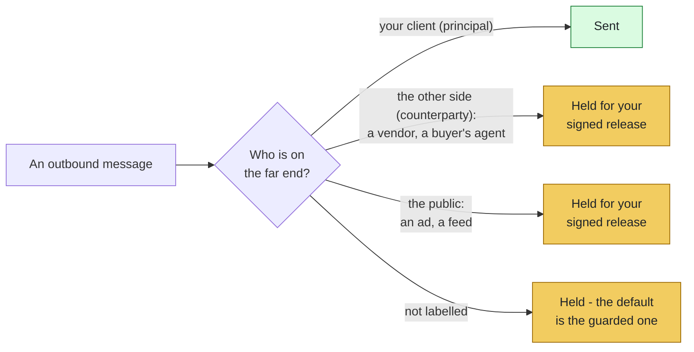

# Tuning Manual — ListingAssistants

> **Words used here.** Tuple, playbook, swarm, hold, release and the other technical words are explained in plain language in [GLOSSARY.md](GLOSSARY.md).

## Runtime & mount status (2026-10-12)

| Item | Status |
|---|---|
| Listing runtime | **WORKING BUILD** - dispatcher + 20 spokes, 1118 tests, all playbooks P01-P24 e2e (incl. the P01 new-listing lifecycle with photo/compliance/Clear-Cooperation gates). Every playbook scores leads through the JEV adapter (Agent 02). Client drawers, the HITL protocol, model drafting (Hermes seam) and the SQLite store are wired by `dispatcher/swarm.py`, which the console runs; their tests are in `tests_listing/test_wiring_2026_10_12.py` and `tests_listing/test_mutation_hardening_2026_10_12.py`. The playbook e2e builder uses a bare hub without them. The update-pack verifier is a tool (`tools/verify_update_pack.py`) with its own tests. |
| Live demo | `tools/run_demo.py` - one listing, six acts, real hub: signed authorization, fair-housing flag caught, go-live verified, pricing question escalated, chain verified. |
| MCP mount | **WORKING** - `dispatcher/identity_mcp.py` (4-tool closed surface, boot conformance gate), proven by `tools/mcp_roundtrip.py` live stdio round trip. Mounts on Hermes/OpenClaw/Claude Desktop (docs/MOUNTING.md). Full live-host install not yet exercised; the MCP protocol is. |
| Front door | `listing.authorize` runs P01 when signed; the host cannot route inside the swarm. Over MCP the server signs it only in `--demo-signing` mode (docs/MOUNTING.md, "Signing over MCP"). |
| Brand | ListingAssistants ([ListingAssistants.com](https://ListingAssistants.com)), formerly `listing-agents`. |


Every numeric/timing parameter in this codebase that a human might
reasonably want to retune, in one place. Compiled by a direct code sweep
(constructor signatures + inline threshold comparisons), not from memory —
if a parameter existed and wasn't listed here on the first pass, that was
a real gap, not an intentional omission.

**Re-swept 2026-07-17** (3rd full pass): found 6 more constructor-level
parameters missed in the first sweep because they're dict/set-shaped, not
simple numerics - the original grep pattern only caught `int`/`float`
defaults. Also found 2 core-level (dispatcher-agents, not this repository)
parameters that were self-flagged in their own code comments as
provisional and never actually ratified - discussed directly with the
owner the same day and ratified as deliberate placeholders (see their own
section below), rather than either silently treated as settled or left
open.

**How to retune any of these:** each one is a constructor keyword argument.
Change it at the point where the agent is instantiated (wherever your
deployment wires up the swarm), e.g.:

```python
Spoke02LeadQualification(hub, hot_lead_sla_seconds=180)
```

No source-code edits required for anything in this table — that's the
point of exposing them as constructor parameters instead of hardcoding
them inline.

---

## TOP OF LIST — Deliberate placeholders & unratified configs (read before deployment)

Re-swept 2026-10-14 from the code and from what the swarm writes when it
starts: every placeholder is in this table, and every stand-in or unarmed
mode is in **Stand-ins and unarmed modes** below. The core's own list is in
dispatcher-agents `docs/TUNING_MANUAL.md`.

| Item | Where | Status | What blocks / what to do |
|---|---|---|---|
| Text pages | `python tools/console.py pager` → `console-state/pager.json` (0600) | **OFF until you set it** | The console's pager (`dispatcher/pager.py`) asks for the Twilio details; pages carry queue + client context only. The core `dispatcher/notifier.py` placeholders (env vars, `+1-555-555-0100`) are not used by the console. |
| Re-score cadence (P21) | `Spoke03LeadNurture.RESCORE_INTERVAL_DAYS` | **7 days** | WARM leads in nurture are re-scored this often. |
| Vacant check interval (P20) | `Spoke05MLSListingManagement.VACANT_CHECK_INTERVAL_DAYS` | **7 days** (signed `watch_interval_days` per listing overrides) | |
| Disclosure warning lead (J4) | `Spoke08DocumentCollection.DISCLOSURE_LEAD_DAYS` | **3 days** | Warned once on the legal line. |
| `loop_threshold=20` | core `dispatcher/hub.py` | **RATIFIED as deliberate placeholder (owner, 2026-07-17)** | No empirical basis existed to pick a better number; revisit after production traffic. |
| MANNERS `N=10` | `dispatcher/manners_reinjection.py` `BACKSTOP_N` | **RATIFIED (2026-07-17); wired in this product 2026-10-14** | Every 10 envelopes an agent handles with no other re-injection, the turn backstop fires (`manners.reinjection`, trigger `turn_backstop`). The core still counts nothing itself (D7); this product does. Counts live in the process; a restart starts them at 0. |
| `config/authority_signers.json` | this repo | **UNRATIFIED — fails closed** | Template for identity-provider logins with MFA. No identity provider is connected in this build, so leave it unratified; the hub checks the key's signature and records that the login binding is off. |
| `config/vendor_panel.json` | this repo | **UNRATIFIED — fails closed** | Template in Agent 09's format (`vendors: vendor_id -> {kind, license_expiry, insurance_expiry, regulated}`); needs your actual vendors. Same fail-closed rule. The operator scenes use `scenes/config/vendor_panel.json`, a synthetic roster you ratify by hand. |
| External adapters (`vendor.schedule`, `client.message.send`, `campaign.publish`) | the `external` destination on the closed track | **NOT WIRED** | Held until your signed release, then queued to `external`; tracked in the adapter table below until connected to real providers. |
| `approved_by` fields | `config/message_templates.json` | **RATIFIED 2026-07-18** (owner blanket sign-off in `_status`) | No code reads this file yet; Agent 11 sends template ids and variables, and wording is the deployment's adapter's job. |

### Stand-ins and unarmed modes (re-swept 2026-10-14)

Each row says how the mode shows itself. The boot lines are the first
entries of the audit log every time the swarm starts.

| Mode | Where | What happens | How it shows itself | To replace |
|---|---|---|---|---|
| Exit gate unarmed (pre-response-selfcheck) | core hub; the swarm passes no reviewer | Outbound text is not reviewed by a second reader; the gate is not called | `selfcheck.unarmed` once at boot | A reviewer model passed as `selfcheck_model` |
| Second opinion unarmed (splitvantage) | core hub | No second model on drift-flagged reflections | `splitvantage.unarmed` at boot | A reviewer pair passed as `crosspol_models` |
| No human notifier | a hub or swarm built without one: the MCP server (`dispatcher/identity_mcp.py`), the playbook test builder, and the daily clock (`tools/run_sweeps.py`) with the pager off, since the clock passes the pager as its notifier | Escalations land on queues and reach no person while that process runs; the clock's queue items are saved with the agent state and show on the Broker Desk or console when one is next opened | `notifier.unarmed` at boot (2026-10-14) | The console always passes one (next row); for the clock, turn the pager on |
| Pager off | `tools/console.py`, no `console-state/pager.json` | Human-queue landings are printed on the session screen (and listed on the Broker Desk) and recorded as `shown`, not as a person reached | `human.notified` with `transport_status: shown`; `onboard` prints `sms_pager: off` | `python tools/console.py pager` |
| JEV local rules | `dispatcher/decision_adapter.py` | Leads are scored by the local rubric engine. The adapter takes the key from `JEV_API_KEY` or, failing that, `config/integrations.json`; the model name from `JEV_MODEL` (default `jev-1.13.0`). The core hub's own boot line reads only the environment variable, so with the key in `integrations.json` the log shows `jev.unarmed_fallback` ("unconfigured") next to `decision.engine` saying a key is present; the `decision.engine` line is the adapter's | `jev.unarmed_fallback` and `decision.engine` at boot; every result carries `is_fallback` and a fallback warning | A key plus a signed `decision_engine.allow_external: true` |
| Signer registry not armed | `config/authority_signers.json` unratified | The key's Ed25519 signature is checked; which login signed is not | `signer.unarmed` on each authority envelope and HITL decision; `onboard` prints it under `not_armed` | Ratify the file with real IdP logins, then `hub.arm_signer_registry()` |
| Model drafting off | `dispatcher/model_drafting.py` | Agent 04 writes remarks by its rules | `drafting.model_status` with `model_ready: false` at boot | `--model-url`, an examined checkpoint, and a signed `drafting.mode: model` |
| Agent state not saved | the MCP server without `LISTING_STATE_DB`, the console with `--no-state`, tests | Agent state, held messages and waits live in the process only | `state.ephemeral` at boot | `LISTING_STATE_DB`; the console saves to `console-state/swarm-state.sqlite` unless `--no-state` |
| Unratified config files | `config/vendor_panel.json`, `config/transaction_milestones.json`, `config/cadence_settings.json` | Refused: Agent 09's roster stays empty, so every vendor request is refused; Agents 07 and 08 keep their ratified constructor defaults | `config.load` with `verdict: unratified` at boot | Edit, ratify (`_status` RATIFIED, date, name) |
| Config files no code reads | `config/message_templates.json`, `config/milestone_map.json`, `config/integrations_template.json` | Nothing: they record decisions and intended providers | Stated in this manual and the Operator Guide | Wiring that reads them |
| External destinations | `vendor.schedule`, `client.message.send`, `campaign.publish` | Kept in a list in the process; nothing leaves the machine | The deliveries are on the audit log; `show external` lists them | A real adapter (table below) |
| Provider registry | `dispatcher/provider_gateway.py`, `config/integrations.json` | Holds provider settings and masks secrets; no network calls, no agent reads it | Operator Guide §13 | Wiring per provider |
| Hermes seam without pillars | `dispatcher/hermes_seam.py` | A model call is refused | `REFUSED_PILLARS_UNARMED` | Install the pillar packages |
| MCP demo signing | `python -m dispatcher.identity_mcp --demo-signing` | The server signs authority calls for the host; demo only | `authority.server_signed` on the chain for each envelope it signs (added 2026-10-14; before, a server signature looked like a broker's), and `server_signs_for_host: true` in the identity description | Run without the flag; the host signs |
| Synthetic showcase | `tools/desk.py --showcase`, `scenes/config/vendor_panel.json` | The ten operator scenes on synthetic data and a synthetic vendor roster | Marked synthetic on the desk and in the roster's `_status` | Not for real work |
| Not built: portal and MLS feedback (Agent 05, three tuples), scrape-source blocking (Agent 10 tuple 6), farm rules for geographic targeting (Agent 12 tuple 8; the demographic refusal is built), a missing briefing source and a human instruction against a contract deadline (Agent 18 tuples 2 and 3) | `listing_spokes_05.py`, `_10.py`, `_12.py`, `_18.py` | No code path; those tuples cannot fire | Named in each agent's docstring | A real integration to build against |
| MANNERS re-injection | `dispatcher/manners_reinjection.py`, wired 2026-10-14 (owner decision) | Phase gates fire at P01's three phases (Agent 05) and at every signed human release, decline, HITL decision or other accepted signed authority (a price change, a config.update), once per event; the turn backstop every 10 turns per agent. A re-injection goes on the chain; the agents are deterministic code with nothing to inject into, and Agent 04's drafting prompt carries the whole MANNERS.md text on every call (the broker's exam questions to a checkpoint do not). `post_compaction` cannot fire: this product has no context compaction or summarization event | `manners.reinjection` with trigger and position | - |
| Process settings | `LISTING_CONFIG_DIR`, `LISTING_STATE_DB`, `IDENTITY_ROOT` (MCP server); `LISTINGASSISTANTS_STATE_DIR` (console, default `console-state/`); pager send timeout 10 s (`dispatcher/pager.py`) | Defaults used when unset: `config/`, no saved state, this repository, `console-state/` | Not on the log | Set the variable |
| Boot attestation not enforced | the test suite; the showcase desk (only in a folder it created; it refuses any folder holding your key); the MCP server when no operator key is found (`LISTINGASSISTANTS_STATE_DIR` pointed at a keyless folder turns its check off; it writes only its own temporary log) | No signed list is checked. The console, the Broker Desk, the daily clock, `repair-record`, and the MCP server with an operator key do check, and refuse to start on any difference (Operator Guide §16) | `boot.attestation` with `enforced: false` and the running hash | Start through the console, the desk or the clock |
| Core parts not called | KPIs, the core after-action report, priority and siding, heartbeat, territories, sleep-marks (boot attestation is called since 2026-10-14) | Not used by this product | dispatcher-agents README, "What runs in listing-assistants today" | Wiring per part |

Ratification path for the config files: review content → edit → change
`_status` to `RATIFIED` with date + sign-off → load. Fail-closed until
then is the invariant, not an inconvenience.

---

## Ratified (owner-approved 2026-07-16)

| Agent | Parameter | Value | Controls |
|---|---|---|---|
| 01 (Lead Capture) | `record_response_timeout_days` | `1` | Days a dedupe check (record.request to 14) can go unanswered before retrying once, then holding with handoff.failed |
| 02 (Lead Qualification) | `hot_lead_sla_seconds` | `300` (5 min) | Response-time SLA for a HOT-tier lead before an alert fires |
| 03 (Lead Nurture) | `frequency_cap_per_week` | `3` | Max nurture-sequence touches per client per calendar week |
| 03 (Lead Nurture) | `legal_contact_hours` | `(8, 21)` | Allowed daily window (24h clock) for sending a scheduled nurture touch - outside it, or on a flagged legal holiday, the touch holds rather than sending |
| 03 (Lead Nurture) | nurture sequences (signed `config.update` `nurture_sequences`, not a constructor arg) | none | Each sequence's touches (`day`, `text`). No definition = nothing sent. The daily clock sends each due touch once. |
| 04 (Listing Description) | `mls_char_limit` | `800` | Character budget before length-cut logic engages (adjectives cut before facts, attributions never cut) |
| 06 (Showing Scheduler) | `feedback_ask_cap` | `2` | Max times a showing-feedback request is sent before giving up |
| 06 (Showing Scheduler) | `no_show_pattern_threshold` | `2` | No-shows from the same showing agent before flagging a pattern |
| 07 (Transaction Coordinator) | `vendor_holdup_days` | `7` | Days a vendor-scheduling wait can sit unconfirmed before escalating |
| 08 (Document Collection) | `document_chase_cap` | `3` | Chase attempts on a missing document before escalating as genuinely missing |
| 10 (Market Data) | `comp_minimum` | `5` | Comps required before a set is *not* flagged "thin" |
| 10 (Market Data) | `staleness_days` | `30` | Age at which a comp is dropped as stale rather than shipped |
| 10 (Market Data) | `retention_days` | `730` (2 yrs) | Historic-data window beyond which "absent" is the answer, never reconstructed |
| 10 (Market Data) | `opinion_press_threshold` | `2` | Repeated pricing-opinion asks before escalating (1st ask = refuse only) |
| 11 (Client Communication) | `quiet_hours` | `(21, 8)` | Window (24h clock) during which non-exempt sends queue instead of going out |
| 17 (Compliance) | `sla_days` | `1` | Turnaround SLA for a compliance verdict before an SLA-breach alert fires |
| 17 (Compliance) | `near_miss_pattern_threshold` | `3` | Flagged verdicts from the same submitting agent before a pattern report goes to the owner |
| 18 (Calendar & Task) | `max_events_per_day` | `8` | Calendar capacity before a day is treated as overloaded |
| 18 (Calendar & Task) | `no_show_grace_minutes` | `60` | Minutes past a showing slot with no post-showing signal from 06 before 18 reports a calendar-detected `showing.no_show` (invoked by the daily `clock.tick` that `dispatcher/sweep_runner.py` `run_daily_sweeps` sends through the hub; checks listed in `dispatcher/clock.py`). PROVISIONAL - no empirical basis, revisit with after-action data |

## Found 2026-07-17, not yet reviewed by owner (dict/set-shaped, missed in the first sweep)

These are real constructor parameters, already live with working defaults
- but unlike the table above, they were never individually walked through
with you on 2026-07-16. Flagging them as such rather than silently
folding them into "Ratified," since a dict-shaped default is a business
rule, not just a number, and deserves its own look.

| Agent | Parameter | Current default | Controls |
|---|---|---|---|
| 03 (Lead Nurture) | `spike_threshold` (in `behavioral.signal` payload, not a constructor arg - see "Per-message defaults" below) | `50` | Engagement-score threshold that pauses a nurture sequence and triggers a rescore (tuples 5/8) - a **separate** value from Agent 12's own `spike_threshold` below, despite the identical name and default |
| 05 (MLS & Listing Mgmt) | `required_artifacts` | `{"sold": "closing_artifact", "pending": "signed_contract_artifact"}` | Which artifact must be on file before a status change to that value is allowed |
| 06 (Showing Scheduler) | `min_notice_hours` | `{"default": 24}` | Minimum notice required for a showing on an occupied property; per-state overrides go in this dict (e.g. `{"CA": 48, "default": 24}`) |
| 08 (Document Collection) | `expected_senders` | `{}` (empty) | Per-context allowlist of who may submit a sensitive document type (preapproval letter, proof of funds, closing statement). **Empty by default means every sensitive document is quarantined until a context has an explicit allowlist entry** - correct, fail-closed behavior, but means this agent quarantines everything sensitive out of the box until populated. |
| 09 (Vendor Coordination) | `roster` | `{}` (empty) | Approved-vendor list (id -> kind/license/insurance/regulated). **Empty by default means every single vendor request is refused** (tuple 6: not on approved list) until this is populated - this agent does nothing useful out of the box. |
| 11 (Client Communication) | `exempt_alert_classes` | `set()` (empty) | Alert classes exempt from the quiet-hours gate (e.g. a genuinely time-critical alert type that should wake the human instead of queuing) - none configured means nothing is exempt, everything queues during quiet hours |

## Per-message defaults (not agent-level config — legitimately vary by caller/platform)

These aren't retuned at agent construction time; each caller can override
them per envelope. The values below are just the fallback when a caller
doesn't specify one.

| Agent | Field | Default | Where it's set | Controls |
|---|---|---|---|---|
| 03 (Lead Nurture) | `spike_threshold` (in `behavioral.signal` payload) | `50` | `listing_spokes_03.py` `behavioral.signal` branch | See note in the table above - distinct from Agent 12's, same name and default by coincidence, not shared code |
| 06 (Showing Scheduler) | `buffer_minutes` (in `showing.request` payload) | `30` | `listing_spokes_06.py` `_schedule()` | Minimum spacing enforced between two showings on the same context before they're treated as conflicting. Missed in the original sweep - became load-bearing only once the buffer-enforcement fix landed (2026-07-16); before that it was captured but never compared against anything, so its default value had no functional effect. |
| 12 (Marketing Campaign) | `spike_threshold` (in `platform.metrics` payload) | `50` | `listing_spokes_12.py` `platform.metrics` branch | Engagement value above which a spike feeds back into nurture (Agent 03) |
| 19 (Prospecting) | `rank_threshold` (in `discovery.feed` payload) | `0.5` | `listing_spokes_19.py` `discovery.feed` branch | Minimum rank-basis-strength before a rank is included rather than presented unranked |

To change the *fallback* value for any of these (not a one-off
override), edit the source line directly — there's no single agent-level
constructor knob for these, by design, since different platforms may
legitimately warrant different defaults.

## Ratified as deliberate placeholders (owner, 2026-07-17) — core, not this repo

These two live in **dispatcher-agents** (the shared core, not this repo),
which is why they weren't caught in a sweep of this repository alone before.
Both were previously self-flagged in their own code/doc comments as never
having been truly decided - "PROVISIONAL AND ARBITRARY, no empirical
basis" was the literal language at the source. **Discussed directly with
the owner 2026-07-17: both ratified as deliberate placeholders, not left
open.** Neither number has empirical backing - that was true before
ratification and remains true now - but "nobody has decided" and "we've
decided to accept this placeholder" are different states, and these are
now the second one. Revisit when real after-action/fade-rate data exists.

| Location | Parameter | Value | Controls |
|---|---|---|---|
| `dispatcher-agents/dispatcher/hub.py` `Hub.__init__` | `loop_threshold` | `20` | Max envelopes per `(client_context_id, intent)` pair before the hub suspends the loop into `clarification.request`, treating it as a possible runaway |
| `MANNERS.md` (this repo) §Re-injection | backstop `N` | `10` | Agent turns (envelopes handled) allowed with no other re-injection before the turn backstop fires. Wired 2026-10-14 in `dispatcher/manners_reinjection.py` |

## Ratified 2026-07-17 (owner decisions #1, #3, #4, #6 — this session)

| Agent | Parameter | Value | Controls |
|---|---|---|---|
| 15 (Financial Tracking) | `commission_rate` | `0.08` | DEFAULT rate used ONLY when a close carries `sale_price` but no explicit `commission_amount`. Explicit amount always wins; computed amounts are labeled `computed_at_default_rate_*`, never presented as recorded figures. Owner-ratified starting point (decision #1); revisit against real closings |
| 04 (Listing Description) | `config/description_cut_priority.json` | `["adjectives", "unattributed_facts"]` | Cut order when remarks exceed `mls_char_limit` (first entry cut first). Attributions never cut — structurally absent from the cut classes (decision #3). File finally exists; tuple 11 always named it |
| 04 (Listing Description) | photo/data contradiction detection | symmetric set difference | When `photo_detected_features` is present, ANY feature in the data sheet not in the photos, or in the photos not in the data sheet, halts the asset into clarification (decision #4, delegated). A caller-supplied `photo_data_contradictions` flag also halts; neither path suppresses the other. Not a numeric knob — documented here so its behavior is known outside the source |
| dispatcher-agents `SignerRegistry.check` | `effective` date enforcement | temporal, fail-closed | A signer entry with no effective date, an unparseable one, or a future-dated one DENIES (decision #8 answer: the field was schema-present, enforcement-absent — `check()` never read it). `today` defaults to the real system date; tests pass it explicitly |

### Added 2026-07-18 (owner decisions #2 refinement, #7)

| Agent | Parameter | Value | Controls |
|---|---|---|---|
| 13 (Buyer Search & Match) | `max_matches_per_buyer_per_day` | `5` | Individual match pings per buyer per day. Beyond it, matches join a ranked end-of-day digest (`flush_match_digest`, sweep-called): ranked by stated-criteria-met desc, ties newest-first. Nothing silently dropped — every match logs to 14 individually (decision #7) |
| 06 (Showing Scheduler) | protected-deadline bump tier gate | `HOT` only | A protected-deadline claim only earns a HITL bump OFFER when `lead_tier` (relayed by 13 from 14's CRM records, where 02 logged it — never client-writable) is HOT. Not hot or unknown: plain conflict sequencing, no offer (decision #2). The bump itself still executes only on the human's signed `confirm_protected_bump` |

## External adapters — NOT YET WIRED (owner decision #6: tracked here until clean)

Three intents route to the virtual destination `external`. The swarm
(`dispatcher/swarm.py`) registers a stand-in handler that keeps each
delivered envelope in a list in the running process; `python tools/console.py`
`{"do": "show", "what": "external"}` shows it. Nothing leaves the machine,
the list is not saved across restarts, and each delivery is on the audit
log. A real adapter replaces the stand-in by registering its own handler
for `"external"`:

| Intent | Sender | What's dark until an adapter exists |
|---|---|---|
| `vendor.schedule` | 09 | Every vendor booking (photography, inspector, appraiser…) |
| `client.message.send` | 11 | Every client-facing message the swarm composes |
| `campaign.publish` | 12 | Every campaign publish AND retract action |

Update this table (and delete rows) as each adapter lands. A deployment
with these dark is a swarm that talks to itself.

## Also worth knowing about (not tuning-manual material, but adjacent)

- **`dispatcher/notifier.py`** (vendored core): `TWILIO_ACCOUNT_SID` /
  `TWILIO_AUTH_TOKEN` default to placeholder strings and the numbers to
  the fictional `+1-555-555-0100` block. While a credential is empty or a
  placeholder (`PLACEHOLDER...`, `YOUR_...`), or the destination is in the
  555-0100..0199 block, the core notifier sends nothing and says why
  (2026-10-14).
  The console does not use it: its pages go through `dispatcher/pager.py`
  with the details you give `python tools/console.py pager`.

## Config files (separate from code — business content, not tuning knobs)

<!-- diagram:config-tunman - drawn in tools/doc_diagrams.py; edit it there, not here -->

<!-- /diagram:config-tunman -->

Six JSON files under `config/` hold business content that genuinely
can't be guessed by code: `vendor_panel.json`, `authority_signers.json`,
`cadence_settings.json`, `message_templates.json`, `milestone_map.json`,
`transaction_milestones.json`. Five of the six now have proposed draft
content grounded in what the code actually implements or the playbooks
already ratified — review, edit, and change `_status` to `RATIFIED` when
approved. `vendor_panel.json` and `authority_signers.json` remain
genuinely empty — they need your actual vendor relationships and IdP
logins, which no amount of drafting on my end can substitute for.

`cadence_settings.json` (2026-07-17): now covers all 15 tunables in the
Ratified table above, not 9 - added `no_show_pattern`, `pricing_opinion_
press`, and `near_miss_pattern`, the three "N occurrences before X"
thresholds missed in the first draft.

`transaction_milestones.json` (new, 2026-07-17): covers Agent 07's
post-contract transaction milestones (inspection, appraisal, title,
etc.) - deliberately split from `milestone_map.json`, which only ever
covered the pre-contract *listing* lifecycle (intake through
showing_active). These aren't overlapping duplicates of the same thing;
they're genuinely two different milestone concepts, now each with their
own real config. Unlike the other five, this one **actually wires into
running code** - `Spoke07TransactionCoordinator` now accepts
`transaction_milestone_config` as a real constructor parameter (default
reproduces the exact prior hardcoded values), and this file's `entries`
are exactly that default's content in ratifiable JSON form. Editing the
JSON alone doesn't change agent behavior yet - whoever wires the swarm
still needs to load this file and pass its content into the constructor,
same as every other config file in this list - but there's now a real
parameter to receive it, not just documentation describing what's
hardcoded. Not covered: the per-milestone business logic in Agent 07's
doc.status handling and the financing_contingency deadline case - see
the file's own `_not_covered_here` field and the class docstring for why.

## Maintenance note

Since 2026-10-11 this repository is the single source for the config files
(the listing-agents-blueprint copies are no longer maintained). Edit them
here only.

If you add a new agent or a new threshold, add it to this table in the
same commit — that's the whole point of keeping this centralized instead
of scattered across code comments. A parameter not in this table is a
parameter nobody outside the source code knows exists.

---

## ABSOLUTE SIGNAL — disclosure gate (added 2026-08-01)

<!-- diagram:audience-tunman - drawn in tools/doc_diagrams.py; edit it there, not here -->


*In this repository: `client.message.send` is principal, `vendor.schedule` counterparty, `campaign.publish` public (`identity/routes.json`). The gate reads the label, not the words.*
<!-- /diagram:audience-tunman -->

| Item | Where | Status | Notes |
|---|---|---|---|
| Route `audience` field | `identity/routes.json` (external routes) | **RATIFIED** | `principal` passes the gate; `counterparty`/`public` HOLD for human release. Missing/unknown → fail-closed to `counterparty`. |
| `audience_verified` flag | `identity/routes.json` | **PER-ROUTE** | `false` = provisional classification, surfaced on the hold. All 3 listing external routes are verified `true`. |
| Disclosure release intent | `disclosure.authority` | **CONSTANT** | Signed authority intent that clears exactly one held message. Reuses the execution-authority stack (Ed25519 sig + signer registry + MFA). No route entry needed (verified directly, re-sends the original). |
| Canonical signal text | `dispatcher/absolute_signal.py` `SIGNAL_TEXT` | **SINGLE SOURCE** | MANNERS.md Manner 15 and docs/FINANCIAL_CAPABILITY.md defer to this. sha256-checked by tests here. Never hand-edit downstream copies. |

---

## Parameters of the wired modules (revised 2026-10-12)

Since 2026-10-12 the swarm builder wires these modules: Agent 02 scores
through the JEV adapter, six agents file into client drawers, Agent 04 can
draft with an examined model, and every audit entry is also written to the
plain-language log. Runtime settings arrive as signed `config.update`
messages; the rest are process options.

### Lead rubric (`dispatcher/lead_rubric.py`, used by Agent 02 and the JEV fallback)

The rubric arrives as a signed `config.update` to Agent 02. All seven keys
are required; a rubric missing any of them is rejected by Agent 02 and held
by the JEV fallback. There are no built-in defaults.

| Key | Meaning |
|---|---|
| `budget_threshold` | budget at or above this earns `budget_weight` |
| `budget_weight` | points for budget |
| `timeline_days_threshold` | timeline at or below this many days earns `timeline_weight` |
| `timeline_weight` | points for timeline |
| `financing_weight` | points when financing progress is `preapproved` |
| `hot_threshold` | score above this is HOT; exactly equal drops to WARM and is flagged for a human |
| `warm_threshold` | score above this is WARM; exactly equal drops to COLD and is flagged |

### JEV adapter (`dispatcher/decision_adapter.py`)

| Parameter | Default | Effect |
|---|---|---|
| `decision_engine.confidence_floor` (signed, to 02) | `0.45` | results below it (or with no readable confidence) hold the lead for your continue/cancel |
| `decision_engine.allow_external` (signed, to 02) | `false` | live HTTPS calls happen only when this is `true` and a key is set |
| `JEV_API_KEY` | unset | key for the live service |
| `JEV_ENDPOINT_URL` | `https://api.typesafe.ai/v1/decisions` | must be `https://` |
| `JEV_FORCE_PYTHON` | `0` | `1` forces the local engine |
| `timeout` | `3.0` s | live call timeout; a failure falls back to the local engine |

### Client drawers (`dispatcher/client_drawer.py`)

| Parameter | Default | Effect |
|---|---|---|
| `drawers_root` (swarm builder) | `drawers` next to the audit log (`console-state/drawers`) | directory holding one subdirectory per client |

Client ids and file names must be single safe path segments; categories are
a fixed set. A cross-client filing raises `ComminglingBreachError`. Files are
stored unencrypted; `verify_hashes()` checks stored SHA-256 values on demand.

### Model drafting (`dispatcher/model_drafting.py`, Agent 04)

| Parameter | Default | Effect |
|---|---|---|
| `drafting.mode` (signed, to 04) | `rules` | `model` turns on model-written remarks when a model is configured and the active checkpoint passed the exam on it |
| `--model-url`, `--model-name` (console) | unset | the locally served model; other hosts refused without `--allow-remote-model` |
| `checkpoints_dir` (swarm builder) | `checkpoints` next to the audit log | the manifest Agent 04's gate reads |
| `mls_char_limit` (Agent 04) | `800` | model remarks longer than this are not used |

### Readable log (`dispatcher/readable_audit.py`)

| Parameter | Default | Effect |
|---|---|---|
| `readable_dir` (swarm builder) | `readable` next to the audit log | where `stream.log` and `daily/eod_ledger_<date>.md` are written |

### HITL protocol (`dispatcher/hitl_protocol.py`)

No timing parameters. A wait stays PENDING until a signed
`hitl.decision.authority` envelope resolves it; Agent 18's morning briefing
lists unresolved waits whenever a briefing is generated.

### Checkpoint manifest and SQLite store

`dispatcher/model_checkpoint_manager.py` and `dispatcher/persistence_sqlite.py`
have no tuning parameters beyond their file locations (`checkpoints_dir`,
`db_path`). Keep `db_path` on a local disk. Rolling the checkpoint pointer
back to the baseline turns model drafting off, because the baseline was
never examined.
